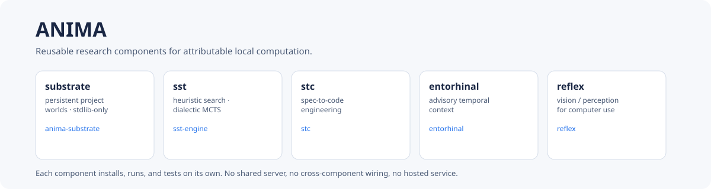
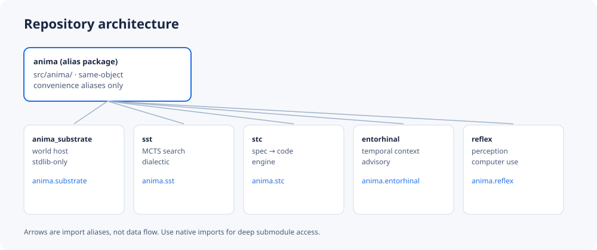

# ANIMA

[](https://github.com/Anshul48/anima/actions/workflows/ci.yml)
[](LICENSE)
[](pyproject.toml)



Reusable research components for attributable local computation: persistent
project worlds ([substrate](components/substrate/)), heuristic search
([sst](components/sst/)), spec-to-code engineering ([stc](components/stc/)),
advisory temporal context ([entorhinal](components/entorhinal/)), and
vision/perception for computer use ([reflex](components/reflex/)).

Each component is independently installable, runnable, and tested under its
own distribution name. This repository claims no runtime integration beyond
that: there is no shared server, no cross-component wiring, and no hosted
service here. Shared background and proposals live in
[docs/anima/](docs/anima/).


## Packaging & Import Structure

The repository contains six distinct distribution packages across six `pyproject.toml` files: one root alias package and five independent component packages.

The root package `anima` exposes convenience import aliases only, mapping directly to five native packages:

| Alias | Distribution Name | Native Import Name | Component Directory | Description |
|---|---|---|---|---|
| `anima.substrate` | `anima-substrate` (0.1.1) | `import anima_substrate` | [`components/substrate/`](components/substrate/) | Persistent project worlds, pinned participants, crash-atomic local state (stdlib-only) |
| `anima.sst` | `sst-engine` (0.1.0) | `import sst` | [`components/sst/`](components/sst/) | Asymmetric dialectic MCTS heuristic search engine |
| `anima.stc` | `stc` (0.1.0) | `import stc` | [`components/stc/`](components/stc/) | Biomimetic spec-to-code autonomous engineering engine |
| `anima.entorhinal` | `entorhinal` (0.1.0) | `import entorhinal` | [`components/entorhinal/`](components/entorhinal/) | Local-first advisory temporal context (evidence, projections, user-controlled snapshots) |
| `anima.reflex` | `reflex` (0.1.0) | `import reflex` | [`components/reflex/`](components/reflex/) | Autonomous computer-use vision & perception (fast spatial affordances & crop routing) |

> **Note on PyPI name collision**: The native import name `reflex` collides with the unrelated Reflex web framework on PyPI. Do not install both into the same Python environment.


## Quickstart

The fastest end-to-end check installs the root alias package plus the stdlib-only substrate component, then executes a real substrate journey (participant run, byte-identical close/reopen, recovery):

```bash
pip install -e . -e components/substrate
python examples/quickstart.py   # ends with: ANIMA quickstart OK
```

See [docs/ARCHITECTURE.md](docs/ARCHITECTURE.md) for how the pieces fit
together, [docs/CODE-TOUR.md](docs/CODE-TOUR.md) for where to start
reading each component, and [docs/ABOUT.md](docs/ABOUT.md) for the
proposed GitHub About text and topics.


## Architecture



The [`anima` alias package](src/anima/) re-exports the five native
distributions as same-object convenience aliases (`anima.substrate`,
`anima.sst`, ...). Native imports (`import anima_substrate`, `import sst`,
...) are primary; the diagram arrows are import aliases, not data flow.
See [docs/ARCHITECTURE.md](docs/ARCHITECTURE.md) for the architecture guide and [docs/anima/architecture/](docs/anima/architecture/) for background proposals.


## Installation

Python 3.12+ is recommended (substrate alone works on 3.11+). From the repository root:

```bash
# Install a single component (e.g. substrate, stdlib-only):
pip install -e components/substrate

# Install all components plus the anima alias package:
pip install -r requirements/components-all.txt
```

Alternatively, Astral's [`uv`](https://github.com/astral-sh/uv) can be used:
```bash
uv pip install -e . -e components/substrate
```
Components [sst](components/sst/) and [stc](components/stc/) also provide frozen `uv.lock` files from their pinned releases.


## Component Guides & Verified Usage

### 1. `substrate` (`anima-substrate`) — Persistent Project Worlds

Offline, stdlib-only host for persistent project worlds. Manages pinned participant families, delegated budgets, and crash-atomic state in a caller-selected directory with zero external runtime dependencies.

* **Install**: `pip install -e components/substrate`
* **CLI Quickstart**:
  ```bash
  anima-substrate --help
  anima-substrate families
  ```
* **Python API**:
  ```python
  import tempfile, pathlib, json, hashlib
  from anima_substrate.host import api
  from anima_substrate.participants import get_family

  work = pathlib.Path(tempfile.mkdtemp(prefix="sub-demo-"))
  state = work / "state"
  api.init_run(state)

  tree = work / "release"
  tree.mkdir(parents=True)
  (tree / "app.py").write_text("print('hello')\n")
  manifest = work / "pins.json"
  manifest.write_text(json.dumps({
      "manifest_version": 1,
      "release": "v1",
      "files": {"app.py": hashlib.sha256(b"print('hello')\n").hexdigest()}
  }))

  fam = get_family("relcheck", "v1")
  fam.create(state, "RC1", {}, "runner")
  rep = fam.run(state, "RC1", {
      "task_id": "T1",
      "manifest_path": str(manifest),
      "tree_root": str(tree)
  })
  print("relcheck valid:", rep["valid"])
  ```

---

### 2. `sst` (`sst-engine`) — Dialectic MCTS Heuristic Search

High-performance heuristic tree search system discovering verified code implementations via asymmetric dialectic rollouts: high-entropy divergent planning, low-entropy monotropic refinement, deterministic gate verification, and value synthesis.

* **Install**: `pip install -e components/sst`
* **Runtime Requirements**: Local search data structures and budget policies run purely locally. Model-driven tree rollouts require either local Ollama models (`ollama run ...`) or external LLM provider configurations.
* **CLI Commands**:
  ```bash
  # Display CLI help and subcommands
  sst --help

  # Execute bounded MCTS search with acceptance test verification
  sst run --help

  # Launch Cytoscape.js DAG visualizer or task UI
  sst visualize --help
  sst ui --help
  ```
* **Python API**:
  ```python
  from sst.core import SSTNode, NodeRole, NodeStatus, DomainMode, PayloadType
  from sst.search.policy import BudgetTracker

  tracker = BudgetTracker()
  node = SSTNode(
      tree_id="tree_demo",
      node_id="node_root",
      parent_id=None,
      depth=0,
      role=NodeRole.PLANNER,
      domain=DomainMode.AUTOBUILD,
      title="Goal: Fast Parser",
      payload_type=PayloadType.GOAL,
      content="Synthesize verified parser",
      status=NodeStatus.UNEXPANDED
  )
  print(f"SST Node created: id={node.node_id}, role={node.role.value}")
  ```

---

### 3. `stc` (`stc`) — Spec-To-Code Autonomous Engineering

Autonomous engineering engine implementing biomimetic separation of concerns: Socratic spec intake, bounded context compilation (strict &le; 25 KB task bundles), ephemeral Git worktree leases, and deterministic quality gates (Ruff, Mypy Strict, Pytest, Mutmut).

* **Install**: `pip install -e components/stc`
* **Runtime Requirements**: Local decomposition, bundle compilation, and worktree leases run offline with git. Full worker execution uses local tool harnesses (such as Aider/Agy) and configured models.
* **CLI Commands**:
  ```bash
  # Inspect runtime environment and invariants
  stc info
  stc health

  # Compile an atomic sub-25KB task bundle from a spec
  stc compile TASK-001 --spec components/stc/examples/sample_spec.yaml

  # Manage ephemeral Git worktree leases
  stc worktree lease --help
  stc worktree list
  ```
* **Python API**:
  ```python
  import hashlib
  from stc.schemas.models import SpecAtom
  from stc.socratic import SocraticDecomposer

  raw_spec = "Goal: Implement secure token validator.\nInvariants: Must reject expired tokens.\n"
  spec = SpecAtom(
      spec_id="SPEC-001",
      source_path="inline",
      raw_content=raw_spec,
      content_sha256=hashlib.sha256(raw_spec.encode()).hexdigest()
  )
  decomposer = SocraticDecomposer()
  toc = decomposer.decompose(spec)
  print("Socratic ambiguity score:", toc.ambiguity_score)
  print("Domain invariants:", toc.domain_invariants.invariants)
  ```

---

### 4. `entorhinal` (`entorhinal`) — Local-First Advisory Temporal Context

Local-first temporal context engine: records task evidence, compiles multi-timescale projections, serves context snapshots to local consumers, and enforces cryptographic hash-chained audit trails, user corrections, and cascade deletion. Operates strictly under advisory authority (zero autonomous mutation authority).

* **Install**: `pip install -e components/entorhinal`
* **Runtime Requirements**: Evidence logging, audit querying, and retention policies run on local SQLite. AI projection distillation optionally integrates with local Ollama (`qwen3.8:27b`, `nomic-embed-text`) or external providers.
* **CLI Commands**:
  ```bash
  # Inspect measured health and projection state
  entorhinal status

  # Inspect real-time chronological evidence timeline
  entorhinal inspect timeline

  # Audit access grants and consumer query logs
  entorhinal audit

  # Start local loopback FastAPI daemon
  entorhinal serve --help
  ```
  *(Note: Importing `entorhinal` displays an advisory `API running WITHOUT authentication` banner on legacy/test paths. For production local serving, configure HTTP principal credentials via `entorhinal auth --help`)*.
* **Python API**:
  ```python
  import entorhinal.schemas.task_event as te
  from entorhinal.runtime.factory import build_runtime

  print("TaskEvent schema version:", te.TaskEvent.__name__)
  ```

---

### 5. `reflex` (`reflex`) — Computer-Use Vision & Perception

System 1 vision and perception engine designed for autonomous computer-use workflows: fast spatial affordance detection, cheap relevance filtering, and targeted escalation of small crops to heavier vision models instead of forwarding entire high-resolution desktop frames.

* **Install**: `pip install -e components/reflex`
* **Runtime Requirements**: Computer-use console uses a mock window manager substrate on Linux/CI environments (`--mock`). Real desktop interaction targets Windows desktop environments.
* **CLI Quickstart**:
  ```bash
  # Display Jarvis computer-use console help
  python components/reflex/main.py --help

  # Run automated demonstration in mock window mode (offline safe)
  python components/reflex/main.py --mock --demo
  ```
* **Python API**:
  ```python
  from reflex.perception.vision.vision_grounder import MockVisionGrounder

  grounder = MockVisionGrounder()
  print("Reflex VisionGrounder initialized:", grounder.__class__.__name__)
  ```

---

## Verification & Testing

Every component includes dedicated unit and conformance test suites:

```bash
# Run root namespace import smoke tests:
pytest tests/ -q

# Run substrate component test suite (stdlib-only):
pytest components/substrate/tests/ -q

# Run root quickstart verification:
python examples/quickstart.py
```

CI workflows run automatically on push and pull requests as defined in [`.github/workflows/ci.yml`](.github/workflows/ci.yml).


## Scope & Boundaries

This repository ships the five research components, the alias namespace package, tests, and curated background documentation:
- **No shared runtime**: There is no overarching daemon, monolithic server, or implicit inter-component coupling.
- **No private data or secrets**: Synthetic test fixtures are sanitized and push-protection safe (see [`SECRET-SCAN.md`](SECRET-SCAN.md)).
- **Explicit model boundaries**: AI model integrations require explicit user-provided local models (e.g. Ollama) or configured API credentials; no paid or unauthenticated remote calls are executed by default.


## Provenance

Staged 2026-10-14 from user-owned sources (see [MANIFEST.md](MANIFEST.md)):

| Component | Source revision staged |
|---|---|
| substrate | worktree HEAD `755b0d1` (2026-10-11) |
| sst | frozen `search.sst@df78f428` (2026-10-04 release) |
| stc | frozen `construction.stc@1f93f15c` (2026-10-06) |
| entorhinal | worktree HEAD `0be71d8` (2026-10-11) |
| reflex | worktree HEAD `8b44867` (2026-10-14; source dir spelled `relfex`) |
| docs/anima | curated subset of ANIMA (2026-10-14) |

Upstream remotes: `anima-substrate`, `entorhinal`, `relfex`, `utilities-sst` (all `github.com/Anshul48/...`); `stc` has no remote configured. Per-file history stays in those sources; this repo starts fresh.


## License

This repository is licensed under the [Apache License, Version 2.0](LICENSE)
(`SPDX-License-Identifier: Apache-2.0`), covering the root files,
[`src/anima/`](src/anima/), [`docs/anima/`](docs/anima/), and every
component directory — including `sst`, `entorhinal`, and `reflex`, which
carried no license text upstream. Each component directory contains its own
`LICENSE` copy with identical terms:

| Path | License file | Terms |
|---|---|---|
| repo root / `src/anima/` / docs | [`LICENSE`](LICENSE) | Apache-2.0 |
| `components/substrate/` | [`LICENSE`](components/substrate/LICENSE) | Apache-2.0 (as carried upstream) |
| `components/stc/` | [`LICENSE`](components/stc/LICENSE) | Apache-2.0 (as carried upstream) |
| `components/sst/` | [`LICENSE`](components/sst/LICENSE) | Apache-2.0 (added at publication; pyproject already stated it) |
| `components/entorhinal/` | [`LICENSE`](components/entorhinal/LICENSE) | Apache-2.0 (added at publication) |
| `components/reflex/` | [`LICENSE`](components/reflex/LICENSE) | Apache-2.0 (added at publication) |

Apache-2.0 here covers this project's code; it does not relicense
third-party material. Third-party code, data, and model terms shipped
inside components keep their own licenses, copyright notices, and
attribution exactly as found, as documented in the component READMEs;
no license text or copyright notice was removed from any directory.
