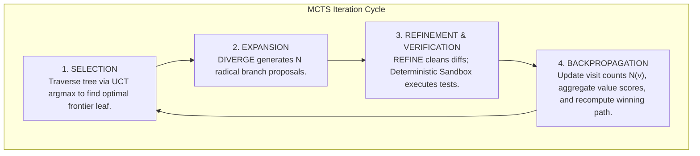

# SST Execution DAG & MCTS Search Lifecycle

> **Document Version:** 1.0.0  
> **Package:** `sst-engine` (`src/sst/search`, `src/sst/storage`)  
> **Status:** Production Architecture Standard  

---

## 1. Overview of the MCTS Search Loop

The State Space Tree (SST) engine structures code discovery as a Monte Carlo Tree Search (MCTS) traversing a Directed Acyclic Graph (DAG) of candidate states. Each search iteration proceeds through four distinct phases:



---

## 2. Phase-by-Phase Mechanics

### 2.1 Selection: Upper Confidence Bound for Trees (UCT)
From the root node, the controller traverses the existing tree to select the most promising active node $n$ according to the UCT formula:

$$\text{UCT}(n) = \bar{V}(n) + c \cdot \sqrt{\frac{\ln N(\text{parent}(n))}{N(n) + \epsilon}}$$

Where:
- $\bar{V}(n) \in [0.0, 1.0]$: Mean normalized value score assigned by semantic evaluation.
- $N(n)$: Total visit count of node $n$.
- $N(\text{parent}(n))$: Total visit count of node $n$'s immediate parent.
- $c = \sqrt{2} \approx 1.414$: Exploration constant balancing exploitation of high-scoring nodes against exploration of under-visited branches.
- $\epsilon = 10^{-5}$: Small positive scalar preventing division-by-zero on unvisited nodes.

Nodes marked as `PRUNED_DETERMINISTIC`, `PRUNED_SEMANTIC`, or `REJECTED_HUMAN` are excluded from the candidate selection frontier.

### 2.2 Expansion: High-Entropy Divergence
Once a frontier candidate node is selected, the engine executes divergent expansion:
1. Compiles a bounded `ContextCapsule` targeting the invariants and code symbols relevant to the parent node.
2. Invokes the `DIVERGE` role with high generation entropy ($T=1.20$, top-$p=0.95$) to brainstorm $K$ distinct structural or algorithmic strategies.
3. Strategies that duplicate existing parent proposals or match negative inhibitor patterns are immediately filtered out.

### 2.3 Refinement & Deterministic Verification
For each divergent branch:
1. Invokes the `REFINE` role ($T=0.05$, top-$p=0.10$) to produce an exact, syntax-checked code patch or unified diff.
2. The patch is staged inside an ephemeral sandbox directory managed by `CandidateCustodyManager`.
3. `SSTDeterministicEvaluator` executes mechanical gates:
   - **Path Containment**: Rejects any patch targeting paths outside the declared task boundaries.
   - **AST Compilation**: Checks that generated Python code parses into valid syntax trees.
   - **Mechanical Tests**: Executes the acceptance test command (e.g., `pytest`).
4. Nodes that exit with non-zero status or syntax errors transition immediately to `FAIL_DETERMINISTIC` and are pruned at **$0 frontier LLM cost**.

### 2.4 Backpropagation & Dynamic Winning Path
Surviving deterministic nodes are evaluated by the `CRITIQUE` role to yield an architectural value score $V(n) \in [0.0, 1.0]$. The outcome is then backpropagated up the ancestor chain:

$$N(\text{ancestor}) \leftarrow N(\text{ancestor}) + 1$$

$$\bar{V}(\text{ancestor}) \leftarrow \frac{1}{N(\text{ancestor})} \sum_{k=1}^{N(\text{ancestor})} V_k$$

Following backpropagation, the `DAGProjection` recalculates the tree's **Optimal Winning Path**:
- Starting at the root, the path greedily traverses children having the highest cumulative score and passing deterministic status.
- The leaf node of the winning path represents the current **Champion Candidate**.

---

## 3. Node State Machine & Lifecycle Transitions

Nodes progress through a strictly ordered finite state machine:

```text
               ┌─────────────┐
               │  PROPOSED   │
               └──────┬──────┘
                      │
           [Deterministic Gate]
             ┌────────┴────────┐
             │                 │
             ▼                 ▼
     ┌──────────────┐   ┌────────────────────┐
     │  FAIL_DETERM │   │ PASS_DETERMINISTIC │
     └──────┬───────┘   └─────────┬──────────┘
            │                     │
      [Pruned $0]           [Cortex Critic]
                            ┌─────┴─────┐
                            │           │
                            ▼           ▼
                   ┌──────────────┐ ┌────────────────┐
                   │ PRUNED_SEM   │ │APPROVED_CORTEX │
                   └──────────────┘ └───────┬────────┘
                                            │
                                  [Human or Promotion]
                                    ┌───────┴────────┐
                                    │                │
                                    ▼                ▼
                            ┌──────────────┐ ┌──────────────┐
                            │   PROMOTED   │ │  SYNTHESIZED │
                            └──────────────┘ └──────────────┘
```

### State Transition Matrix

| Current State | Event / Trigger | Target State | Invariant Guard |
| :--- | :--- | :--- | :--- |
| `PROPOSED` | Evaluator exits non-zero / AST fails | `FAIL_DETERMINISTIC` | Dead-end; cannot be revived. |
| `PROPOSED` | Evaluator exits code 0 | `PASS_DETERMINISTIC` | Unlocks semantic model scoring. |
| `PASS_DETERMINISTIC` | Value score < threshold ($0.70$) | `PRUNED_SEMANTIC` | Pruned from selection frontier. |
| `PASS_DETERMINISTIC` | Value score $\ge$ threshold ($0.70$) | `APPROVED_CORTEX` | Eligible for champion promotion. |
| `APPROVED_CORTEX` | Multiple branches pass | `SYNTHESIZED` | Colimit synthesis creates composite child. |
| `APPROVED_CORTEX` | Destructive edit / deletion detected | `ESCALATE_HUMAN` | Requires explicit human approval. |
| `APPROVED_CORTEX` | CLI promotion command | `PROMOTED` | Patch written to active workspace. |

---

## 4. Multi-Stage Pruning Shears

SST operates a dual-gate pruning pipeline to prevent unnecessary inference expenditure:

```
[Candidate Branch Generated]
             │
             ▼
┌───────────────────────────────┐
│ Stage 1: Zero-Cost Sandbox    │  Exit != 0 / AST Error ──> [❌ $0 AUTO-PRUNE]
│ (Syntax, Linter, Test Suite)  │
└──────────────┬────────────────┘
               │ Exit == 0 (Tests Pass)
               ▼
┌───────────────────────────────┐
│ Stage 2: Semantic Value Critic│  Value Score < 0.70    ──> [✂️ SEMANTIC PRUNE]
│ (Frontier Architectural Audit)│
└──────────────┬────────────────┘
               │ Value Score >= 0.70
               ▼
┌───────────────────────────────┐
│ Stage 3: Promotion / Colimit  │  Multiple branches     ──> [✨ COLIMIT SYNTHESIS]
│ (Winning Path Recommendation) │  Irreversible action   ──> [👤 HUMAN ESCALATION]
└───────────────────────────────┘
```

1. **Stage 1 (Mechanical Gate)**: Completely eliminates syntactically invalid code, hallucinated dependencies, and broken logic without expending frontier tokens.
2. **Stage 2 (Semantic Gate)**: Evaluates clean code for maintainability, security, and adherence to design specifications. Branches that score below $0.70$ are archived with feedback rationale.
3. **Stage 3 (Colimit & Synthesis Gate)**: Recombines high-performing divergent branches before finalizing the winning solution.
