# STC: Biomimetic Spec-to-Code Autonomous Engineering Engine
## Volume 02: Execution Directed Acyclic Graph (DAG)

> **System:** STC (Spec-To-Code)  
> **Project Directory:** `code/utilities/stc`  
> **Document Status:** `[DECIDED]`  
> **Acyclic Invariant:** No circular dependencies are permitted. Re-evaluations occur through explicit, bounded epoch iterations ($N \le 3$) that reset to a defined upstream node with an incremented iteration index.

---

## 1. Master Execution DAG Visual Topology

```mermaid
graph TD
    classDef intake fill:#1e293b,stroke:#38bdf8,stroke-width:2px,color:#f8fafc;
    classDef socratic fill:#1e1b4b,stroke:#818cf8,stroke-width:2px,color:#f8fafc;
    classDef memory fill:#064e3b,stroke:#34d399,stroke-width:2px,color:#f8fafc;
    classDef morpho fill:#451a03,stroke:#fb923c,stroke-width:2px,color:#f8fafc;
    classDef substrate fill:#4c0519,stroke:#fb7185,stroke-width:2px,color:#f8fafc;
    classDef judiciary fill:#581c87,stroke:#c084fc,stroke-width:2px,color:#f8fafc;
    classDef promotion fill:#14532d,stroke:#4ade80,stroke-width:2px,color:#f8fafc;
    classDef circuit fill:#7f1d1d,stroke:#ef4444,stroke-width:2px,color:#f8fafc;

    %% TIER 0: INTAKE & INGESTION
    SPEC_RAW["N01: Ingest Spec Atom<br/>[spec.md / Natural Language]"]:::intake
    SPEC_SCHEMA["N02: Validate Spec Schema<br/>[stc.schemas.SpecAtom]"]:::intake

    %% TIER 1: SOCRATIC DECOMPOSITION
    TOC_DECOMP["N03: Tree of Concerns (TOC) Decomposition<br/>[5 Dimensions: Invariants, Storage, Protocols, Security, Fallbacks]"]:::socratic
    ARCH_DIFF{"N04: Ambiguity Detected?<br/>[Archetype Diffing]"}:::socratic
    ARCH_CHOICE["N05: Sovereign Structured Choice<br/>[2 Pre-baked Opinions Selected]"]:::socratic
    INVARIANTS_LOCK["N06: Neocortex Invariants Locked<br/>[01_INVARIANTS.md & schemas.py]"]:::socratic

    %% TIER 2: COGNITIVE MEMORY & CONTEXT COMPILATION
    TRACE_QUERY["N07: Query Hippocampal Memory<br/>[Trace SQLite FTS5 + Semantic PPR]"]:::memory
    GENE_FETCH["N08: Fetch Genetic Invariants & Negative Inhibitors<br/>[Trace Genome DB]"]:::memory
    BUNDLE_COMPILE["N09: Compile Sub-25KB Task Bundle<br/>[task_bundle.yaml]"]:::memory

    %% TIER 3: CELLULAR MORPHOGENESIS & LEASED WORKTREES
    WORKTREE_LEASE["N10: Allocate Leased Git Worktree<br/>[worktrees/stc-task-XYZ]"]:::morpho
    MEMBRANE_CHECK["N11: Verify Typing Membranes<br/>[PEP 544 Protocols & Pydantic Models]"]:::morpho
    WORKER_DISPATCH["N12: Dispatch Executive Worker<br/>[agy / aider / dsh in Worktree]"]:::morpho

    %% TIER 4: SUBSTRATE HARD QUALITY GATES
    SUB_LINT["N13: Substrate Lint Gate<br/>[ruff check --fix=false]"]:::substrate
    SUB_TYPE["N14: Substrate Type Gate<br/>[mypy --strict (0 errors)]"]:::substrate
    SUB_TEST["N15: Substrate Test Gate<br/>[pytest (100% pass, 0 skips)]"]:::substrate
    SUB_MUTATION["N16: Substrate Mutation Gate<br/>[mutmut mutation kill >= 85%]"]:::substrate
    RECEIPT_GEN["N17: Sign Machine Receipt<br/>[receipt.json (SHA256 Signed)]"]:::substrate

    %% TIER 5: TRIAS POLITICA JUDICIARY
    JUDICIARY_AUDIT["N18: Blind Judiciary Red Team<br/>[Codex CLI in isolated read-only tree]"]:::judiciary
    JUDICIARY_VERDICT{"N19: Judiciary Verdict?<br/>[Pass / Reject with Evidence]"}:::judiciary

    %% TIER 6: PROMOTION & GENETIC EVOLUTION
    SOVEREIGN_MERGE["N20: Sovereign Promotion & Merge<br/>[Human signs off -> merge to main]"]:::promotion
    GENOME_STORE["N21: Ingest into Evolving Trace Genome<br/>[Save positive genes & negative inhibitors]"]:::promotion
    WORKTREE_CLEAN["N22: Worktree Release & Garbage Collection<br/>[git worktree remove]"]:::promotion

    %% CIRCUIT BREAKERS & RETRIES
    CIRCUIT_FAIL["CIRCUIT BREAKER: Abort & Quarantine<br/>[Log Refutation to Trace DB]"]:::circuit

    %% WIRING
    SPEC_RAW --> SPEC_SCHEMA
    SPEC_SCHEMA --> TOC_DECOMP
    TOC_DECOMP --> ARCH_DIFF
    ARCH_DIFF -- "Yes (Ambiguity)" --> ARCH_CHOICE
    ARCH_CHOICE --> INVARIANTS_LOCK
    ARCH_DIFF -- "No (Deterministic)" --> INVARIANTS_LOCK
    INVARIANTS_LOCK --> TRACE_QUERY
    TRACE_QUERY --> GENE_FETCH
    GENE_FETCH --> BUNDLE_COMPILE
    BUNDLE_COMPILE --> WORKTREE_LEASE
    WORKTREE_LEASE --> MEMBRANE_CHECK
    MEMBRANE_CHECK --> WORKER_DISPATCH
    WORKER_DISPATCH --> SUB_LINT
    SUB_LINT --> SUB_TYPE
    SUB_TYPE --> SUB_TEST
    SUB_TEST --> SUB_MUTATION
    SUB_MUTATION --> RECEIPT_GEN
    RECEIPT_GEN --> JUDICIARY_AUDIT
    JUDICIARY_AUDIT --> JUDICIARY_VERDICT

    JUDICIARY_VERDICT -- "REJECT (Bug/Mock)" --> CIRCUIT_FAIL
    CIRCUIT_FAIL -. "Bounded Retry (Epoch <= 3)" .-> BUNDLE_COMPILE

    JUDICIARY_VERDICT -- "APPROVE" --> SOVEREIGN_MERGE
    SOVEREIGN_MERGE --> GENOME_STORE
    GENOME_STORE --> WORKTREE_CLEAN
```

---

## 2. Topological Tiers & Node Specifications

### Tier 0: Intake & Ingestion
| Node ID | Component | Input | Output | Verification Barrier |
| :--- | :--- | :--- | :--- | :--- |
| **N01** | `stc.intake.ingest_spec` | File path or stdin raw markdown specification | Raw string buffer | File exists, size $< 1\text{MB}$, valid UTF-8 |
| **N02** | `stc.intake.validate_schema` | Raw string buffer | `SpecAtom` (Pydantic model) | Valid schema conformance, non-empty goal, parsed meta tags |

### Tier 1: Socratic Decomposition & Invariant Locking
| Node ID | Component | Input | Output | Verification Barrier |
| :--- | :--- | :--- | :--- | :--- |
| **N03** | `stc.socratic.decompose_toc` | `SpecAtom` | `TreeOfConcerns` (TOC) | All 5 dimensions populated (Invariants, Storage, Protocols, Security, Fallbacks) |
| **N04** | `stc.socratic.detect_ambiguity` | `TreeOfConcerns` | Boolean + List of `ArchetypeDiff` | Ambiguity detection heuristics ($\Delta\text{entropy} > \tau$) |
| **N05** | `stc.socratic.present_choice` | `ArchetypeDiff` (Option A vs Option B) | User selection index (0 or 1) | Zero open-ended text input; atomic integer choice |
| **N06** | `stc.socratic.lock_invariants` | User choice + TOC | `01_INVARIANTS.md`, `schemas.py`, `protocols.py` | Written to disk, tagged `[INVARIANT]`, SHA256 hashed |

### Tier 2: Cognitive Memory & Context Compilation
| Node ID | Component | Input | Output | Verification Barrier |
| :--- | :--- | :--- | :--- | :--- |
| **N07** | `stc.memory.trace_query` | Feature keywords, domain entities | Relevant ADRs, prior trace atoms | SQLite FTS5 query latency $< 50\text{ms}$, non-empty results |
| **N08** | `stc.memory.gene_fetch` | Module type (e.g. `event_bus`, `auth`) | Positive Gene Schemas + Negative Inhibitors | Trace Genome DB lookup; validates against current Python version |
| **N09** | `stc.compiler.compile_bundle` | Invariants + Protocols + Retrieved Genes | `task_bundle.yaml` | **Strict size barrier: Size $\le 25\text{KB}$**; contains 0 unrelated files |

### Tier 3: Cellular Morphogenesis & Leased Worktrees
| Node ID | Component | Input | Output | Verification Barrier |
| :--- | :--- | :--- | :--- | :--- |
| **N10** | `stc.worktree.lease` | `task_id`, branch name | Physical directory `worktrees/stc-task-XYZ/` | Clean git status, isolated branch, lease TTL timestamp recorded |
| **N11** | `stc.worktree.verify_membrane` | Target directory | Type verification receipt | Upstream `protocols.py` present; downstream implementation files stubbed |
| **N12** | `stc.orchestrator.dispatch_worker`| `task_bundle.yaml`, worktree path | File modifications, git diff | Worker executes only in leased directory; zero writes outside worktree |

### Tier 4: Substrate Hard Quality Gates
| Node ID | Component | Input | Output | Verification Barrier |
| :--- | :--- | :--- | :--- | :--- |
| **N13** | `stc.substrate.run_linter` | Modified files in worktree | Linter stdout + exit code | `ruff check` exit code **0**, `ruff format --check` exit code **0** |
| **N14** | `stc.substrate.run_typecheck` | Target modules | Mypy report + exit code | `mypy --strict` exit code **0**, untyped defs = 0 |
| **N15** | `stc.substrate.run_tests` | Pytest test files | Pytest XML/JSON + exit code | `pytest -v` exit code **0**, 0 failed, 0 skipped |
| **N16** | `stc.substrate.run_mutation` | Source & test files | Mutation score | `mutmut` surviving mutants == 0 (or mutation score $\ge 85\%$) |
| **N17** | `stc.substrate.sign_receipt` | All tool outputs & hashes | `receipt.json` | Signed HMAC-SHA256 receipt; references commit hash and all gate metrics |

### Tier 5: Trias Politica Judiciary Audit
| Node ID | Component | Input | Output | Verification Barrier |
| :--- | :--- | :--- | :--- | :--- |
| **N18** | `stc.judiciary.audit` | Git diff + `task_bundle.yaml` + `receipt.json` | `JudiciaryVerdict` | Independent Codex CLI audit; no worker chat transcripts supplied |
| **N19** | `stc.judiciary.evaluate` | `JudiciaryVerdict` | Pass / Quarantine decision | Probes for fake mocks, silent fallbacks, or invariant violations |

### Tier 6: Promotion & Genetic Evolution
| Node ID | Component | Input | Output | Verification Barrier |
| :--- | :--- | :--- | :--- | :--- |
| **N20** | `stc.promotion.sovereign_merge`| Passed verdict + Diff summary | Merged commit on `main` | **Human Vanguard signature required**; sole authority to merge |
| **N21** | `stc.genome.ingest_trace` | Merged code + `receipt.json` + refutation log | Ingested Trace Genome Atom | Ingested to Project Trace SQLite DB with `status="PROMOTED"` |
| **N22** | `stc.worktree.cleanup` | Leased worktree path | Removed worktree directory | `git worktree remove` executed; temporary files purged |

---

## 3. Circuit Breakers, Rollbacks & Epoch Bounds

### 3.1 Hard Fail-Closed Conditions
If any of the following events occur, the execution halts immediately and triggers `CIRCUIT_FAIL`:
1. **Substrate Gate Failure:** Any non-zero exit code from `ruff`, `mypy`, or `pytest`.
2. **Mock Infiltration:** Test file contains forbidden mock patterns (`unittest.mock.MagicMock` on core database or domain entities).
3. **Silent Fallback Detection:** Diff contains `except Exception: pass` or `except ...: return []` in domain services.
4. **Context Bundle Overflow:** `task_bundle.yaml` exceeds 25,600 bytes ($25\text{KB}$).
5. **Contract Tampering:** Worker modified upstream `01_INVARIANTS.md` or `protocols.py` without Sovereign authorization.

### 3.2 Bounded Epoch Retries
- When `CIRCUIT_FAIL` is triggered, the error diagnostic and refutation rationale are packaged into a `NegativeInhibitorGene`.
- The inhibitor is added to the `task_bundle.yaml` under `forbidden_patterns`.
- An execution counter (`epoch_index`) is incremented:
  - If `epoch_index <= 3`: The pipeline resumes at **N09 (Compile Sub-25KB Task Bundle)** with the negative inhibitor injected.
  - If `epoch_index > 3`: The task is quarantined, the worktree is frozen for human inspection, and an alert is emitted to the Sovereign Vanguard. **Zero runaway infinite loops.**

---

## 4. Critical Path & Concurrency Model

- **Sequential Invariants:** N01 through N09 are strictly sequential (Domain specification must stabilize before code dispatch).
- **Parallel Workers:** Once N09 completes, independent subsystems (e.g., Auth vs Ingest vs Storage) can execute N10 through N17 in **parallel isolated worktrees** without cross-interference.
- **Topological Merge Order:** Parallel worktrees merge into `main` in topological dependency order (Upstream Core $\to$ Domain Services $\to$ Downstream Adapters $\to$ CLI).
