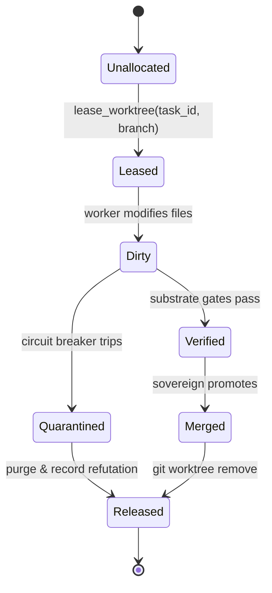

# STC: Biomimetic Spec-to-Code Autonomous Engineering Engine
## Volume 03: Lossless Subsystem Engineering Specifications

> **System:** STC (Spec-To-Code)  
> **Project Directory:** `code/utilities/stc`  
> **Target Environment:** Python 3.12+, `uv`, SQLite FTS5, Git Worktrees, Project Trace, Cordis Plugin Bus  
> **Status:** `[DECIDED]`  
> **Lossless Standard:** Every protocol, state machine, algorithm, boundary invariant, and data contract is specified with zero hand-waving, zero pseudocode, and zero "TBD" blocks.

---

## 1. Subsystem 1: Socratic Elicitation & Archetype Diffing (`stc.socratic`)

### 1.1 Purpose & Role
Transforms unstructured or semi-structured specification text (`spec.md`) into a rigorously validated, mathematically unambiguous `TreeOfConcerns` (TOC) and generates concrete, contrasting `ArchetypeDiff` options for the Human Sovereign whenever architectural ambiguity is detected.

### 1.2 The 5 Dimensions of the Tree of Concerns (TOC)
Every specification ingested by STC is mapped into a 5-tuple:
$$\mathcal{TOC} = \langle \mathcal{D}_{inv}, \mathcal{S}_{pers}, \mathcal{P}_{comm}, \mathcal{B}_{sec}, \mathcal{F}_{res} \rangle$$

1. **$\mathcal{D}_{inv}$ (Domain Invariants):** Business rules that must never be violated under any state transition (e.g., "Account balance cannot drop below zero", "A task cannot be completed without a signed receipt").
2. **$\mathcal{S}_{pers}$ (Persistence & Storage Contracts):** Schemas, indexing strategies, atomicity models (ACID/BASE), mutation idempotency keys, and content-addressed storage hashes.
3. **$\mathcal{P}_{comm}$ (Communication & Transport Protocols):** PEP 544 typed interfaces, REST/JSON-RPC endpoints, event payloads, channel topics, and serialization formats.
4. **$\mathcal{B}_{sec}$ (Boundary Isolation & Security):** Authentication models, PII redaction policies (`entorhinal`), token lifecycle, filesystem sandboxing, and non-root execution permissions.
5. **$\mathcal{F}_{res}$ (Failure Modes & Resilience):** Circuit breaker trip thresholds, exponential backoff with jitter parameters, timeout deadlines, and fail-closed error classifications.

### 1.3 Ambiguity Detection Algorithm
Ambiguity in a specification atom is computed via three deterministic heuristics:
1. **Missing Dimension Penalty ($P_{dim}$):** If any of the 5 dimensions has empty rules, $P_{dim} = 0.5$.
2. **Under-specified Error Policies ($P_{err}$):** If exceptions or timeout handling are mentioned without exact numeric thresholds, $P_{err} = 0.3$.
3. **Contradiction Divergence ($P_{contra}$):** If terms match opposing architectural patterns (e.g., "stateless" paired with "in-memory session state"), $P_{contra} = 1.0$.

$$\text{AmbiguityScore} = \min\left(1.0, P_{dim} + P_{err} + P_{contra}\right)$$
If $\text{AmbiguityScore} \ge 0.3$, the engine halts compilation and generates an `ArchetypeDiff`.

### 1.4 Archetype Diff Generation Rules
The Socratic engine **never** presents open-ended questions like *"How do you want to handle errors?"* It must generate exactly **two opposing, complete archetypes**:
- **Archetype Alpha (Conservative / Fail-Closed):** Strict validation, immediate error propagation, synchronous verification, high security, zero stale data allowance.
- **Archetype Beta (Resilient / High-Throughput):** Grace windows, optimistic concurrency, asynchronous worker processing, fallback buffers, eventually consistent state.
- **Format Requirement:** Each option must provide a 1-sentence summary, trade-off matrix, and the exact invariant line to be written to `01_INVARIANTS.md`.

---

## 2. Subsystem 2: Context Compiler & Cognitive Memory Interface (`stc.compiler`)

### 2.1 Purpose & Role
Compiles atomic, hyper-targeted `task_bundle.yaml` files for executive coding workers. It enforces a strict **sub-25KB context ceiling** to prevent attention saturation and hallucination.

### 2.2 Dual-Store Query Mechanism
```
  ┌─────────────────────────────────────────────────────────────┐
  │                    `stc.compiler` Engine                    │
  └───────────────┬─────────────────────────────┬───────────────┘
                  │                             │
                  ▼                             ▼
  ┌─────────────────────────────┐ ┌─────────────────────────────┐
  │    Neocortex (Immutable)    │ │   Hippocampus (Episodic)    │
  │ • `01_INVARIANTS.md`        │ │ • Project Trace SQLite FTS5 │
  │ • `schemas.py`              │ │ • PPR Semantic Association  │
  │ • `protocols.py`            │ │ • Negative Inhibitor Genes  │
  │ • System ADRs               │ │ • Historical Diff Hashes    │
  └─────────────────────────────┘ └─────────────────────────────┘
```
1. **Neocortex Access:** Reads local static repository contracts directly from filesystem. Extracts only the specific `Protocol` class and `BaseModel` relevant to the target feature.
2. **Hippocampal Query:** Dispatches a structured search query to the Project Trace local database:
   ```sql
   SELECT doc_id, snippet(documents_fts, 2, '<b>', '</b>', '...', 10)
   FROM documents_fts
   WHERE documents_fts MATCH :query
   ORDER BY rank LIMIT 3;
   ```
3. **Negative Inhibitor Gene Lookup:** Retrieves historical failure patterns for the component (e.g., "Do not use Windows named pipes for inter-process communication; use localhost TCP sockets").

### 2.3 Task Bundle Structure & Budget Enforcement
The compiled `task_bundle.yaml` must adhere to the following byte budget:
- **Header & Metadata:** $\le 1\text{KB}$ (`task_id`, `epoch_index`, `timestamp`, `author`).
- **Goal & Acceptance Criteria:** $\le 3\text{KB}$ (Exact behavior required, happy path + 3 edge cases).
- **Invariants & Constraints:** $\le 4\text{KB}$ (Forbidden libraries, non-negotiable assertions).
- **Membrane Contracts:** $\le 8\text{KB}$ (The exact PEP 544 Protocol definitions and Pydantic schemas).
- **Negative Inhibitors:** $\le 4\text{KB}$ (Disproven patterns from previous epochs).
- **Target File Map:** $\le 2\text{KB}$ (Exact relative filepaths and line anchor markers).
- **Total Hard Ceiling:** **25,600 Bytes ($25\text{KB}$)**. If the bundle exceeds 25KB, the compiler throws `BundleSizeExceededError` and prunes context hierarchically.

---

## 3. Subsystem 3: Morphogenetic Cellular Worktree Manager (`stc.worktree`)

### 3.1 Purpose & Role
Provides total filesystem and Git branch isolation for executive coding workers. No worker is ever permitted to execute directly in the primary workspace root or on `main`.

### 3.2 Worktree Lease Lifecycle


### 3.3 Isolation Invariants
1. **Branch Naming Standard:** All worktrees branch from `main` under `feature/stc-{task_id}-e{epoch}`.
2. **Directory Sandbox:** Created under `worktrees/stc-{task_id}/` (ignored in `.gitignore`).
3. **Cross-OS Handling:**
   - File edits may occur via Windows filesystem tools.
   - Git operations use native `git worktree add --force <path> <branch>`.
   - Subprocess executions (`pytest`, `mypy`, `ruff`) execute in the target environment (or WSL/container if configured).
4. **Time-To-Live (TTL):** Leases carry a 1-hour TTL. If a worker hangs or crashes without releasing the lease, STC automatically revokes the lease and frees the directory.

---

## 4. Subsystem 4: Substrate Hard Quality Gates & Machine Receipts (`stc.substrate`)

### 4.1 Purpose & Role
The deterministic execution engine that enforces zero-defect software quality before any human or judicial auditor ever sees the code. Replaces vague LLM self-certification with signed machine evidence.

### 4.2 The 4 Mechanical Quality Gates
```
  ┌────────────────────────────────────────────────────────────────────────┐
  │ GATE 1: CODE HYGIENE & STYLE (`ruff`)                                  │
  │ • Command: `uv run ruff check .` && `uv run ruff format --check .`     │
  │ • Requirement: Exit Code == 0 (Zero warnings, zero formatting diffs)   │
  └───────────────────────────────────┬────────────────────────────────────┘
                                      │
                                      ▼
  ┌────────────────────────────────────────────────────────────────────────┐
  │ GATE 2: STATIC TYPE SYSTEM (`mypy`)                                    │
  │ • Command: `uv run mypy --strict src/ tests/`                          │
  │ • Requirement: Exit Code == 0 (Zero Any leaks, 100% typed functions)   │
  └───────────────────────────────────┬────────────────────────────────────┘
                                      │
                                      ▼
  ┌────────────────────────────────────────────────────────────────────────┐
  │ GATE 3: DETERMINISTIC TEST SUITE (`pytest`)                            │
  │ • Command: `uv run pytest -v --tb=short --junitxml=report.xml`         │
  │ • Requirement: Exit Code == 0 (100% pass rate, 0 failed, 0 skipped)    │
  └───────────────────────────────────┬────────────────────────────────────┘
                                      │
                                      ▼
  ┌────────────────────────────────────────────────────────────────────────┐
  │ GATE 4: MUTATION ROBUSTNESS (`mutmut`)                                 │
  │ • Command: `uv run mutmut run --paths-to-mutate=src/`                  │
  │ • Requirement: Mutation Kill Rate >= 85% (Kills trivial assert gaming) │
  └────────────────────────────────────────────────────────────────────────┘
```

### 4.3 Tamper-Evident Machine Receipt (`receipt.json`)
Every substrate execution aggregates into an immutable JSON document:
```json
{
  "receipt_id": "rcpt_8f9c42b10a2e",
  "task_id": "STC-001-INGEST",
  "epoch_index": 1,
  "commit_hash": "e4d3c2b1a098",
  "timestamp_utc": "2026-09-03T10:15:00Z",
  "environment": {
    "python_version": "3.12.4",
    "os": "Windows-11-10.0.22631-SP0",
    "uv_version": "0.12.0"
  },
  "gates": {
    "ruff": {"exit_code": 0, "violations": 0},
    "mypy": {"exit_code": 0, "errors": 0},
    "pytest": {"exit_code": 0, "passed": 18, "failed": 0, "skipped": 0, "duration_seconds": 1.42},
    "mutmut": {"mutation_score": 0.92, "killed": 23, "survived": 2}
  },
  "sha256_checksum": "9b71d224bd62f3785d96d46ad3ea3d73319bfbc2890caadae2dff72519673ca7"
}
```

---

## 5. Subsystem 5: Trias Politica Judiciary Audit (`stc.judiciary`)

### 5.1 Purpose & Role
Operates as the adversarial branch of government. A headless Codex CLI instance reviews the worker's git diff in a clean, read-only worktree without seeing conversational chatter, actively searching for anti-patterns and subversions.

### 5.2 Adversarial Audit Checklist
The Judiciary agent verifies:
1. **Mock Infiltration:** Did the worker mock the core domain logic, storage engine, or network layers rather than writing real implementations?
2. **Silent Fallback:** Are there empty `except:` clauses, fallback returns (`return []`, `return None`), or silenced assertions?
3. **Contract Tampering:** Did the worker alter `protocols.py` or `01_INVARIANTS.md` to make failing tests pass?
4. **Leakage & Dead Code:** Are there unused imports, debugging statements (`print`, `console.log`), or hardcoded API keys/passwords?

### 5.3 Verdict Emission
The Judiciary emits a structured `JudiciaryVerdict`:
- `status`: `APPROVED` | `QUARANTINED` | `REJECTED`
- `violations`: List of `ViolationItem(rule, filepath, line_number, evidence_snippet)`
- `reasoning`: Concise 2-sentence rationale.

---

## 6. Subsystem 6: Genetic Code Bank & Trace Importer (`stc.genome`)

### 6.1 Purpose & Role
Maintains the long-term evolutionary memory of the system. Ingests promoted software implementations and disproven negative dead ends directly into Project Trace's SQLite database.

### 6.2 Genetic Taxonomy
1. **Structural Gene (Positive):** Proven Pydantic models, PEP 544 protocols, and clean architecture module layouts that have survived production gates.
2. **Behavioral Gene (Positive):** Deterministic algorithmic implementations (e.g., RRF rank fusion, Levenshtein DOM pruning, token bucket rate limiters).
3. **Negative Inhibitor Gene (Negative Knowledge):** Documented failure modes, refutations, and incompatible library combinations (e.g., "Do not use `asyncio.create_subprocess_exec` on Windows without `ProactorEventLoop`").

### 6.3 Ingestion Pipeline
When the Human Sovereign executes promotion:
1. The diff and `receipt.json` are hashed.
2. The gene is tagged with domain keywords (e.g., `#storage`, `#sqlite`, `#protocol`).
3. An atom is written to the Project Trace database table `trace_genome_atoms`.
4. Subsequent Socratic and Compiler runs query this table to pre-seed future task bundles.
