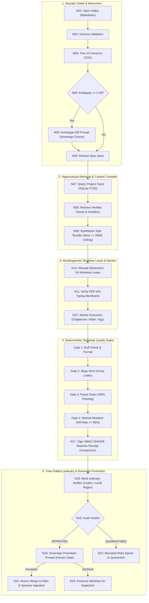

# STC (Spec-To-Code)

[](https://www.python.org/downloads/)
[](https://github.com/astral-sh/uv)
[](https://github.com/astral-sh/ruff)
[](https://mypy-lang.org/)
[](LICENSE)
[](tests/)
[](01_INVARIANTS.md)

**STC** is a production-grade, distributed autonomous engineering engine implementing the **Biomimetic Spec-to-Code Architecture**. It transforms natural language and technical specifications into zero-defect, production-ready software through Socratic decomposition, bounded context compilation, morphogenetic Git worktrees, deterministic substrate quality gates, and blind judicial verification.

---

## 🏛️ Executive Architecture & Core Philosophy

STC addresses the primary failure modes of LLM code generation (context rot, mock gaming, silent fallbacks, and multi-agent coordination overhead) by introducing **biological and constitutional separation of concerns**:



---

## ⚖️ Trias Politica Separation of Powers

STC enforces a constitutional separation of powers where no single entity can both write code and certify its correctness:

| Branch | Role | Implementation | Authority & Boundaries |
| :--- | :--- | :--- | :--- |
| **Legislative / Sovereign** | Human Architect | CLI (`stc promote`) | **Sole merge authority.** Decides architectural ambiguity trade-offs; inspects machine receipts and diffs; authorizes merge to `main`. |
| **Executive / Builder** | AI Worker / Chaperone | `src/stc/worktree/`, `src/stc/orchestrator/` | **Confined execution.** Operates exclusively within leased, isolated Git worktrees (`worktrees/stc-{task_id}`). Zero writes to `main`. |
| **Judicial / Critic** | Blind Adversarial Auditor | `src/stc/judiciary/` (`stc judge`) | **Independent adversarial probe.** Evaluates diffs and signed receipts without access to builder chat history. Probes for mocks, fallbacks, tampering, and leaks. |

---

## 📚 Technical Volume Documentation

The complete architectural specifications, invariant registers, and operational runbooks:

| Volume | Document | Description |
| :---: | :--- | :--- |
| **01** | [`01_INVARIANTS.md`](01_INVARIANTS.md) | **Non-negotiable constitutional invariants**, normative threshold register, and anti-patterns. |
| **01** | [`01_PLAN_BROAD_STROKES.md`](01_PLAN_BROAD_STROKES.md) | High-level strategic vision, 5 core pillars, failure modes, epistemic status, and ADRs. |
| **02** | [`02_EXECUTION_DAG.md`](02_EXECUTION_DAG.md) | 22-node Directed Acyclic Graph (DAG) execution lifecycle, node contracts, and circuit breakers. |
| **03** | [`03_LOSSLESS_SUBSYSTEM_SPECS.md`](03_LOSSLESS_SUBSYSTEM_SPECS.md) | Loss-free engineering specifications for all 6 subsystems and core algorithms. |
| **04** | [`04_DATA_CONTRACTS_AND_SCHEMAS.md`](04_DATA_CONTRACTS_AND_SCHEMAS.md) | Pydantic V2 immutable data contracts, frozen schemas, and PEP 544 typed protocols. |
| **05** | [`05_CLI_AND_INTERFACE_SPEC.md`](05_CLI_AND_INTERFACE_SPEC.md) | CLI interface specifications, Rich terminal visual outputs, and machine-readable JSON modes. |
| **06** | [`06_VERIFICATION_AND_TEST_HARNESS.md`](06_VERIFICATION_AND_TEST_HARNESS.md) | Zero-mock testing harness, mutation testing standards (`mutmut`), and cross-OS safety. |
| **07** | [`07_ROLLOUT_FLIGHT_PLAN.md`](07_ROLLOUT_FLIGHT_PLAN.md) | 6-stage rollout verification roadmap and daily Sovereign operating cadence. |
| **08** | [`08_CHAPERONE_AND_EXECUTION_ENGINE.md`](08_CHAPERONE_AND_EXECUTION_ENGINE.md) | Chaperone execution engine, passive notary logging, and CLI worker containment. |
| **REF**| [`ARCHITECTURE.md`](ARCHITECTURE.md) | High-level architectural overview, directory topology, and typed membrane boundaries. |

---

## ⚡ Key Subsystems

1. **Socratic Decomposition (`src/stc/socratic/`):**
   - Decomposes specs into a 5-dimensional `TreeOfConcerns` (Goal, Boundaries, State, Failure Modes, Verification).
   - Computes `AmbiguityScore`. When $\ge \tau$ (0.30), halts compilation and presents an `ArchetypeDiff` with two competing architectural choices to the Sovereign.

2. **Context Compiler & Memory Bundler (`src/stc/compiler/`, `src/stc/memory/`):**
   - Synthesizes an atomic `TaskBundle` strictly constrained by a **25,600-byte (25 KB) ceiling** to eliminate attention saturation ($O(N^2) \rightarrow O(1)$).
   - Interacts with Neocortex invariants and local Project Trace SQLite FTS5 database to inject relevant structural genes and negative inhibitors.

3. **Morphogenetic Worktree Orchestrator (`src/stc/worktree/`, `src/stc/orchestrator/`):**
   - Leases ephemeral Git worktrees (`worktrees/stc-{task_id}`) with cross-process file locking.
   - Enforces TTL expiration (Leased $\rightarrow$ Expired $\rightarrow$ Quarantined), confinement snapshot validation, and automatic post-gate cleanup.

4. **Deterministic Substrate Quality Gates (`src/stc/substrate/`):**
   - Runs mechanical quality gates (Ruff lint/format, Mypy strict, Pytest 100%, Mutmut $\ge 85\%$).
   - Generates an HMAC-SHA256 cryptographically signed machine execution receipt (`receipt.json`).

5. **Blind Judiciary Auditor (`src/stc/judiciary/`):**
   - Performs independent, adversarial code audits on the candidate diff.
   - Verifies receipt cryptographic signatures, hunts for `MagicMock` infiltration, flags silent exception swallowing (`except ...: pass`), detects secret key leaks, and ensures scope confinement.

6. **Genetic Memory Store (`src/stc/genome/`):**
   - Catalogs approved implementation patterns as structural genes and recorded mistakes as negative inhibitors into Project Trace for future generations.

---

## 🚀 Installation & Quickstart

### Prerequisites
- Python 3.12+
- [uv](https://docs.astral.sh/uv/) (v0.12+)
- Git 2.45+

### Installation
```bash
# Clone the repository
git clone https://github.com/Anshul48/stc.git
cd stc

# Install dependencies into virtual environment
uv sync --all-groups

# Configure environment variables
cp .env.example .env
```

---

## 🛠️ Complete CLI Guide

STC provides both a Rich human-readable terminal UI and a machine-readable JSON output mode (`-j` / `--json`):

### 1. Autonomous End-to-End Pipeline Execution
Executes the full 22-node DAG pipeline from spec intake to receipt signing and Sovereign merge prompt:
```bash
uv run stc run ./specs/feature_rrf.md
```

### 2. Socratic Spec Intake & Ambiguity Detection
Parses a feature spec, builds the Tree of Concerns (TOC), and resolves ambiguities interactively:
```bash
uv run stc spec ./specs/sample_spec.md
```

### 3. Sub-25KB Task Bundle Compilation
Compiles Neocortex invariants, Project Trace memory, and spec instructions into a bounded context bundle:
```bash
uv run stc compile STC-001 --spec ./specs/sample_spec.md --out ./artifacts/task_bundle.yaml
```

### 4. Ephemeral Worktree Management
Allocates, lists, and cleans up isolated Git worktrees:
```bash
# Allocate an isolated worktree lease
uv run stc worktree lease STC-001 --branch feature/stc-001

# List active worktrees and lease TTL statuses
uv run stc worktree list

# Release and purge a completed worktree lease
uv run stc worktree release STC-001 --purge
```

### 5. Mechanical Substrate Quality Gates
Runs the four deterministic mechanical quality gates against a worktree or directory:
```bash
uv run stc gate STC-001 --path ./worktrees/stc-STC-001
```

### 6. Blind Adversarial Judiciary Audit
Dispatches the independent auditor to verify the diff and receipt:
```bash
uv run stc judge STC-001 --receipt ./artifacts/receipts/rcpt_STC-001.json --diff ./artifacts/stage_5_clean.patch
```

### 7. Sovereign Promotion & Genome Ingestion
The Human Sovereign merges an approved candidate to `main` and ingests its genes into Trace:
```bash
uv run stc promote STC-001 --receipt ./artifacts/receipts/rcpt_STC-001.json
```

### 8. System Diagnostics & Health
```bash
uv run stc health
uv run stc info
```

---

## 🛡️ Mechanical Quality Gate Standards

Every PR and commit must satisfy all mechanical gates with exit code 0:

```bash
# Gate 1: Code hygiene and formatting
uv run ruff check .
uv run ruff format --check .

# Gate 2: Static type soundness (strict mode, zero Any leaks)
uv run mypy --strict src/ tests/

# Gate 3: Comprehensive test suite (209 tests, 100% pass)
uv run pytest -v

# Gate 4: Mutation robustness testing (target: >= 85.00% kill rate)
uv run mutmut run
```

---

## 🤝 Contributing

Contributions that uphold STC's constitutional invariants are welcome! Please read [`CONTRIBUTING.md`](CONTRIBUTING.md) and [`CODE_OF_CONDUCT.md`](CODE_OF_CONDUCT.md) before opening a pull request.

---

## 🔒 Security

For vulnerability disclosures and security policies, see [`SECURITY.md`](SECURITY.md).

---

## 📄 License

Licensed under the [Apache License, Version 2.0](LICENSE).
