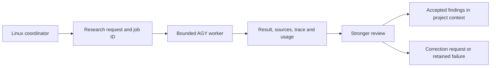

# Linux coordination with Antigravity research workers

> Public curation note: links to records excluded from this public release were converted to plaintext historical references; the original record identities are preserved inline.

Prepared 2026-10-09. The user intends to work purely from Linux and proposed Antigravity on Windows as an inexpensive research subagent, with stronger review afterward. The design below is a proposal. One bounded Windows research run was performed under that authorization; its terminal status was `ERROR`, and it is retained as a failed run.

My recommendation is to put the job queue, project state, and review on Linux and start with Antigravity's native Linux CLI as the worker. A separately running Windows host can provide the same worker through a narrow transport adapter. Windows on the same dual-boot PC cannot execute while that PC is booted into native Linux. The existing migration plan (historical record `../../../migration_runs/windows-to-linux-20261008/PLAN.md`, excluded from this public release) describes that same-PC topology; no answer to the hardware clarification had arrived when this proposal was written.

The mechanics are straightforward. Reliable unattended execution and economical research need a small adapter, explicit completion checks, and bounded tasks. The live experiment gives a concrete reason for all three.

## Available building blocks

Antigravity documents a native Linux CLI at `~/.local/bin/agy`. Authentication can use the operating system's credential store; a new Linux installation should complete its own sign-in. Maintaining a Windows host is optional for this research workflow. [Installation and authentication](https://antigravity.google/docs/cli/install/)

The CLI supports headless prompts, JSON or streamed events, explicit model selection, conversation identifiers, and timeouts. These capabilities were also present in the installed Windows executable's help. The adapter must inspect the streamed terminal result. [Headless mode](https://www.antigravity.google/docs/cli/headless/)

Remote Control provides a browser interface to a running host. It is useful for human inspection and intervention; the documentation consulted does not establish a public machine-to-machine submission endpoint for that feature. [Remote Control](https://antigravity.google/docs/remote-control?tab=cli)

A separate Antigravity Python SDK exists, with a Gemini API key in its quickstart. That does not establish that it uses the signed-in CLI's subscription entitlement. Prefer the available CLI for the first experiment. [SDK overview](https://antigravity.google/docs/sdk/overview/)

The ordinary agent can research through web tools. Calling a task “deep research” does not demonstrate integration with the separately named Gemini Deep Research service. This trial exercised general agent research.

## Host choice

| Arrangement | Practical assessment | When it earns its place |
|---|---|---|
| Codex and AGY on native Linux | Simplest initial arrangement; authenticate and qualify there | Normal source research and comparisons |
| Linux coordinator and a separate Windows machine | Feasible; add transport, host availability checks, and host-local authentication | Existing Windows capacity or Windows-specific investigations |
| Linux coordinator and a Windows VM | Feasible with VM, storage, and credential maintenance | A task actually requires Windows behavior |
| Linux booted and Windows only installed on the same PC | Windows worker unavailable | Durable files can carry cross-boot handoffs, but cannot provide concurrent execution |

For a separate Windows machine, SSH can invoke a fixed worker entrypoint and retrieve its artifacts. Submit a job file instead of interpolating a large prompt into a remote shell command. Authenticate the Windows process as its own configured user. Test headless credential access under that identity. Copying credential files between operating systems is unnecessary for that design and was not qualified here.

The worker interface should describe a research job, rather than an operating system. That lets the coordinator use a local CLI today and a remote host later without changing its review procedure. Linux-to-Windows submission was not tested in this session.

## The first useful loop

Begin with one worker process at a time and a directory per job. A small Python adapter can submit requests, capture output, inspect completion, and present a review inbox. Persistent services, a dashboard, and STC integration can follow if repeated use justifies them. Check the actual runtime qualification of existing harness adapters before reuse; a launcher name or catalog entry is not delegation evidence.

Each request should state the question, the decision it informs, constraints, source freshness, selected model, allowed operations, and a bounded output contract. Give it a stable job ID and record each execution attempt separately. Ask explicitly for evidence against the favored answer.

The response should contain a short decision brief, a claim-to-source table, unresolved questions, counterevidence, and raw run identity and status. Separate source statements from worker inference. A useful task is “compare these approaches under our update and retrieval constraints, and find what would invalidate the recommendation.” An unrestricted request to research an entire field is harder to budget and review.

Only the wrapper should publish the completion record after validating the terminal result and required artifacts. Keep the worker's findings provisional until review. An initial sequence can be `queued -> running -> needs_review -> reviewed`, with failed and incomplete outcomes recorded separately. A completed process and an accepted finding are distinct transitions.

This needs ordinary persistent task state and a narrow adapter. A general multi-agent platform or developmental substrate is not a prerequisite.

## Make review improve the decision

The cheap worker can find candidate sources, extract relevant claims, map alternatives, compare interfaces, and prepare objections. The stronger reviewer should concentrate on facts that change the decision, gaps in the comparison, and the proposed experiment's suitability.

A URL in a report is insufficient evidence. For consequential claims, open the cited primary source, check version and conditions, and verify that it supports the claim. Executable claims may need a bounded local probe. Preserve uncertainty where sources leave it unresolved.

Review need not repeat every search. A compact, inspectable packet lets the coordinator check decisive claims and request targeted correction. Start with one correction attempt when a defect has a specific repair. Preserve the original report and identify the new attempt; avoid open-ended exchanges between models.

Useful initial assignments include Linux compatibility research for one dependency, comparing two candidate libraries against concrete requirements, and finding counterexamples to an architecture proposal. Project-wide rewriting and integration acceptance should have their own explicitly scoped assignments.

## Asynchronous review needs a trigger

An active Linux coordinator can continue independent work and check its review inbox at useful boundaries. The user should receive decisions and material uncertainties, rather than ferrying prompts and reports between applications.

If the coordinator session ends, a completed file alone will not reopen that conversation. Either the next session reads the inbox, or a persistent runner starts a separate bounded review job and stores its result. Codex's non-interactive execution and SDK interfaces provide building blocks for programmatic jobs and resumable threads. [Codex non-interactive mode](https://learn.chatgpt.com/docs/non-interactive-mode), [Codex SDK](https://learn.chatgpt.com/docs/codex-sdk)

Make the inbox useful before adding automatic reviewer launches. That avoids paying for reviews before the worker's evidence quality is known.

## What the trial showed

The installed Windows CLI ran `gemini-3.8-flash-medium` from an isolated working directory, with a public-source prompt, streamed output, and a six-minute timeout. It finished in about 263 seconds. The trace recorded seven completed URL-fetch actions, three web searches, and thirteen reads of the run's generated source-cache files. No terminal-command, file-write, or other-agent invocation appeared in its tool trace.

The process exited with code `0`, but the terminal envelope reported `ERROR` because the stream was interrupted. It returned a substantial report with a duplicated partial section. The failed status is retained, and the report is unaccepted. The provider reported 425,235 input tokens, 4,396 output tokens, and 1,556,940 cache-read tokens. These counters do not establish a monetary bill or account quota debit. Run evidence and independent review (historical record `2026-10-09-LINUX-AGY-RESEARCH-AUTOMATION/EVIDENCE.md`) are excluded from this public release; raw operational transcripts are retained privately by the owner.

My invocation also combined `--mode plan` with `--disable-slash-commands`. The CLI warned that this makes plan mode ineffective. Its initial event reported `permission_mode: always-proceed`. Thus, the observed public-source behavior does not qualify a restricted worker policy. Correct the invocation in the next implementation and check permission enforcement separately.

The worker's report contained useful capability information, but overgeneralized quota behavior, inflated the difficulty of a separate-host SSH adapter, and made weak claims about sleep handling and idempotency. The independent corrections are recorded with the raw result. No research rerun was needed to develop this proposal; the stream failure remains unresolved.

## Make research economical

Flash is a candidate inexpensive worker. Model choice alone cannot establish low total cost: this small documentation task repeatedly read a large cached page and accumulated substantial context. Compare quota use and reviewer effort per useful accepted finding before scaling.

Narrow the next question, start with a few sources, and request a compact claim table. Where source pages contain large navigation or script payloads, supply relevant extracted sections with their URLs and retrieval metadata. Reuse those extracts across related questions. Prompted source limits remain advisory unless the adapter or tool policy enforces them.

Measure source collection, worker reasoning, and review separately. Use a deadline and inspect usage between stages; a timeout alone is not a hard token budget. Keep any claimed spend ceiling honest about what the provider and wrapper can enforce.

Antigravity documents plan-dependent quotas and optional credit overages. Existing subscription access therefore does not establish unlimited research. Account entitlement, remaining quota, and overage settings were not measured here. [Plans and AI credits](https://antigravity.google/docs/plans/)

## Completion and recovery rules

- Require a valid terminal result and inspect its status even when process exit indicates success. Retain partial text without marking the task complete.
- Inspect diagnostics for unavailable tools or permissions. Headless approval requests can be soft-denied while execution continues. [Headless permissions](https://www.antigravity.google/docs/cli/headless/)
- Configure necessary public-source access and narrow file access. This trial did not establish enforced file or command restrictions. [Permissions](https://antigravity.google/docs/permissions?tab=cli)
- Pass explicit timeouts and use an outer process deadline. Local help showed a `0s` timeout default while documentation described five minutes.
- Preserve the job ID across retries and give attempts distinct identities. Resume a recorded conversation only for an intended continuation. A fresh UUID alone does not deduplicate execution.
- Detect host unavailability and suspension separately from agent failure. Test the actual execution user and power behavior; background execution alone does not qualify sleep resilience.
- Record expired authentication and exhausted quota explicitly. Avoid blind retries and automatic switches to a more expensive provider.

## The next concrete proof

On the user's Linux installation, first run one narrow public-source task through the signed-in CLI and independently inspect its result. Then demonstrate asynchronous submission through review, including recovery of its job record after a restart. Finally, test an unavailable worker or denied source and verify that the adapter retains an incomplete outcome.

Compare a few representative jobs with direct coordinator research. Continue when accepted findings arrive with useful source coverage and lower total effort. Add a Windows transport when a separately running Windows host has a concrete role.

If the user's question also covers project migration, treat that as a separate workflow: capture, restoration, environment rebuilding, and verification can largely be scripted, while the dual-boot transition and interactive sign-ins require explicit handoffs. The existing migration packet is the starting point.
