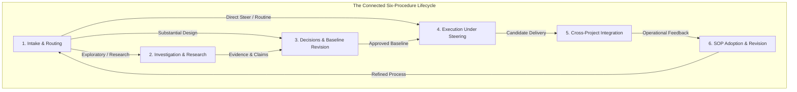
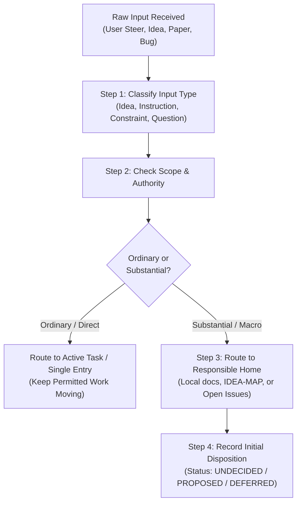
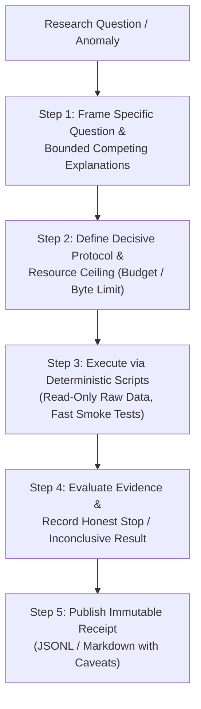
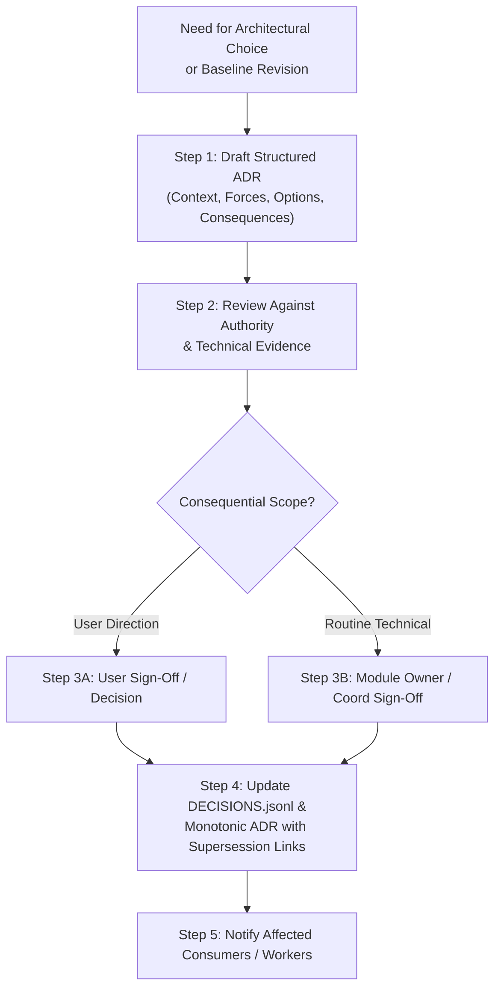
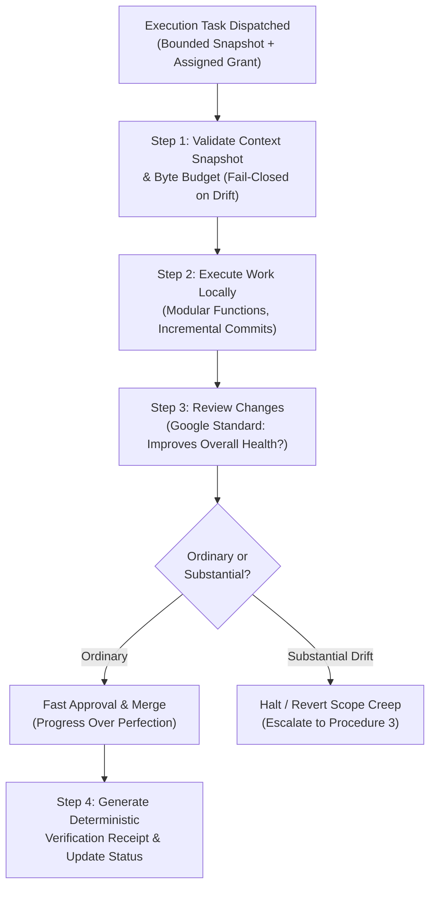
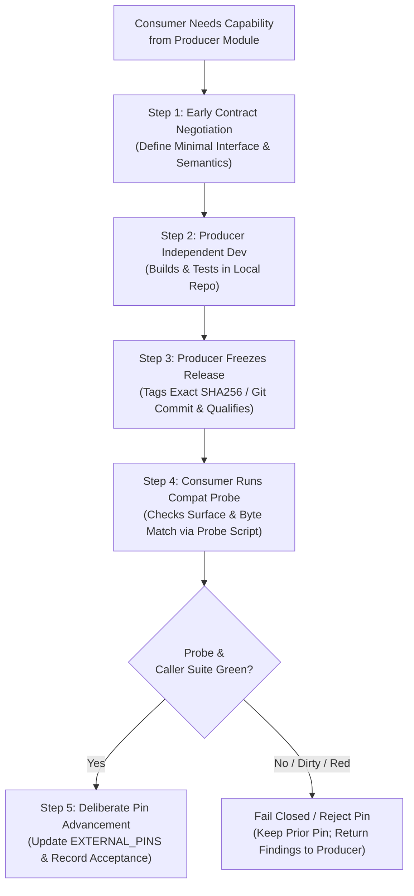
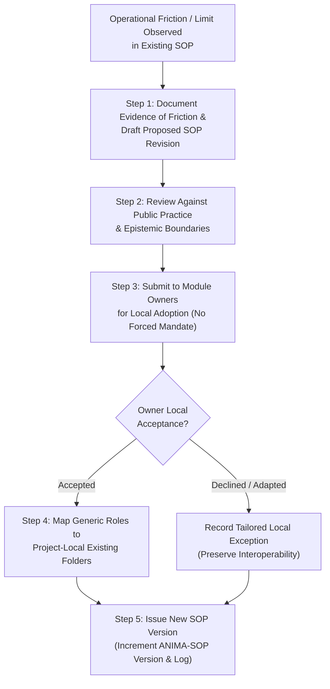

# OPERATING-PROCEDURES: Connected Engineering & Research Standard Operating Procedures

> Public curation note: links to records excluded from this public release were converted to plaintext historical references; the original record identities are preserved inline.

**Version:** ANIMA-SOP-2026-10-10-v0.1  
**Status:** Proposed for owner-local adoption  
**Document Home:** `ANIMA/architecture/proposals/2026-10-10-PERSONAL-ASSISTANT-AND-DEVELOPMENTAL-SUBSTRATE/SOPs/OPERATING-PROCEDURES.md`  
**Relative Cross-Links:**
- Suite Index & Everyday Guide: [README.md](README.md)
- Worked Reference Cases: [WORKED-CASES.md](WORKED-CASES.md)
- Primary Practice Adaptations: [SOURCE-ADAPTATIONS.md](SOURCE-ADAPTATIONS.md)
- Integrated Baseline: [2026-10-10 Context Integration](../../../../context/integrations/2026-10-10/INDEX.md)
- Canonical Decisions: ANIMA Decisions & Corrections (historical record `../../../../context/DECISIONS-AND-CORRECTIONS.jsonl`, excluded from this public release)
- Architecture Notes: [ANIMA Architecture Notes](../../../notes/)

---

## 1. Overview and Core Architectural Tenets

This document establishes the six connected Standard Operating Procedures (SOPs) governing human-directed, agent-assisted engineering, research, and architecture across ANIMA and its related independent projects (STC, SST, TRACE, TL, Substrate, Entorhinal, Reflex).

### Foundational Tenets
1. **Separation of Epistemic Status:** Every statement, note, and artifact must strictly maintain its evidentiary state:
   - `reported`: Asserted by an external source, user utterance, or unverified model output.
   - `observed`: Directly witnessed in execution output, log trace, or inspected source code.
   - `verified`: Formally checked against deterministic gates, automated tests, or cryptographic hashes.
   - `proposed`: Under architectural or technical consideration; not yet accepted.
   - `accepted`: Formally approved by the responsible authority within its explicit scope.
   - `deferred`: Recognized as a valid future idea or obligation, but deliberately unscheduled.
2. **Authority vs. Evidence:** Authority determines what changes are *permitted*; evidence determines what *appears to work*. No amount of authority can make a broken implementation functional; no amount of evidence authorizes an unapproved boundary or spending breach.
3. **Explicit Supersession Over Erasure:** Past decisions, designs, and failed experiments are never overwritten or deleted. New choices explicitly cite and supersede past choices, preserving the historical forces, alternatives, and failure lessons.
4. **Proportionate Overhead:** Routine technical work and everyday maintenance require only a single attributable record entry. Formal proposals, multi-stage investigations, and cross-project contracts are reserved for substantial boundary or semantic shifts.

---

## 2. Procedure 1: New Input, Intake, and Routing

### 1. Triggers
- Arrival of a new user conversational turn, steer, or requirement.
- Receipt of an external research paper, technical proposal, or bug report.
- Discovery of an unmodeled edge case or runtime anomaly during development.

### 2. Inputs
- Raw message, transcript excerpt, or document locator.
- Active baseline context snapshot and current project responsibility map ([RESPONSIBILITIES.md](../../../RESPONSIBILITIES.md)).
- Current open issues and decision logs (DECISIONS-AND-CORRECTIONS.jsonl (historical record `../../../../context/DECISIONS-AND-CORRECTIONS.jsonl`, excluded from this public release)).

### 3. Owner & Executor
- **Authority:** User owns intent, consequential scope, and semantic direction; Module Architect owns project-local scope; Programme Coordinator owns macro intake.
- **Executor:** Programme Coordinator, Module Architect, or active Assistant session.

### 4. Operational Steps
1. **Capture Raw Provenance:** Record the exact wording, source turn/session identifier, timestamp, and author. Never paraphrase away critical qualifiers or technical caveats.
2. **Classify Input Type:** Categorize the input into one of five functional types:
   - `DIRECT-INSTRUCTION`: Explicit command altering priorities, tasks, or execution constraints.
   - `SPECULATIVE-IDEA`: Proposed mechanism, feature, or analogy without an immediate mandate.
   - `CONSTRAINT-CHANGE`: Alteration to budget, platform, authority boundary, or security posture.
   - `INVESTIGATION-REQUEST`: Question requiring factual lookup, code inspection, or empirical testing.
   - `ROUTINE-FEEDBACK`: Clarification, bug fix, or minor stylistic guidance on active work.
3. **Scope Triage & Home Determination:** Assign the input to its responsible home:
   - *Project-Local Scope:* Pertains strictly to one module's internals (e.g., STC parser optimization, SST tree search heuristic). File under `<project>/docs/architecture/FUTURE-IDEAS.md` or local issues. Keep ANIMA macro context untouched.
   - *Cross-Project Scope:* Affects interactions between two or more modules (e.g., STC ↔ SST caller contract). File under both participating projects and index in ANIMA cross-cutting notes.
   - *Macro / World Scope:* Affects ANIMA-wide hosting, lifecycle membranes, directory structures, or global research priority bets. File under `ANIMA/context/IDEA-MAP.md` or `ANIMA/context/OPEN-ISSUES.md`.
   - *Long-Term Research / Exploratory:* Distant biological or hardware analogy. File under `ANIMA/architecture/notes/` with exploratory markers.
4. **Record Initial Disposition & Maintain Execution Velocity:**
   - Assign initial epistemic status: `UNDECIDED`, `PROPOSED`, or `DEFERRED`.
   - For routine instructions within existing grants, record a single attributable line in the session status log and continue execution immediately. Do not stall active, permitted build tasks for non-blocking speculative ideas.

### 5. Decision Criteria
- *Trivial / Routine vs. Substantial:* If the input does not alter exported interfaces, semantic guarantees, or resource limits, it is handled immediately as routine work (Google Review standard).
- *Explicit Instruction vs. Ambiguous Speculation:* Explicit current user instructions immediately supersede stale historical documentation without requiring secondary approval; ambiguous speculations or rhetorical questions are recorded as `PROPOSED` and do not authorize execution.

### 6. Record & Artifact Mapping
- Macro ideas: `ANIMA/context/IDEA-MAP.md`
- Macro open issues: `ANIMA/context/OPEN-ISSUES.md`
- Project-local ideas: `<project>/docs/architecture/FUTURE-IDEAS.md` (or existing project equivalent, e.g., `stc/docs/` or `trace-architecture/docs/`)
- Traceable decision log: `ANIMA/context/DECISIONS-AND-CORRECTIONS.jsonl`

### 7. Failure & Exception Handling
- *Ambiguous Authority:* If an input appears to conflict with prior user constraints, log an attributable entry in `OPEN-ISSUES.md`, request clarification from the User, and continue unblocked orthogonal work.
- *Input Overload:* Do not create elaborate multi-page proposals for every casual remark; maintain a lightweight single-line table entry to preserve context without bloat.

### 8. Completion Definition
- Raw input is filed in its designated repository location with full provenance, classified type, assigned owner, and explicit initial status (`UNDECIDED`, `PROPOSED`, or `DEFERRED`).

### 9. Authority Boundary
- The executor may capture, classify, and route any input, and execute direct instructions within existing grants. The executor may *not* promote speculative ideas to accepted baseline architecture or commit cross-project integration obligations without User or Module Owner approval.

---

## 3. Procedure 2: Discussion, Investigation, and Research

### 1. Triggers
- An unresolved architectural tension between competing designs.
- An observed runtime performance bottleneck, failure, or behavioral anomaly.
- A requirement to investigate public engineering practices or external technical literature.

### 2. Inputs
- Explicit research question or hypothesis.
- Read-only baseline datasets or code snapshots (following Wilson et al. raw data discipline).
- Assigned resource envelope (maximum spend, timeout, token/byte budget, or tool-call ceiling).

### 3. Owner & Executor
- **Authority:** User authorizes new external expenditures or major investigative campaigns; Coordinator defines bounded protocols; Specialist Worker executes within sandbox.
- **Executor:** Designated Research Specialist or Task Worker.

### 4. Operational Steps
1. **Frame Bounded Competing Explanations:** Formulate the core question, stating at least two plausible, competing hypotheses or trade-off alternatives rather than conducting an open-ended survey.
2. **Define Decisive Protocol & Stop Criteria:**
   - Specify the exact observation or metric that will discriminate between hypotheses.
   - Set a strict resource ceiling (e.g., maximum 10 HTTP fetches, 5 minutes execution timeout, or $0.50 budget).
   - Define explicit pivot/stop conditions (e.g., "If three consecutive fetches return no empirical data, terminate and record absence of evidence").
3. **Execute via Scripted, Reproducible Pipelines:**
   - Follow Wilson et al. good enough practices: never edit raw data; run deterministic transformation scripts (`runall.py` / `verify.sh`).
   - Implement fast build-and-smoke sample tests to verify scripts before running extensive corpora.
   - Respect working memory limits by keeping analysis functions modular (~60 lines, ≤5–6 parameters).
4. **Synthesize Findings with Calibrated Epistemic Certainty:**
   - Clearly distinguish directly observed facts from author recommendations or model extrapolations.
   - Record negative or inconclusive results with equal prominence; absence of decisive evidence is a critical finding that prevents premature commitments.
5. **Publish Immutable Evidence Receipt:** File findings with exact command lines, input hashes, raw outputs, and documented uncertainties.

### 5. Decision Criteria
- *Decisiveness Threshold:* An investigation is complete when the empirical observation clearly supports one hypothesis over competitors, or when the resource ceiling is reached and inconclusive status is declared.
- *No Forced Consensus:* If evidence is ambiguous, the outcome is recorded as `INCONCLUSIVE`, preserving both alternatives.

### 6. Record & Artifact Mapping
- Research reports: `ANIMA/architecture/research/<date>-<topic>/` or `<project>/docs/research/`
- Evidence receipts: `EVIDENCE.md`, `LIMITS.md`, or machine-checkable JSONL test summaries.
- Architecture synthesis: `SYNTHESIS.md` containing recommended adaptations, costs, and rejected alternatives.

### 7. Failure & Exception Handling
- *Tool or Network Failure:* Log the exact error, HTTP status, or stack trace; do not fabricate or reconstruct missing data from ungrounded memory.
- *Resource Budget Exhaustion:* Immediately halt execution, record the partial frontier reached, and escalate to the Coordinator with a pivot recommendation.

### 8. Completion Definition
- A structured report is published containing: the original question, competing explanations, exact method/protocol, observed evidence, limitations, and an explicit conclusion (`SUPPORTED`, `REFUTED`, or `INCONCLUSIVE`).

### 9. Authority Boundary
- Research workers produce evidence and recommendations; they do *not* possess authority to adopt findings as canonical architecture, modify project baselines, or alter module contracts.

---

## 4. Procedure 3: Decisions and Baseline Revision

### 1. Triggers
- Resolution of an architectural investigation or research synthesis.
- Need to establish a new module boundary, interface contract, or technology selection.
- Need to revise or supersede a prior architectural baseline.

### 2. Inputs
- Synthesis of options, trade-offs, and supporting evidence receipts.
- Existing decision log (DECISIONS-AND-CORRECTIONS.jsonl (historical record `../../../../context/DECISIONS-AND-CORRECTIONS.jsonl`, excluded from this public release)) and relevant ADRs.
- Prior superseded ADRs and historical context.

### 3. Owner & Executor
- **Authority:** User owns consequential decisions (major boundaries, semantics, spend, tooling paradigms); Module Architect owns local component design; Programme Coordinator owns macro integration baseline.
- **Executor:** Module Architect or Macro Coordinator.

### 4. Operational Steps
1. **Draft Structured Architecture Decision Record (ADR):** Follow Nygard ADR structure:
   - `Title`: Monotonically numbered noun phrase (e.g., `ADR-012: Adopt SQLite Event Store for SST`).
   - `Context`: Value-neutral articulation of the technical, economic, and operational forces in tension.
   - `Options Considered`: Enumerate viable alternatives and why they were rejected.
   - `Decision`: Active-voice statement of the selected choice.
   - `Status`: Explicit marker (`PROPOSED`, `ACCEPTED`, `DEPRECATED`, `SUPERSEDED`).
   - `Consequences`: Realistic summary of positive gains, negative burdens, and neutral obligations.
2. **Establish Explicit Supersession Chains:** If modifying a prior decision:
   - Mark the prior ADR status as `SUPERSEDED BY ADR-YYY`.
   - In the new ADR, include `SUPERSEDES ADR-XXX` and explicitly explain what new evidence, requirements, or constraints justified the change.
   - Never overwrite or erase the historical ADR file.
3. **Obtain Authoritative Sign-Off:**
   - If the decision involves consequential semantics, resource posture, or global architecture, submit the proposal to the User for explicit acceptance.
   - If the decision is routine technical design within an established grant, sign off locally as Module Architect or Coordinator.
4. **Commit to Immutable Decision Registers:**
   - Commit the Markdown ADR under `<project>/docs/architecture/` or `ANIMA/architecture/decisions/`.
   - Append a structured entry to `ANIMA/context/DECISIONS-AND-CORRECTIONS.jsonl` containing `id`, `date`, `decision`, `supersedes`, `rationale`, `scope`, and `authority`.
5. **Issue Downstream Task Handoffs:** Update active worker context snapshots and communicate baseline revisions to affected sessions.

### 5. Decision Criteria
- *Evidence vs. Preference:* Decisions must be justified by demonstrable technical facts, benchmark data, or explicit user directives rather than speculative aesthetic preferences.
- *Separation of Accepted vs. Implemented:* Marking an ADR as `ACCEPTED` establishes architectural policy; it does not imply that the feature is built, tested, or ready for production reliance.

### 6. Record & Artifact Mapping
- Global decision ledger: `ANIMA/context/DECISIONS-AND-CORRECTIONS.jsonl`
- Narrative decision records: `ANIMA/architecture/decisions/ADR-NNN.md` or `<project>/docs/architecture/DECISIONS.md`
- Module directives: `ANIMA/architecture/templates/MODULE-ARCHITECTURE-DIRECTIVE.md`

### 7. Failure & Exception Handling
- *Contested Baseline / Ambiguity:* If workers or sub-teams identify unforeseen blockers in an accepted ADR, the decision is flagged as `UNDER-REVIEW` in `OPEN-ISSUES.md` without silently reverting the baseline in code.

### 8. Completion Definition
- A numbered ADR is committed, linked bi-directionally to any superseded past records, entered into the append-only JSONL register, and communicated to affected executors.

### 9. Authority Boundary
- The Coordinator and Module Architects may draft proposals and approve routine local technical decisions. Only the User can authorize consequential semantic shifts, global platform migrations, or new spending limits.

---

## 5. Procedure 4: Execution Under Steering

### 1. Triggers
- Dispatch of an authorized development, refactoring, or documentation task.
- Mid-task steering guidance or course correction received from the User.

### 2. Inputs
- Assigned task packet, explicit goal statement, and acceptance criteria.
- Compiled, byte-budgeted context snapshot (`workspace.json` / `workspace_context.py`).
- Active codebase baseline and local execution sandbox.

### 3. Owner & Executor
- **Authority:** Module Owner or Programme Coordinator holds operational custody; Worker operates under delegated execution grant.
- **Executor:** Task Worker or Assistant session.

### 4. Operational Steps
1. **Pre-Flight Snapshot & Boundary Verification:**
   - Verify that the local context snapshot does not exceed the designated UTF-8 byte budget (e.g., 60,000 bytes Markdown / 150,000 bytes JSON context ceiling).
   - Ensure the snapshot reflects the latest accepted baseline; fail closed if workspace drift or uncommitted conflicting edits are detected.
2. **Incremental, Modular Implementation:**
   - Adhere to Wilson et al. modularity guidelines: short functions (~60 lines, ≤5–6 arguments), clear variable naming, no dead/commented-out blocks.
   - Maintain strict separation of concerns: do not modify out-of-scope files or alter cross-module interfaces during an internal implementation task.
3. **Proportionate Change Review (The Google Standard):**
   - Review all proposed changes against the core standard: *Does this Change List definitely improve the overall health of the system?*
   - Favor steady forward progress over pedantic perfection. Approve improvements that pass tests and improve maintainability even if minor non-blocking optimizations remain possible.
   - Differentiate blocking maintainability/correctness defects from non-blocking suggestions (label suggestions as optional "Nits").
4. **Enforce the Ordinary vs. Substantial Boundary:**
   - *Ordinary Changes (Proceed Immediately):* Internal refactoring, performance tuning, bug fixes, test expansions, documentation updates.
   - *Substantial Scope Creep (Halt & Escalate):* If the implementation requires altering an exported contract, adding external dependencies, or breaking backward compatibility, halt execution and route back to Procedure 3 (Decisions).
5. **Deterministic Verification & Receipt Generation:**
   - Run local build, lint, type checks, and smoke test suites.
   - Generate immutable test receipts and update the active task status in the project ledger.

### 5. Decision Criteria
- *Approval Rule:* Changes are approved if they meet functional acceptance criteria, pass all automated checks, and improve overall system health without introducing regressions.
- *Zero Unauthorized Scope Expansion:* Workers are strictly prohibited from implementing unapproved speculative features or altering global contracts under the guise of routine execution.

### 6. Record & Artifact Mapping
- Progress logs: `ANIMA/progress_logs/<date>-<task>.md` or `<project>/docs/progress_logs/`
- Local ledgers: `<project>/coordination/STATUS.md` and `LEDGER.md`
- Verification receipts: `results/receipts/` or test output logs.

### 7. Failure & Exception Handling
- *Test Failure / Build Break:* Revert uncommitted changes immediately to the last known good commit; diagnose failure using deterministic logs; do not attempt blind trial-and-error edits in a dirty tree.
- *Mid-Task User Steer:* If the User issues a steer mid-build, pause execution, apply Procedure 1 (Intake), update task objectives, and resume work without discarding valid orthogonal progress.

### 8. Completion Definition
- Implementation satisfies task acceptance criteria, passes automated verification gates, generates clean diffs, and publishes an attributable completion status entry.

### 9. Authority Boundary
- Workers are authorized to write, refactor, and test code within their assigned module and task scope. Workers may *not* advance consumer pins, publish breaking API changes, or accept their own work across trust boundaries.

---

## 6. Procedure 5: Cross-Project Cooperation and Integration

### 1. Triggers
- A consumer module requires a functional capability or data service from an independent producer module (e.g., STC consuming SST search, TRACE consuming TL context).
- A producer module publishes a new candidate release and requests consumer qualification.

### 2. Inputs
- Published producer release manifest and exact frozen commit hash (no mutable paths or floating branches).
- Versioned consumer caller contract (e.g., `STC-SST-CALLER-CONTRACT.md` or `CONTEXT-CONTRACT.md`).
- Consumer automated compatibility probe script (e.g., `sst_compat_probe.py`).

### 3. Owner & Executor
- **Authority:** Producer Module Owner owns internal implementation and standalone release qualification; Consumer Module Owner owns consumer pin selection and integration acceptance.
- **Executor:** Integration Coordinator or Consumer Task Runner.

### 4. Operational Steps
1. **Agree Minimal Contracts Early:**
   - Before implementation begins, negotiate a compact, versioned export contract specifying: observable capabilities, input/output schemas, ordering semantics, error/cancellation behaviors, and resource limits.
   - A contract proposal is an agreed design; it is *not* a qualified release.
2. **Maintain Producer Autonomy & Independent Delivery:**
   - The producer builds and tests its release independently within its own repository.
   - The producer qualifies its standalone release against its own unit and functional requirements, publishing a formal release record with exact commit hashes, test receipts, and explicit exclusions.
3. **Publish Frozen Release Identity (No Floating Latest):**
   - The producer freezes an immutable release artifact (Git commit SHA, content-addressed snapshot hash, dependency lockfile).
   - Consumers strictly forbid tracking `latest`, floating branch names (`main`/`HEAD`), or mutable working directories.
4. **Consumer Pre-Integration Probe & Integrity Verification:**
   - The consumer executes an automated compatibility probe against the offered producer release (e.g., `sst_compat_probe.py --sst-root <path>`).
   - The probe enforces spot-file byte integrity against the exact offered pin (fails closed if the tree is `DIRTY`, `MISSING-SURFACE`, or `NO-GIT`).
5. **Caller-Side Integration Qualification & Deliberate Pinning:**
   - The consumer executes its own end-to-end caller suite (e.g., `DialecticRunner` against pristine SST pin) using its own domain evaluators and custody wrappers.
   - If green: the consumer deliberately advances its pin record (e.g., `EXTERNAL_PINS["sst"] = "<sha>"`), updates its contract revision log, and marks integration accepted.
   - If red or dirty: the consumer fails closed, retains the prior stable pin, and returns detailed defect findings to the producer.
   - Existing running instances retain their starting pins (no implicit migration of active runs).

### 5. Decision Criteria
- *Fail-Closed Rule:* A consumer never consumes a dirty, unpinned, or unverified producer tree.
- *Independence of Optional Participants:* Optional modules may remain unintegrated or decline integration without blocking either the producer's standalone release or the consumer's fallback execution.
- *Source Availability vs. Qualification:* The fact that code exists in a producer repository does not constitute a qualified, consumable release.

### 6. Record & Artifact Mapping
- Consumer contracts: `<consumer>/docs/<CONSUMER>-<PRODUCER>-CALLER-CONTRACT.md`
- Producer releases: `<producer>/docs/<PRODUCER>-RELEASE.md` or `ANIMA/catalogue/releases/`
- Consumer pin registries: `ANIMA/catalogue/pins/` or consumer codebase constants (`lease_git.EXTERNAL_PINS`).
- Global module catalogue: `ANIMA/catalogue/MODULES.json`

### 7. Failure & Exception Handling
- *Surface Incompatibility:* If the producer breaks an exported method signature, the consumer probe flags `MISSING-SURFACE`, blocking pin advancement.
- *Producer Schedule Delay:* The consumer proceeds using its existing pinned release or mock fallback; parallel development continues unhindered.

### 8. Completion Definition
- A frozen producer commit is verified by consumer probe scripts, successfully passes the consumer's caller test suite, and is deliberately recorded in the consumer's pinned configuration with an explicit dated entry.

### 9. Authority Boundary
- The Producer Owner cannot force a consumer to upgrade or accept a release. The Consumer Owner cannot modify producer code or dictate internal implementation choices. Cross-project integration occurs solely through agreed, frozen contracts.

---

## 7. Procedure 6: SOP Adoption and Revision

### 1. Triggers
- Observed operational friction, excessive administrative drag, or coordination failure when applying an existing SOP.
- Identification of new, superior public engineering or scientific computing practices.
- Creation of a new independent project requiring process onboarding.

### 2. Inputs
- Documented friction log or comparative practice evaluation ([SOURCE-ADAPTATIONS.md](SOURCE-ADAPTATIONS.md)).
- Current SOP suite baseline (`ANIMA-SOP-2026-10-10-v0.1`).
- Owning project directory structures and local governance preferences.

### 3. Owner & Executor
- **Authority:** User authorizes global process shifts; Project / Module Owners authorize local adoption within their repositories; Macro Coordinator authors proposed revisions.
- **Executor:** Programme Coordinator or Process Author.

### 4. Operational Steps
1. **Document Concrete Friction & Empirical Rationale:**
   - Articulate the specific inefficiency, failure mode, or ambiguity observed in active workflows.
   - Ground proposed changes in primary practice evidence (e.g., Nygard, Rust, Google, Wilson et al.) while respecting small-team scaling constraints.
2. **Draft Proposed SOP Revision with Explicit Versioning:**
   - Author proposed revisions under `ANIMA/architecture/proposals/` using explicit semantic versioning (e.g., `ANIMA-SOP-2026-10-10-v0.2`).
   - Highlight exact diffs, added clauses, removed overhead, and anticipated consequences.
3. **Submit for Owner-Local Adoption (No Centralized Coercion):**
   - Distribute the proposed SOP to individual project owners (STC, SST, TRACE, TL, Substrate) as an informing proposal.
   - Respect project autonomy: project owners adopt, adapt, or reject the proposal according to their local needs. A shared SOP is an agreement, not developmental runtime machinery.
4. **Map Generic Record Roles to Project-Local Directories:**
   - When adopting, owners map the six generic record roles onto their existing folder structures rather than creating redundant duplicate files:
     - `Architecture Entry` → `<project>/docs/architecture/README.md` or `START_HERE.md`
     - `Discussions` → `<project>/docs/architecture/DISCUSSIONS.md` or `notes/`
     - `Decisions` → `<project>/docs/architecture/DECISIONS.md` or `ADR-NNN.md`
     - `Future Ideas` → `<project>/docs/architecture/FUTURE-IDEAS.md`
     - `Contracts` → `<project>/docs/<MODULE>-CONTRACT.md`
     - `Releases & Pins` → `<project>/docs/RELEASE.md` or `EXTERNAL_PINS`
5. **Publish Consolidated SOP Suite & Update Index:**
   - Record adoption status across projects in `ANIMA/catalogue/MODULES.json` or coordination status reports.

### 5. Decision Criteria
- *Coordination Value vs. Overhead:* An SOP revision is adopted only if it demonstrably reduces confusion, prevents unverified breakage, or speeds up safe execution. If an SOP adds pure clerical friction without safety benefits, it is pruned.
- *Local Autonomy:* A project owner holds sovereign authority over its internal folder organization and local development habits, provided cross-project contract and release obligations are satisfied.

### 6. Record & Artifact Mapping
- SOP suite home: `ANIMA/architecture/proposals/2026-10-10-PERSONAL-ASSISTANT-AND-DEVELOPMENTAL-SUBSTRATE/SOPs/`
- Comparative practice evidence: `SOURCE-ADAPTATIONS.md`
- Local project mapping records: `<project>/docs/architecture/README.md`

### 7. Failure & Exception Handling
- *Project Non-Adoption:* If a project declines a new SOP revision, it continues operating under its previously accepted local procedures. The Coordinator notes the divergence in the integration matrix and maintains contract compatibility.

### 8. Completion Definition
- A versioned SOP document is published, reviewed by project owners, locally mapped into participating project directories, and indexed in the macro architecture registry.

### 9. Authority Boundary
- The process author may author and propose SOP revisions. Only the User and responsible Module Owners can adopt and enforce procedures within their respective domains.
