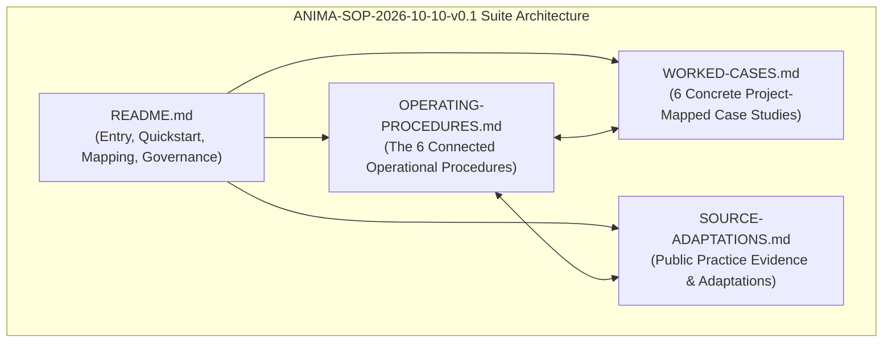

# ANIMA Shared Standard Operating Procedures (SOPs)

> Public curation note: links to records excluded from this public release were converted to plaintext historical references; the original record identities are preserved inline.

**Version:** ANIMA-SOP-2026-10-10-v0.1  
**Status:** Proposed for owner-local adoption  
**Document Home:** `ANIMA/architecture/proposals/2026-10-10-PERSONAL-ASSISTANT-AND-DEVELOPMENTAL-SUBSTRATE/SOPs/README.md`  
**Issuance Date:** 2026-10-10  
**Authority Reference:** `campaign/AUTHORIZATION.md`

---

## 1. Executive Summary & Suite Navigation

This directory contains the connected Standard Operating Procedures (SOPs) for idea intake, research investigation, architectural decision-making, execution steering, cross-project integration, and process governance across the ANIMA programme and its associated independent projects (STC, SST, TRACE, TL, Substrate, Entorhinal, Reflex).



### Document Navigation Map

| Document | Primary Role & Contents | Target Audience |
|---|---|---|
| **[README.md](README.md)** (This File) | Entry point, short everyday paths, suite navigation, project record mappings, adoption boundary, and source audit. | All Engineers, Architects, and Coordinators |
| **[OPERATING-PROCEDURES.md](OPERATING-PROCEDURES.md)** | Complete, connected 6-procedure specifications (Intake, Research, Decisions, Execution, Integration, Governance) with full 9-point criteria. | Executing Agents, Task Runners, Module Owners |
| **[WORKED-CASES.md](WORKED-CASES.md)** | Six concrete worked reference cases tracing actual ecosystem records, contracts, and exception flows across STC, SST, TRACE, TL, Substrate. | Implementers, Integrators, Reviewers |
| **[SOURCE-ADAPTATIONS.md](SOURCE-ADAPTATIONS.md)** | Empirical analysis of 5 primary public practices (Nygard ADRs, Rust RFCs, Google Review, Kubernetes KEPs, Wilson et al. PLOS) with reuse/change/reject matrices. | Process Architects, Researchers |

### Context & Integration Links
All relative links resolve from the final proposal home:
- **Source Integration Index:** [2026-10-10 Context Integration](../../../../context/integrations/2026-10-10/INDEX.md)
- **Current ANIMA Architecture Notes:** [ANIMA Notes Directory](../../../notes/)
- **Responsibility & Delivery Policies:** [RESPONSIBILITIES.md](../../../RESPONSIBILITIES.md) | [MODULE-DELIVERY.md](../../../MODULE-DELIVERY.md)
- **Canonical Decision Register:** DECISIONS-AND-CORRECTIONS.jsonl (historical record `../../../../context/DECISIONS-AND-CORRECTIONS.jsonl`, excluded from this public release)
- **Global Module Catalogue:** [MODULES.json](../../../../catalogue/MODULES.json)

---

## 2. The Short Everyday Path (Quickstart)

For 90% of daily activities, follow these rapid, low-friction rules:

```text
+---------------------------------------------------------------------------------------------------------+
|                                        THE EVERYDAY WORKFLOW RULES                                      |
+---------------------+-----------------------------------------------------------------------------------+
| 1. Receiving Input  | - Direct instruction from User? Execute immediately within grant; log status.     |
|                     | - Speculative idea / analogy? File single-line entry in local FUTURE-IDEAS.md.    |
|                     | - Never stall active permitted builds for unvetted suggestions.                   |
+---------------------+-----------------------------------------------------------------------------------+
| 2. Writing Code     | - Keep functions modular (~60 lines, <=5-6 params; Miller's limit).               |
|                     | - Pass local unit/smoke tests in seconds.                                         |
|                     | - If it improves overall system health without regressions, merge it!             |
+---------------------+-----------------------------------------------------------------------------------+
| 3. Making Decisions | - Routine technical choice? Single attributable entry in local ledger.            |
|                     | - Substantial boundary/contract shift? Write short ADR; link superseded record.   |
|                     | - Consequential semantics, spend, or platform change? Escalate to User.           |
+---------------------+-----------------------------------------------------------------------------------+
| 4. Researching      | - Define explicit question + competing hypotheses + strict resource ceiling.     |
|                     | - Keep raw data read-only; use deterministic scripts; retain negative results.   |
+---------------------+-----------------------------------------------------------------------------------+
| 5. Integrating      | - Agree contracts early; never track unpinned 'latest' or dirty working trees.    |
|                     | - Consumer verifies offered frozen release commit via probe script before pin.    |
+---------------------+-----------------------------------------------------------------------------------+
```

---

## 3. Adoption, Authority, and Issuance Boundary

> [!IMPORTANT]
> **Adoption & Issuance Statement:**  
> This documentation suite (`ANIMA-SOP-2026-10-10-v0.1`) is issued as an architectural **proposal for owner-local adoption**.  
> The Macro Coordinator owns canonical documentary integration and proposal synthesis. Individual project and module owners (STC, SST, TRACE, TL, Substrate, Entorhinal, Reflex) retain sovereign ownership over their repositories, internal implementations, and local workflow adoption.  
> This document does *not* assert unilateral delivery, automatic adoption, or centralized administrative control over independent projects.

### The Authority Hierarchy
1. **The User:** Holds exclusive authority over operative objectives, semantic direction, consequential architecture choices, spending budgets, and security/membrane boundaries. Explicit current instructions supersede stale documentation immediately without requiring secondary approvals.
2. **Module / Project Owners:** Own local module architecture, internal design, release qualification, and local SOP adoption.
3. **The Programme Coordinator:** Owns active programme DAGs, cross-project contract reconciliation, macro intake, and documentary baseline integration.
4. **Task Workers / Agents:** Execute bounded tasks within delegated grants, producing deterministic verification receipts.

---

## 4. Project-Local Mapping Expectations

Rather than mandating duplicate administrative directories, project owners map the six generic record roles onto their existing folder conventions:

```mermaid
flowchart LR
    subgraph Generic["Generic SOP Record Roles"]
        G1["Architecture Entry"]
        G2["Discussion Notes"]
        G3["Decisions & ADRs"]
        G4["Future Ideas"]
        G5["Integration Contracts"]
        G6["Releases & Pins"]
    end

    subgraph Projects["Project-Specific Existing Mappings"]
        P_STC["STC: docs/STC-DSH-RECORD.md, STC-SST-CALLER-CONTRACT.md"]
        P_SST["SST: docs/01_PLAN_BROAD_STROKES.md, STC-HANDOFF.md"]
        P_TRACE["TRACE: docs/CONTEXT-CONTRACT.md, FILING-POLICY.md"]
        P_TL["TL: candidate-batch / sys manifests"]
        P_SUB["Substrate: docs/ARCHITECTURE.md, CONTRACTS.md"]
    end

    Generic -.-> Projects
```



### Concrete Project Mapping Guide

| Generic Record Role | Standard Role Description | STC Mapping | SST Mapping | TRACE / TL Mapping | Substrate Mapping |
|---|---|---|---|---|---|
| **Architecture Entry** | Current design, reading routes, responsibilities | `stc/README.md` | `sst/README.md` | `projects/trace-architecture/START_HERE.md` | `projects/substrate/docs/ARCHITECTURE.md` |
| **Discussion Notes** | Attributable notes, trade-offs, research | `stc/docs/` | `sst/docs/` | `projects/trace-architecture/docs/` | `projects/substrate/CANONICAL-RECORD.md` |
| **Decisions (ADRs)** | Accepted choices, reasons, supersessions | `stc/docs/` (ADRs) | `sst/docs/` (ADRs) | `projects/trace-architecture/docs/` | `projects/substrate/docs/` |
| **Future Ideas** | Unscheduled possibilities, evidence triggers | `stc/docs/FUTURE-IDEAS.md` | `sst/docs/01_PLAN_BROAD_STROKES.md` | `projects/trace-architecture/docs/` | `projects/substrate/docs/ROADMAP.md` |
| **Contracts** | Exported promises, schemas, calling conventions | `stc/docs/STC-SST-CALLER-CONTRACT.md` | `sst/docs/03_DATA_CONTRACTS.md` | `projects/trace-architecture/docs/CONTEXT-CONTRACT.md` | `projects/substrate/docs/CONTRACTS.md` |
| **Releases & Pins** | Frozen commit identities, probe scripts, pins | `stc/docs/STC-DSH-RELEASE.md` (`EXTERNAL_PINS`) | `sst/docs/STC-HANDOFF.md` | `projects/trace-architecture/docs/SOURCE-LAYOUT.md` | `projects/substrate/docs/CONSUMER.md` |

---

## 5. Actual Source Reading and Known Uncertainties

### 5.1. Inspected Public Sources Audit
The SOP suite was grounded directly in the inspected evidence from five primary public practice sources (see [SOURCE-ADAPTATIONS.md](SOURCE-ADAPTATIONS.md)):
1. **Michael Nygard (2011):** *Documenting Architecture Decisions* (ADRs).
2. **Rust Language Project (2026-10-10):** *Rust RFCs README & Governance*.
3. **Google Engineering Practices (2026-10-10):** *The Standard of Code Review*.
4. **Kubernetes Project (2026-10-10):** *Kubernetes Enhancement Proposals (KEPs)*.
5. **Greg Wilson et al. (2017):** *Good Enough Practices in Scientific Computing* (PLOS Comput Biol).

### 5.2. Documented Uncertainties & Operating Limits
- **Scale Asymmetry:** Public practices from Google, Rust, and Kubernetes reflect multi-thousand-person environments; they have been scaled down here to eliminate multi-tier committee drag.
- **Empirical Absence:** None of the public sources provide randomized controlled trials demonstrating superior software outcomes; their advice is adapted as structured practitioner heuristics.
- **Runtime Plasticity Boundary:** These SOPs govern human and agent engineering workflows; they do *not* constitute runtime developmental machinery inside the substrate.
