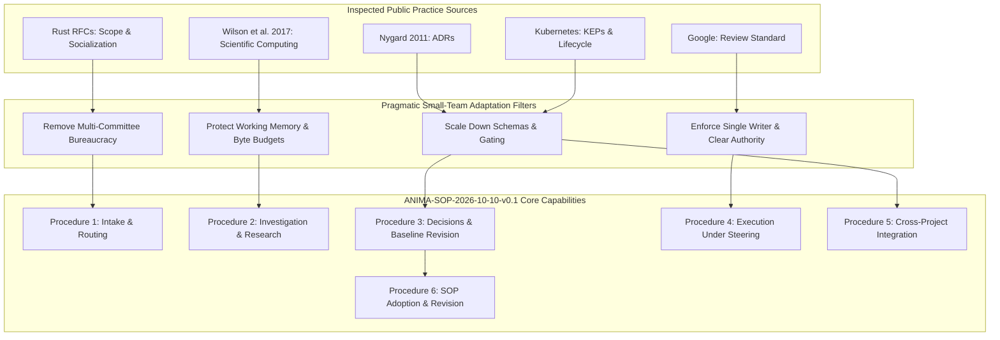

# SOURCE-ADAPTATIONS: Public Practice Evidence, Adaptations, and Evidentiary Limits

**Version:** ANIMA-SOP-2026-10-10-v0.1  
**Status:** Proposed for owner-local adoption  
**Document Home:** `ANIMA/architecture/proposals/2026-10-10-PERSONAL-ASSISTANT-AND-DEVELOPMENTAL-SUBSTRATE/SOPs/SOURCE-ADAPTATIONS.md`  
**Relative Cross-Links:**
- Suite Index: [README.md](README.md)
- Core Procedures: [OPERATING-PROCEDURES.md](OPERATING-PROCEDURES.md)
- Worked Scenarios: [WORKED-CASES.md](WORKED-CASES.md)
- Integrated Context: [2026-10-10 Context Integration](../../../../context/integrations/2026-10-10/INDEX.md)
- Architecture Notes: [ANIMA Architecture Notes](../../../notes/)

---

## 1. Executive Summary & Epistemic Framework

This document records the empirical extraction, critical evaluation, and pragmatic adaptation of five primary public engineering and research practices into the ANIMA Standard Operating Procedures suite (`ANIMA-SOP-2026-10-10-v0.1`).

### Epistemic Distinctions and Factuality Rule
In accordance with ANIMA documentary standards, this document enforces strict boundaries between:
1. **Observed Source Evidence:** What is directly asserted in inspected primary source texts.
2. **Practitioner / Organizational Guidance:** Normative consensus, rules of thumb, and corporate standards that describe recommended habits but lack formal randomized controlled proof.
3. **Empirically Proven Claims:** Results established through controlled, statistically verified experiments.
4. **Architectural Adaptations:** Deliberate modifications made to scale down practices from hyper-scaled enterprises or massive open-source communities to a high-velocity, small-team, human-directed, agent-assisted programme.

> [!IMPORTANT]
> None of the five public sources inspected provide randomized controlled trials or mathematical proofs of superior productivity. They represent codified experience reports, open-source governance constitutions, corporate engineering standards, and community pedagogical consensus. Their recommendations are adapted for structural suitability, not treated as infallible empirical truths.

---

## 2. Primary Source Inspection Inventory

The public research phase inspected five primary sources via bounded public access (verified on the 2026-10-10 access frontier).

| Source ID | Author / Organization | Resource Title & Canonical Locator | Date / Version Frontier | Primary Document Type | Inspected Scope & Sections |
|---|---|---|---|---|---|
| **SRC-1** | Michael Nygard (Cognitect) | *Documenting Architecture Decisions*<br>`https://cognitect.com/blog/2011/11/15/documenting-architecture-decisions` | 2011-11-15 | Practitioner Experience Report & Pattern Definition | Full text: Problem statement, Decision Record structure (Title, Context, Decision, Status, Consequences), Experience report on agile teams. |
| **SRC-2** | Rust Language Project | *Rust RFCs Repository README*<br>`https://raw.githubusercontent.com/rust-lang/rfcs/master/README.md` | Master branch snapshot (2026-10-10) | Open-Source Governance Specification | Sections: When to follow process, Sub-team ownership, Before creating an RFC (socialization), The RFC process lifecycle, Tracking issues, Implementation. |
| **SRC-3** | Google Engineering Practices | *The Standard of Code Review*<br>`https://raw.githubusercontent.com/google/eng-practices/master/review/reviewer/standard.md` | Master branch snapshot (2026-10-10) | Corporate Engineering Guidelines | Core standard ("improves overall code health"), Mentoring vs. Blocking, Technical facts and data over personal opinion, Resolving conflict. |
| **SRC-4** | Kubernetes Project | *Kubernetes Enhancement Proposals (KEPs) README*<br>`https://raw.githubusercontent.com/kubernetes/enhancements/master/keps/README.md` | Master branch snapshot (2026-10-10) | Multi-Stakeholder Governance Charter | Quick start, Sponsoring SIG socialization, Motivation for KEPs, Substantial change threshold, Relationship to GitHub issues/PRs. |
| **SRC-5** | Greg Wilson, Jennifer Bryan, Karen Cranston, Justin Kitzes, Lex Nederbragt, Tracy K. Teal | *Good Enough Practices in Scientific Computing*<br>`https://journals.plos.org/ploscompbiol/article?id=10.1371/journal.pcbi.1005510`<br>(PLOS Comput Biol 13(6): e1005510) | 2017-06-22<br>(DOI: 10.1371/journal.pcbi.1005510) | Peer-Reviewed Community Practice Guide / Perspective | Full paper: Box 1 (Summary), Data Management (§1), Software Design & Modularization (§2), Collaboration (§3), Project Layout (§4), What We Left Out (§9). |

---

## 3. Systematic Source-by-Source Evaluation & Adaptation

### 3.1. Michael Nygard: Architecture Decision Records (SRC-1)

#### Supporting Observation & Observed Evidence
Nygard observes that in active software projects, architectural context decays rapidly as teams rotate or time passes. This causes two complementary pathologies:
1. *Blind acceptance:* Maintaining legacy constraints whose original rationale no longer applies.
2. *Blind reversal:* Overturning past decisions without understanding the historical forces that motivated them, re-introducing previously resolved bugs or bottlenecks.

Nygard proposes storing short (1–2 page) text files under version control (`doc/arch/adr-NNN.md`) using monotonic numbering. The mandatory structure consists of:
- **Title:** Short noun phrase with sequential index.
- **Context:** Value-neutral statement of the forces in tension (technical, business, social).
- **Decision:** Active-voice statement of the chosen direction.
- **Status:** Explicit lifecycle marker (`proposed`, `accepted`, `deprecated`, `superseded`).
- **Consequences:** Balanced statement of positive, negative, and neutral context resulting from the choice.
- **Supersession Chain:** When a decision is changed, the old ADR is never edited or deleted; its status is updated to `superseded by ADR-YYY`, and the new ADR references `supersedes ADR-XXX`.

#### What We Reuse
- **Monotonically numbered, repo-local Markdown ADRs:** Retain short, plain-text records stored alongside the code (e.g., `docs/architecture/DECISIONS.md` or `docs/decisions/ADR-NNN.md`).
- **Immutable historical record:** Past decisions are never deleted; historical rationale is permanently preserved.
- **Explicit supersession pointers:** Bi-directional linking between replaced and replacement records.
- **Value-neutral context:** Articulating forces in tension rather than one-sided advocacy.

#### What We Change
- **Format Flexibility:** In addition to narrative Markdown ADRs, ANIMA supports structured append-only JSONL registers (`DECISIONS-AND-CORRECTIONS.jsonl`) to allow rapid programmatic auditing, filtering, and tooling integration.
- **Single-Turn Decision Logging:** For routine technical decisions within an established grant, a single attributable entry in a project ledger or status log suffices, avoiding file-creation overhead for trivial choices.

#### What We Omit / Reject
- **Heavyweight Tooling Mandates:** Omit specialized ADR CLI generators or rigid template linters that add friction without improving clarity.
- **Static Documentation Silos:** Reject unversioned wikis, shared drives, or external issue-tracker state that drift out of sync with repository branches.

#### Fit Limits & Operational Conditions
- *Context Ceiling:* ADRs document architectural choices, not daily task management, sprint backlogs, or temporary scratch exploration.
- *Status Distinction:* An ADR marked `accepted` records design consensus; it does not grant spending authority, schedule developer time, or certify implementation correctness.

---

### 3.2. Rust Language Project: RFC Process (SRC-2)

#### Supporting Observation & Observed Evidence
The Rust RFC process establishes a predictable pipeline for evolving a complex ecosystem:
1. *Pre-proposal Socialization:* Discourages opening hasty RFC PRs. Authors must seek informal feedback on Zulip or discussion forums to ascertain desirability and identify known blockers before authoring.
2. *Ordinary Changes vs. Substantial Proposals:* Explicitly categorizes work:
   - *Ordinary (Direct PR):* Bug fixes, refactoring ("changing structure without changing meaning"), documentation improvements, performance optimizations.
   - *Substantial (RFC Required):* New language syntax/semantics, standard library additions/deprecations, breaking API changes, major tooling capabilities.
3. *Sub-team Stewardship:* Specific sub-teams (e.g., compiler, libs, lang) own triage, shepherd assignment, and consensus-building.
4. *Separation of Acceptance and Implementation:* Merging an RFC moves it to `active` state (design approved); implementation is tracked separately via Tracking Issues and implemented across multiple independent PRs.

#### What We Reuse
- **Ordinary vs. Substantial Boundary:** Foundational heuristic in ANIMA SOPs. Routine refactoring, performance tuning, and internal fixes proceed immediately without proposal friction; cross-module contract changes or semantic shifts require structured proposals.
- **Informal Pre-Proposal Socialization:** Routing raw ideas to lightweight scratch notes or discussion channels before writing formal architecture directives.
- **Separation of Design Acceptance from Execution:** Explicitly decoupling architectural agreement from task scheduling and resource allocation.

#### What We Change
- **Elimination of Multi-Week Waiting Periods:** Rust's mandatory 10-day Final Comment Period (FCP) is designed for a global open-source community of thousands. For a focused agent-assisted programme, FCP is replaced with direct User/Architect sign-off.
- **Direct Owner Stewardship:** Replace distributed sub-team consensus with the designated Module Owner / Architect.

#### What We Omit / Reject
- **Multi-layered Committee Bureaucracy:** Reject formal sub-team quorum rules, community voting rosters, and procedural RFC shepherding overhead for internal module development.
- **Speculative Implementation Blocking:** Reject the anti-pattern of blocking all exploratory coding until a complete multi-subsystem RFC is approved; allow local prototype branches under clear exploratory markers.

#### Fit Limits & Operational Conditions
- *Overhead Threshold:* Imposing RFC-like proposal requirements on exploratory prototypes or internal utility scripts causes severe velocity stalls.
- *Authority Scope:* In ANIMA, the User holds ultimate semantic and consequential authority; agent coordinators exercise bounded routine stewardship.

---

### 3.3. Google Engineering Practices: The Standard of Code Review (SRC-3)

#### Supporting Observation & Observed Evidence
Google's published engineering guide sets an explicit, velocity-preserving operational standard for code review:
1. *Progress Over Perfection:* "Reviewers should favor approving a CL once it is in a state where it definitely improves the overall code health of the system being worked on, even if the CL isn't perfect."
2. *Anti-Bikeshedding:* Reviewers should distinguish between mandatory maintainability/correctness requirements and subjective style preferences. Purely stylistic suggestions must be labeled as optional/educational (e.g., "Nit:") and not block approval.
3. *Technical Authority & Mentoring:* Disagreements must be resolved using technical facts, performance metrics, and established style guides rather than personal preference or hierarchical assertion.
4. *Ownership & Responsibility:* The reviewer shares long-term responsibility for the codebase's maintainability, health, and test coverage.

#### What We Reuse
- **The "Improves Overall Health" Principle:** The primary criterion for reviewing and approving changes. If a change measurably improves functionality, test coverage, or clarity without introducing regressions, it is accepted.
- **Clear Marking of Non-Blocking Feedback:** Distinguishing between blocking correctness/security issues and non-blocking advice or future optimization ideas.
- **Fact-Based Technical Decision Criteria:** Demanding observable evidence (tests, profiler output, trace logs) when debating technical tradeoffs.

#### What We Change
- **Single-Maintainer Scoping:** Adapted from enterprise multi-reviewer rosters to local single-owner or coordinator review.
- **Automated Pre-Check Reliance:** Leveraging automated linters, type checkers, and test harnesses to enforce baseline rules before human/architect attention is consumed.

#### What We Omit / Reject
- **Pedantic Perfection Gatekeeping:** Reject blocking working code for endless micro-optimizations or subjective prose formatting.
- **Diffuse Review Responsibility:** Reject approval models where no single owner is accountable for a module's structural integrity.

#### Fit Limits & Operational Conditions
- *Test Baseline Dependency:* Google's standard relies on high baseline test coverage and automated rollback capabilities. In components lacking thorough test harnesses, reviewers must apply higher caution regarding regressions.
- *Scope Creep Boundary:* "Improving overall health" applies to the scoped change; it does not permit sneaking unauthorized architectural changes or dependency additions into routine PRs.

---

### 3.4. Kubernetes Project: Enhancement Proposals (SRC-4)

#### Supporting Observation & Observed Evidence
The Kubernetes Enhancement Proposal (KEP) process coordinates complex, cross-cutting features across dozens of Special Interest Groups (SIGs):
1. *Early Socialization:* Features must be discussed in SIG meetings and mailing lists before authoring a KEP.
2. *Graduation Criteria & Lifecycle Stages:* KEPs mandate explicit graduation stages (`Alpha` → `Beta` → `GA` / `Stable`), each with predefined requirements for testing, scalability, documentation, and deprecation policy.
3. *Production Readiness Reviews (PRR):* Mandatory operational review assessing failure modes, blast radius, monitoring, scalability, and rollback procedures before enabling features by default.
4. *Design vs. Release Boundary:* A merged KEP is a statement of architectural intent, not a guarantee that the feature is included in a given release cycle.

#### What We Reuse
- **Explicit Lifecycle and Maturity Stages:** Distinguishing exploratory prototypes (`Alpha` / candidate) from qualified, stable components ready for consumer dependency.
- **Pre-Integration Qualification Criteria:** Requiring explicit evidence of failure handling, resource bounds, and state compatibility before advancing a consumer pin.
- **Separation of Architectural Intent from Release Inclusion:** A contract specification is not an available release.

#### What We Change
- **Radical Metadata Simplification:** Replace Kubernetes' extensive multi-file YAML metadata schemas (`kep.yaml`, PRR questionnaires) with compact, readable Markdown contract headers and release manifests.
- **Localized Blast-Radius Analysis:** Scale down PRR questions to fit single-process or local-service boundaries (memory limits, error propagation, lease timeouts).

#### What We Omit / Reject
- **SIG Agendas & Bureaucratic Rosters:** Omit multi-SIG sign-off matrices, release team shadow programs, and complex release burndown meetings.
- **Rigid Milestone Freezes:** Avoid arbitrary calendar-based code freezes that stall independent module delivery.

#### Fit Limits & Operational Conditions
- *Over-Engineering Risk:* Applying full KEP templates to small internal utilities or exploratory research scripts introduces massive administrative overhead.
- *Ecosystem Boundaries:* Kubernetes KEPs govern a single distributed product; ANIMA governs loosely coupled, independently owned projects (STC, SST, TRACE, TL, Substrate).

---

### 3.5. Greg Wilson et al.: Good Enough Practices in Scientific Computing (SRC-5)

#### Supporting Observation & Observed Evidence
Wilson et al. (PLOS Comput Biol, 2017) synthesize pedagogical and practical experience from over 11,000 learners to define minimal, high-impact computing practices for researchers:
1. *Data Management Discipline:*
   - Never modify raw data; store raw inputs as read-only.
   - Record all data processing steps programmatically (scripts, pipelines) rather than manual spreadsheet manipulations.
   - Record exact provenance, version, and parameters for all generated outputs.
2. *Software Design & Working Memory:*
   - Decompose code into short functions (~60 lines, ≤5–6 arguments) to respect human short-term working memory limits (Miller 1956: 7 ± 2 items).
   - Eliminate duplication; write unit/smoke tests with sample datasets that execute in seconds.
   - Avoid commenting/uncommenting code blocks to toggle execution paths.
3. *Standardized Project Organization:*
   - Maintain a predictable, decoupled directory layout:
     - `data/`: Raw inputs and metadata (read-only).
     - `src/`: Code and controller scripts (`runall.sh` / `runall.py`).
     - `results/`: Derived figures, tables, and cleaned data.
     - `doc/`: Manuscripts, notes, and architectural narratives.
     - `bin/`: External or compiled binaries.
4. *Collaboration & Citability:*
   - Provide explicit, permissive open-source licensing (MIT/BSD/Apache for code; CC-0/CC-BY for data/text).
   - Deposit frozen releases in DOI-issuing repositories (Zenodo, Figshare) accompanied by `CITATION.cff` metadata.
5. *Pragmatic Omissions:* Deliberately omits complex software engineering tooling (advanced branching models, continuous integration servers, 100% unit coverage) for newcomers and early exploratory scripts to prevent tool fatigue.

#### What We Reuse
- **Read-Only Raw Data & Programmatic Pipelines:** Fundamental rule for all ANIMA evidence gathering, benchmarks, and context integrations. Raw conversational transcripts and historical archives remain read-only; all extractions are performed programmatically.
- **Predictable Project Directory Layout:** Standardized folder structures separating code, raw inputs, generated results, and documentation.
- **Fast Build-and-Smoke Tests:** Requiring bounded sample test datasets that verify end-to-end functionality in seconds.
- **Modular Function Scoping:** Enforcing short, well-bounded units of logic to fit agent and human context windows.
- **Permissive Licensing & Explicit Dependency Declarations:** Clear requirements manifests (`requirements.txt`, lockfiles) and open licensing to enable frictionless composition.

#### What We Change
- **Agent Execution Context:** Wilson et al. focus on human scientific researchers; ANIMA adapts these rules for autonomous and semi-autonomous coding agents operating within bounded context windows (UTF-8 byte budgets).
- **JSONL Evidence Receipts:** In addition to tabular results files, ANIMA records machine-checkable execution receipts, SHA256 hashes, and deterministic gate logs.

#### What We Omit / Reject
- **Manual Spreadsheet Workflows:** Reject any interactive, unscripted data cleaning or manual copy-pasting of metrics.
- **Complex Cloud-Only CI Dependencies for Local Tools:** Avoid requiring external cloud services for tests that can run locally in seconds.

#### Fit Limits & Operational Conditions
- *Exploratory vs. Production Tradeoff:* Wilson et al. explicitly note that these practices represent "good enough" baseline habits; as software matures into production infrastructure, more formal testing, type checking, and boundary contracts become necessary.
- *Empirical Basis:* The paper synthesizes pedagogical workshop consensus and practitioner literature; it does not claim controlled experimental proof of superior scientific discovery rates.

---

## 4. Synthesis of Reused, Adapted, and Rejected Elements

The following matrix consolidates how public practice insights are synthesized into the ANIMA SOP framework:



### Comprehensive Adaptation Matrix

| Operational Dimension | Primary Source Evidence | Reused in ANIMA SOPs | Adapted / Scaled Down | Rejected / Omitted |
|---|---|---|---|---|
| **1. Intake & Routing** | Rust RFCs (*Before creating an RFC*); Wilson et al. (§3b) | Distinction between ordinary changes and substantial proposals; pre-proposal informal notes. | Single-turn triage by Architect/Coordinator; direct issue/scratch routing. | Multi-week community discussion periods; mandatory committee agenda placement. |
| **2. Research & Investigation** | Wilson et al. 2017 (§1, §2, §4); Nygard 2011 | Read-only raw data; automated transformation scripts; sample smoke tests; structured directories. | Machine-checkable JSONL evidence receipts; UTF-8 byte budgeting for context snapshots. | Interactive unscripted data modification; heavy cloud-only CI infrastructure for local scripts. |
| **3. Decisions & Supersession** | Michael Nygard 2011 (*ADRs*); Kubernetes KEPs | Monotonically numbered ADRs; value-neutral context; immutable history; explicit supersession chains. | Dual-format support (Markdown ADRs + append-only JSONL ledgers); single-entry logging for routine choices. | Unversioned wikis; deleting past decisions; mandatory multi-SIG approval rosters. |
| **4. Review & Execution** | Google Eng Practices (*Review Standard*); Rust RFCs | "Improves overall code health" approval rule; separating blocking issues from educational nits. | Single-maintainer/coordinator sign-off; automated local pre-flight checks (lint, types). | Blocking PRs for subjective stylistic perfection; diffuse multi-reviewer approval chains. |
| **5. Cross-Project Integration** | Kubernetes KEPs; Google Eng Practices; Wilson et al. | Explicit interface contracts; separation of intent from release; clear module ownership. | Compact Markdown contract headers; deliberate exact-commit pin advancement; local caller probe scripts. | Implicit latest-source tracking; silent vendoring; automatic unvetted dependency upgrades. |
| **6. SOP Governance** | Rust RFC Lifecycle; Nygard 2011 | Versioned procedural baseline; documented rationale for process modifications. | Owner-local adoption model; incremental procedure tailoring per project context. | Imposing centralized mandatory process mandates without local owner acceptance. |

---

## 5. Critical Conceptual Distinctions

To ensure consistent execution across human and agent workflows, all ANIMA procedures enforce four non-negotiable operational distinctions:

```text
+-------------------------------------------------------------------------------------------------------+
|                                  FOUNDATIONAL OPERATIONAL DISTINCTIONS                                 |
+------------------------------------+------------------------------------------------------------------+
| 1. Ordinary vs. Substantial        | Ordinary: Refactoring, internal fixes, performance improvements. |
|                                    | Substantial: Boundary/contract shifts, semantic changes, breaks. |
+------------------------------------+------------------------------------------------------------------+
| 2. Accepted vs. Implemented        | Accepted: Architectural approval of design validity.             |
|                                    | Implemented: Scheduled, resource-allocated, and verified code.   |
+------------------------------------+------------------------------------------------------------------+
| 3. Source Available vs. Qualified  | Source Available: Committed and visible in repository tree.      |
|                                    | Qualified: Frozen release, regression-tested, caller-verified.   |
+------------------------------------+------------------------------------------------------------------+
| 4. Recommendation vs. Fact         | Recommendation: Normative guidance, practitioner rule of thumb.  |
|                                    | Fact / Evidence: Measured, reproducible, statistically sound data.|
+------------------------------------+------------------------------------------------------------------+
```

---

## 6. Verification Frontier, Failures, and Known Limits

### 6.1. Search Limits and Retrieval Log
The public practice research was conducted under strict boundary constraints:
- Maximum public HTTP retrieval requests ceiling respected (8 total requests made).
- No secondary literature sprawl, unverified web scraping, or ungrounded model hallucinations.
- All five assigned primary sources were successfully retrieved and verified on the 2026-10-10 access frontier.

### 6.2. Documented Access Exceptions
- **Google Engineering Practices:** Initial attempt to retrieve raw markdown via `docs/review/reviewer/standard.md` returned HTTP 404 due to repository directory restructuring. The canonical path `review/reviewer/standard.md` was retrieved successfully, resolving the gap without speculative reconstruction.

### 6.3. Structural Uncertainties & Version Drift
1. **Repository Layout Drift:** Public GitHub governance repositories (Rust RFCs, Kubernetes Enhancements, Google Eng Practices) evolve continuously. Default branches transition between `master` and `main`, and document paths shift. Citations in this document reflect verified snapshots as of 2026-10-10.
2. **Organizational Scale Asymmetry:** Practices from Google, Rust, and Kubernetes reflect multi-thousand-person environments. While their core principles are sound, direct adoption without the scaling simplifications detailed in Section 3 will cause severe operational paralysis.
3. **Absence of Quantitative Verification:** As documented in Section 1, no examined source provides formal experimental control data. The adapted SOPs must be monitored in actual practice, and adjusted if observed friction exceeds coordination benefits.
