# PRACTICE-COMPARISON.md: Comparative Engineering & Research Practice Framework

## 1. Executive Summary and Scope

This report analyzes concrete software engineering and research practices drawn from five public sources ([Nygard 2011](https://cognitect.com/blog/2011/11/15/documenting-architecture-decisions), [Rust RFCs](https://github.com/rust-lang/rfcs), [Google Eng Practices](https://google.github.io/eng-practices/), [Kubernetes KEPs](https://github.com/kubernetes/enhancements), and [Wilson et al. 2017](https://journals.plos.org/ploscompbiol/article?id=10.1371/journal.pcbi.1005510)). 

The objective is to evaluate how small, high-velocity engineering and research teams can balance design rigor, intellectual attribution, and change velocity without incurring the bureaucratic drag of large-enterprise or massive-open-source governance structures.

---

## 2. Core Practice Dimensions & Dual-Route Matrix

For each core operational area, practices are categorized into a **Simple Route** (calibrated for small teams of 2–5 members) and a **Formal Route** (calibrated for high-stakes, multi-stakeholder cross-boundary changes).

```mermaid
flowchart TD
    subgraph Intake["1. Idea Intake"]
        I1["Informal pre-proposal socialization (Forum/Issue)"] -->|Substantial?| I2["Structured RFC/KEP template"]
        I1 -->|Ordinary?| I3["Direct PR / Issue"]
    end
    subgraph Decisions["2. Decisions & Supersession"]
        D1["Repo-local markdown ADR (Monotonic NNN)"] --> D2["Status: Proposed / Accepted"]
        D2 -->|Context Shifts| D3["Status: Deprecated / Superseded (with pointer)"]
    end
    subgraph Review["3. Change Review"]
        R1["Google Standard: Improves overall code health?"]
        R1 -->|Yes| R2["Approve without pedantic perfection"]
        R1 -->|No/Regressive| R3["Request focused maintainability changes"]
    end
    subgraph Evidence["4. Investigations"]
        E1["Immutable Raw Data + Scripted Pipelines"] --> E2["Sample Smoke Tests (Wilson et al.)"]
        E2 --> E3["Citable DOI Repository Artifacts"]
    end
    subgraph Integration["5. Integration Ownership"]
        O1["Designated Reviewer/Subsystem Owner Veto & Care"] --> O2["Permissive Licensing & Explicit Requirements"]
    end
```

### 2.1. Lightweight Idea Intake

* **Problem Context:** Early-stage ideas risk either suffocating under excessive proposal friction or polluting the system when unvetted concepts are prematurely coded.
* **Simple Route (Small Teams):**
  * *Intake Mechanism:* Low-friction pre-proposal notes in a shared issue tracker or lightweight communication channel (e.g. Zulip/chat/shared `todo.txt` as in Wilson et al. §3b).
  * *Filtering Criteria:* Immediate sanity-check against near-term project scope before writing code or extensive specs.
* **Formal Route (Cross-Boundary / High Impact):**
  * *Intake Mechanism:* Sponsoring group / sub-team socialization (Rust RFC *Before creating an RFC*; Kubernetes KEP *Quick start*). Structured template requiring motivation, detailed design, drawbacks, and alternatives considered.
* **Reuse / Change / Reject Evaluation:**
  * *Reuse:* Pre-RFC discussion channels to weed out non-viable or previously rejected approaches before formal authoring.
  * *Change:* Strip out multi-committee scheduling overhead (e.g. SIG agendas, sub-team triage meetings) in small teams; replace with a designated 1-on-1 design review.
  * *Reject:* Mandatory multi-week RFC comment periods for purely internal, easily reversible implementation decisions.

### 2.2. Attributable Decisions and Supersession

* **Problem Context:** Architectural rationale decays rapidly over time. Teams suffer from "blind acceptance" (fear of altering old systems) or "blind reversal" (breaking unwritten non-functional constraints) (Nygard 2011).
* **Simple Route (Small Teams):**
  * *Mechanism:* Architecture Decision Records (ADRs) stored directly in the repository (`doc/arch/adr-NNN.md`).
  * *Structure:* Short 1–2 page Markdown files containing: `Title`, `Context` (value-neutral forces in tension), `Decision` (active voice), `Status` (`proposed`, `accepted`, `deprecated`, `superseded`), and `Consequences` (positive, negative, and neutral).
  * *Supersession:* History-preserving record chain. Earlier ADRs retain their original context and rationale; when reversed or updated, their status field is updated to reference the superseding ADR, maintaining an attributable audit trail.
* **Formal Route (Substantial Ecosystem Changes):**
  * *Mechanism:* Structured enhancement documents adapted from KEP/RFC practices, utilizing proposed lifecycle metadata, issue references, and review checkpoints calibrated for team scale.
* **Reuse / Change / Reject Evaluation:**
  * *Reuse:* Sequential, monotonic ADR files in version control with explicit supersession-status updates.
  * *Change:* Keep decision documents short and narrative; avoid complex multi-stage KEP metadata YAML schemas unless external automation strictly requires it.
  * *Reject:* Living wiki pages or untracked verbal agreements that obscure who decided what and why.

### 2.3. Proportionate Change Review

* **Problem Context:** Code review can degenerate into pedantic bikeshedding that stalls progress or superficial rubber-stamping that degrades system health.
* **Simple Route (Small Teams):**
  * *Guiding Principle (Google Review Standard):* Approve any Change List (CL) / Pull Request (PR) that *definitely improves overall system health*, even if not perfect. Prioritize continuous improvement over perfection.
  * *Scoping (Rust RFC Guidelines & Wilson et al.):* Distinguish non-substantial changes (refactoring, formatting, performance optimizations, bug fixes, test additions) from substantial design deviations. Non-substantial changes proceed immediately via standard PRs.
  * *Lightweight Guardrails (Wilson et al. §9):* Omit heavyweight review gatekeeping or rigid coverage metrics on early exploratory code; focus on basic modularity (~60 lines/function, ≤5–6 parameters) and readability.
* **Formal Route (Substantial / High Impact):**
  * *Mechanism:* Two-phase review: design approval via RFC/KEP consensus, followed by technical implementation review against the accepted design contract.
* **Reuse / Change / Reject Evaluation:**
  * *Reuse:* The "improves overall code health" decision boundary.
  * *Change:* Permit author discretion on style details when no objective rule applies; leave suggestions as non-blocking comments rather than gating review blockers.
  * *Reject:* Requiring exhaustive polishing of inconsequential code fragments before granting approval.

### 2.4. Evidence-Producing Investigations

* **Problem Context:** Research conclusions and experimental claims become untraceable and unrepeatable without rigorous artifact discipline.
* **Simple Route (Small Teams):**
  * *Data Discipline (Wilson et al. §1a–1e):* Never overwrite raw data; store raw inputs as read-only. Automate all transformation steps via deterministic scripts rather than manual spreadsheet manipulations.
  * *Project Layout (Wilson et al. §4):* Enforce consistent directory structures: `data/` (raw/metadata), `results/` (derived outputs/figures), `src/` (core logic and controller/runall scripts), `doc/` (notes/manuscripts), `bin/` (external/compiled tools).
  * *Verification (Wilson et al. §2i):* Provide small build-and-smoke test datasets that verify end-to-end functionality in seconds across machines.
* **Formal Route (Archival & Publication):**
  * *Mechanism:* External artifact deposition in DOI-issuing repositories (Zenodo, Figshare) tied to release tags and structured citation manifests (`CITATION.cff` or `CITATION` files).
* **Reuse / Change / Reject Evaluation:**
  * *Reuse:* Separation of raw data from generated results; controller scripts (`runall.sh` / `runall.py`); build-and-smoke sample data.
  * *Change:* Replace complex containerized CI pipelines with simple self-contained shell/Python execution scripts during exploratory phases.
  * *Reject:* Interactive manual data editing without programmatic record-keeping.

### 2.5. Independently Owned Software Integration

* **Problem Context:** Shared codebases succumb to tragedy-of-the-commons when integration boundaries are ambiguous and ownership is diffused.
* **Simple Route (Small Teams):**
  * *Ownership (Google Review Guidelines & Wilson et al. §3d):* Subsystem owners retain explicit responsibility for module health and hold authority to decline out-of-scope features.
  * *Licensing & Dependencies (Wilson et al. §2g, §3d):* Explicit dependency declarations (`requirements.txt`, lockfiles); explicit permissive licensing (MIT/BSD/Apache) to avoid legal and technical integration friction.
* **Formal Route (Distributed Ecosystems):**
  * *Mechanism:* SIG / Sub-team formal stewardship, triage rosters, and consensus-driven voting protocols (Rust sub-teams, Kubernetes SIGs).
* **Reuse / Change / Reject Evaluation:**
  * *Reuse:* Clear module ownership; explicit dependency manifests; permissive licensing.
  * *Change:* Rely on direct lead-maintainer review instead of committee consensus voting.
  * *Reject:* Merging code into a subsystem without the explicit approval of the engineer responsible for its ongoing maintenance.

---

## 3. Critical Conceptual Distinctions

To prevent conflation and organizational failure, teams must maintain four foundational boundaries:

| Distinction | Description & Operational Boundary | Typical Failure Mode When Conflated |
|---|---|---|
| **Ordinary Changes vs. Substantial Proposals** | *Ordinary:* Refactorings ("changing shape does not change meaning"), performance improvements, warning cleanups, bug fixes, and internal doc fixes. *Substantial:* Semantic shifts, new user-facing capabilities, interface breaks, dependency additions, or architectural pattern changes. | Paralysis from subjecting minor routine improvements to lengthy RFC cycles, or architectural decay from sneaking major structural changes into unreviewed PRs. |
| **Accepted Decision vs. Implementation Priority** | *Accepted Decision:* Agreement that a proposed design is sound, feasible, and architecturally approved. *Implementation Priority:* The strategic resource allocation determining *when* and *if* the accepted design is scheduled for execution. | Assuming that because an ADR or RFC is merged/accepted, it must be implemented immediately regardless of team roadmap and current capacity. |
| **Source Availability vs. Release / Qualification** | *Source Availability:* Code or data is committed, visible, and accessible in version control or a public repo. *Release Qualification:* Artifact has met verification standards, dependency pinning, regression testing, and consumer suitability criteria. | Treating raw repository code or public scratch scripts as validated, stable, and ready for production or third-party reliance. |
| **Recommendation vs. Empirical Evidence** | *Recommendation:* Expert consensus, normative advice, or practitioner rules of thumb (e.g. Google code health heuristic, Wilson et al. good enough practices). *Empirical Evidence:* Statistically measured, controlled experimental data demonstrating causal outcomes. | Dogmatically enforcing guidelines as proven scientific facts without monitoring whether they actually improve local team velocity and quality. |

---

## 4. Synthesis of Recommendations for Small Teams

| Practice Area | Small-Team Recommendation | Avoid / Reject | Primary Source Justification |
|---|---|---|---|
| **Intake** | Informal discussion & issue sketch before drafting formal text. | Immediate heavyweight proposal requirements for tentative thoughts. | Rust RFCs (*Before creating an RFC*); Wilson et al. (§3b) |
| **Decisions** | Repository-stored, sequentially numbered ADRs (`doc/arch/adr-NNN.md`). | Ephemeral verbal consensus or volatile unversioned wikis. | Nygard 2011 (*Decision*, *Consequences*) |
| **Review** | Approve if it improves overall code health; continuous progress over perfection. | Blocking PRs on subjective stylistic preferences or non-essential polish. | Google Eng Practices (*The Standard of Code Review*) |
| **Investigations** | Read-only raw data, modular functions (Miller's limit), smoke tests, explicit file layout. | Monolithic untracked scripts and in-memory manual manipulations. | Wilson et al. 2017 (§1, §2, §4) |
| **Integration** | Subsystem maintainer ownership, explicit dependency manifests, permissive licensing. | Committee voting layers; undeclared implicit runtime dependencies. | Google Eng Practices; Rust RFCs; Wilson et al. (§2g, §3d) |
