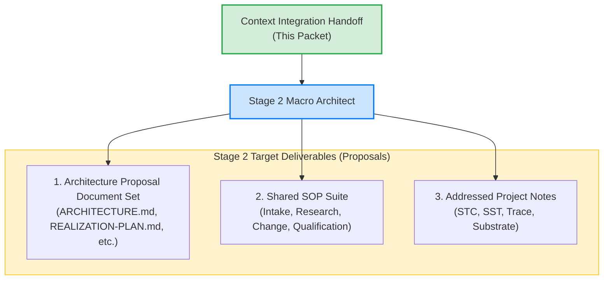
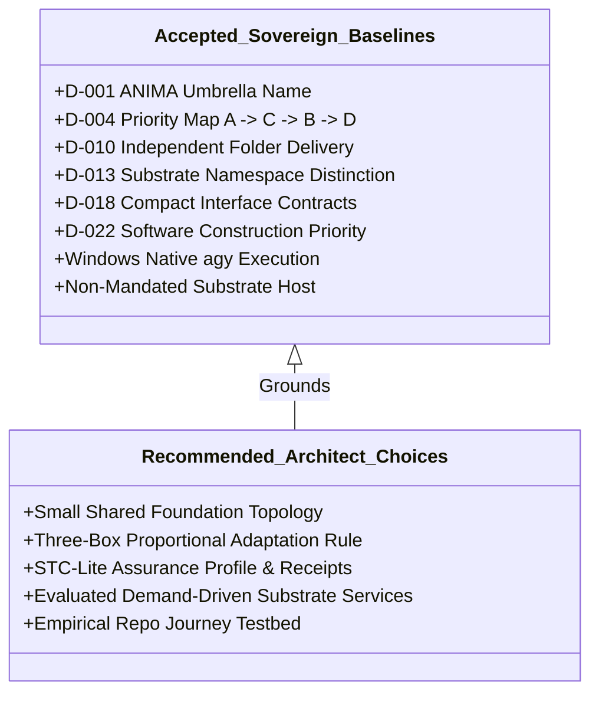
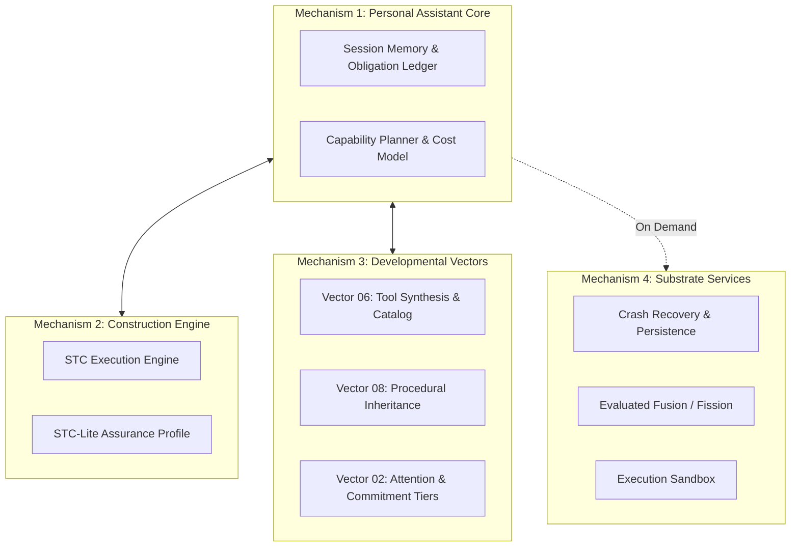
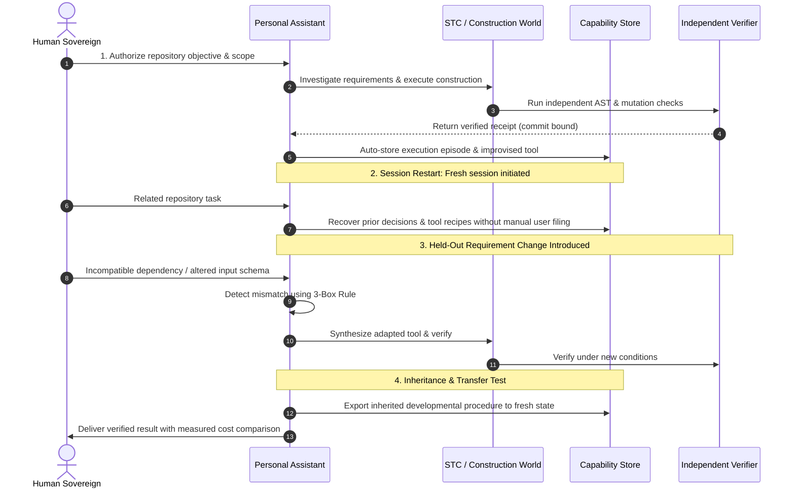
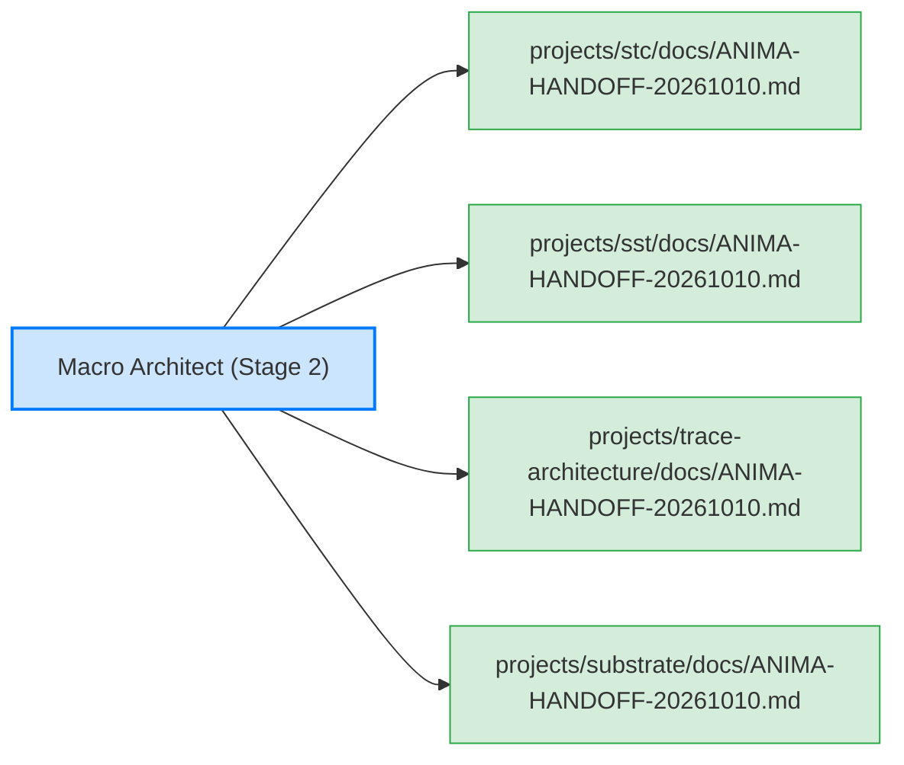
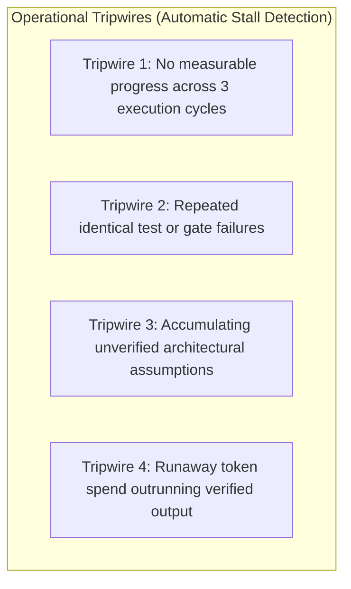

# ANIMA Stage 2 Macro-Architect Briefing & Handoff Packet

> Public curation note: links to records excluded from this public release were converted to plaintext historical references; the original record identities are preserved inline.

**Intended Final Home:** `ANIMA/context/integrations/2026-10-10/`  
**Proposal Target Directory:** `../../architecture/proposals/2026-10-10-PERSONAL-ASSISTANT-AND-DEVELOPMENTAL-SUBSTRATE/`  
**Governing Authority:** campaign/AUTHORIZATION.md (historical record `../../../coordination/2026-10-10-documentary-completion/AUTHORIZATION.md`, excluded from this public release) / User Instruction at current-coordinator-L286 (historical record `preserved/chats/current-coordinator.READABLE.md#current-coordinator-L286`, excluded from this public release)  
**Authoritative Decisions:** D-001 through D-022 (historical record `../../DECISIONS-AND-CORRECTIONS.jsonl`, excluded from this public release)

---

## 1. Operating Mandate & Stage 2 Scope

This handoff packet provides the self-contained briefing for the **Stage 2 Macro Architect**. 

### The Architect's Scope

Under the sovereign authority of campaign/AUTHORIZATION.md (historical record `../../../coordination/2026-10-10-documentary-completion/AUTHORIZATION.md`, excluded from this public release) and current-coordinator-L286 (historical record `preserved/chats/current-coordinator.READABLE.md#current-coordinator-L286`, excluded from this public release), the Macro Architect is assigned to:
1. **Author the Macro-Architecture Proposal:** Complete the formal proposal document set for the **Personal Assistant and Developmental Substrate**, targeting `ANIMA/architecture/proposals/2026-10-10-PERSONAL-ASSISTANT-AND-DEVELOPMENTAL-SUBSTRATE/`.
2. **Design the First Useful Realization:** Detail the concrete software construction journey for the personal assistant, including capability acquisition, session restart recovery, held-out environment adaptation, and empirical comparison against simpler baselines.
3. **Author the Shared SOP Suite:** Produce a complete, connected suite of standard operating procedures grounded in inspected practices (idea intake, research foraging, architectural change control, release qualification).
4. **Prepare Addressed Project Handoffs:** Author recipient-specific handoff notes and prompts addressed to each participating project directory (`projects/stc`, `projects/sst`, `projects/trace-architecture`, `projects/substrate`).

> [!IMPORTANT]
> The user authorizes the completion of **proposals, plans, SOPs, and documentary handoffs**. Product builds, code modifications to active sources, package deployments, consumer pin advancements, and unratified contract changes remain strictly outside this assignment.

---

## 2. Accepted Baseline vs. Recommended Architect Choices

To prevent conflating sovereign commitments with provisional designs, the architect must maintain the following separation:

### 2.1 Accepted Sovereign Baselines (Non-Negotiable)
- **Umbrella Identity:** ANIMA is the approved umbrella name (D-001 (historical record `../../DECISIONS-AND-CORRECTIONS.jsonl`, excluded from this public release)).
- **Research Priority Ordering:** $A \to C \to B \to D$ (Computationally Useful Knowledge $\to$ Learned Schemas/Operations $\to$ Meta-Learning $\to$ Computational/Physical Co-Design) (D-004 (historical record `../../DECISIONS-AND-CORRECTIONS.jsonl`, excluded from this public release)).
- **Immediate Domain Priority:** Software construction is the immediate priority for the personal assistant; research and physical development remain active long-term goals (D-022 (historical record `../../DECISIONS-AND-CORRECTIONS.jsonl`, excluded from this public release)).
- **Independent Project Delivery:** STC, SST, Trace, and Substrate develop independently in their owning folders; macro integration occurs via compact published contracts and qualified pins, not mutable source imports (D-010 (historical record `../../DECISIONS-AND-CORRECTIONS.jsonl`, excluded from this public release), D-018 (historical record `../../DECISIONS-AND-CORRECTIONS.jsonl`, excluded from this public release)).
- **Substrate Namespace Distinction:** The broad world-hosting substrate design home is strictly distinct from STC's mechanical package named substrate (D-013 (historical record `../../DECISIONS-AND-CORRECTIONS.jsonl`, excluded from this public release)).
- **Host Non-Mandate:** Broad substrate alpha persistence is an experimental candidate, not a mandated runtime host or demonstrated learning engine.

### 2.2 Recommended Architect Choices (Proposals for Stage 2)
- **Small Shared Foundation:** Build the personal assistant using existing execution machinery (STC, prompt-kit) and a durable capability store, consuming substrate services (crash recovery, fusion) on demand rather than forcing a heavy 4-layer deployment ([SYNTHESIS.md](SYNTHESIS.md) §5).
- **Three-Box Rule:** Scale adaptation proportionally: adjust action sequences first $\to$ adapt procedures second $\to$ construct new tools third $\to$ transform structural organization only when coordination bottlenecks demand it ([SYNTHESIS.md](SYNTHESIS.md) §5).
- **STC-Lite Profile Proposal:** Evaluate formalizing STC-Lite as an assurance profile within STC (with task/commit hash binding and upgrade gates) rather than maintaining a separate code fork ([SYNTHESIS.md](SYNTHESIS.md) §5), subject to STC owner review.

---

## 3. Required Macro Mechanisms & First Realization Plan

The Stage 2 architecture proposal must detail four interconnected macro mechanisms:

### 3.1 The First Realization Journey (Software Construction Assistant)

The architect must design a concrete 5-stage repository journey that tests the assistant under rigorous empirical conditions ([2026-10-09-PERSONAL-ASSISTANT-AND-DEVELOPMENTAL-SUBSTRATE.md](../../../architecture/notes/2026-10-09-PERSONAL-ASSISTANT-AND-DEVELOPMENTAL-SUBSTRATE.md)):

1. **Phase 1 (Initial Repository Journey):** Execute a bounded feature or refactoring task under the accepted baseline, producing an independent verification receipt (binding commit hash and task ID).
2. **Phase 2 (Restart Recovery):** In a fresh session, recover relevant architectural decisions, failure logs, and construction capabilities without requiring human re-explanation or manual tool filing.
3. **Phase 3 (Held-Out Environment Adaptation):** Introduce a genuine breaking change (incompatible dependency, changed schema). The assistant detects the mismatch, applies the 3-box rule, adapts or constructs a tool, and passes verification.
4. **Phase 4 (Inherited Advantage Transfer):** Instantiate a fresh assistant state containing only the inherited developmental recipe. Measure whether it solves a related novel task faster than a static baseline.
5. **Phase 5 (Empirical Accounting):** Measure total inference cost, background consolidation overhead, human management time, and verification pass/kill rates against applicable project test suites.

---

## 4. Complete SOP Suite & Project-Addressed Delivery

### 4.1 Required Shared SOP Suite

The architect must specify four core operational SOPs grounded in inspected practices:

| SOP Identifier | Scope & Operational Objective | Grounded Reference Seed |
|---|---|---|
| **SOP-01: Idea Intake & Triage** | Ingesting new proposals, papers, or inspirations; classifying into User Directives, Model Proposals, or Research Hypotheses; mapping to vectors. | [INTAKE-AND-ROUTING.md](../../INTAKE-AND-ROUTING.md), [IDEA-MAP.md](../../IDEA-MAP.md) |
| **SOP-02: Research Spikes & Epistemic Foraging** | Conducting bounded, cost-controlled research investigations; formulating discriminating hypotheses; setting explicit tripwires. | [2026-10-08-SOP-RESEARCH-PROMPT.md](../../../architecture/notes/2026-10-08-SOP-RESEARCH-PROMPT.md), [FORAGING-PROMPTS.md](../../../architecture/notes/2026-10-05-DEVELOPMENTAL-WORLDS/FORAGING-PROMPTS.md) |
| **SOP-03: Architectural Change Control** | Managing baseline revisions; escalating semantic branch points to human sovereign; binding receipts to commit hashes. | DECISIONS-AND-CORRECTIONS.jsonl (historical record `preserved/documents/anima/context/DECISIONS-AND-CORRECTIONS.jsonl`, excluded from this public release), current-coordinator-L286 (historical record `preserved/chats/current-coordinator.READABLE.md#current-coordinator-L286`, excluded from this public release) |
| **SOP-04: Release & Interface Qualification** | Qualifying cross-project consumer pins; validating contracts; verifying backward compatibility and failure isolation. | [MODULE-DELIVERY.md](../../../architecture/MODULE-DELIVERY.md), [projects/stc/docs/STC-SST-CALLER-CONTRACT.md](../../../../../components/stc/docs/STC-SST-CALLER-CONTRACT.md) |

### 4.2 Project-Addressed Delivery (Additive Notes)

In accordance with current-coordinator-L286 (historical record `preserved/chats/current-coordinator.READABLE.md#current-coordinator-L286`, excluded from this public release) and campaign/AUTHORIZATION.md (historical record `../../../coordination/2026-10-10-documentary-completion/AUTHORIZATION.md`, excluded from this public release), the architect must author addressed handoff prompts and deliver them as additive notes inside each owning project directory:

1. **`projects/stc/` (STC Lead):** Brief on STC's role as the First Construction World; specify STC-Lite assurance profile requirements, receipt schema extensions, and tool-repertoire integration interfaces.
2. **`projects/sst/` (SST Lead):** Brief on durable state storage contracts, context compaction schemas, and integration with the assistant's long-term memory.
3. **`projects/trace-architecture/` (Trace Lead):** Brief on knowledge representation contracts, schema + delta compression outputs, and research graph integration.
4. **`projects/substrate/` (Substrate Lead):** Brief on demand-driven service adoption (crash recovery, fusion/recipes); clarify proposal status and host evaluation criteria.

---

## 5. Critical Open Dependencies & Tripwires

The architect must address and monitor the following unresolved dependencies:

1. **Verification Oracle Absence in Open Research:** Code tests cannot verify theoretical insights. The architect must define where human judgment or domain experts serve as the oracle, avoiding multi-agent consensus loops as substitutes for ground truth.
2. **Executable Sandboxing vs. Contractual Promises:** The assistant's tool-execution environment must enforce OS-level confinement to prevent unintended filesystem or network side effects.
3. **Host Evaluation Criteria (Open Issues O-04 & O-05):** Maintain rigorous criteria for adopting substrate hosting features based on measured coordination reduction.

---

## 6. Target Deliverables for Stage 2

The Stage 2 Architect is expected to author the following proposal package in `ANIMA/architecture/proposals/2026-10-10-PERSONAL-ASSISTANT-AND-DEVELOPMENTAL-SUBSTRATE/`:

- [ ] `README.md` — Executive orientation, proposal status, and reading routes.
- [ ] `ARCHITECTURE.md` — Comprehensive macro-architecture proposal (Assistant, STC Engine, Developmental Vectors, Substrate Services).
- [ ] `REALIZATION-PLAN.md` — 5-phase software construction journey, test harness, and empirical baseline comparisons.
- [ ] `SOP-SUITE.md` — Complete shared SOPs (Intake, Research, Change Control, Qualification).
- [ ] `PROJECT-HANDOFFS.md` — Master record of addressed project notes prepared for `projects/stc/`, `projects/sst/`, `projects/trace-architecture/`, and `projects/substrate/`.
- [ ] `DECISIONS-AND-OPEN-QUESTIONS.md` — Record of recommended decisions and open research questions.
