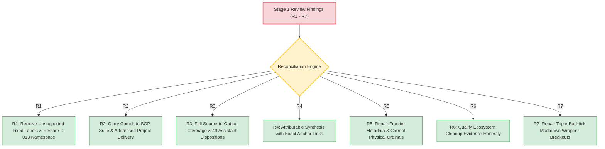
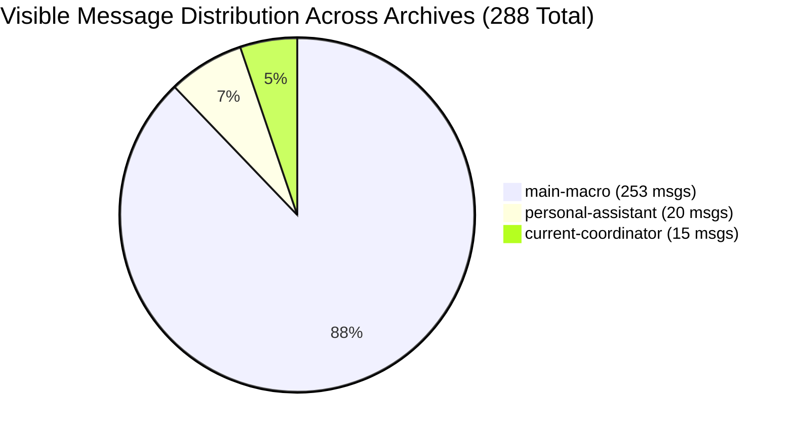
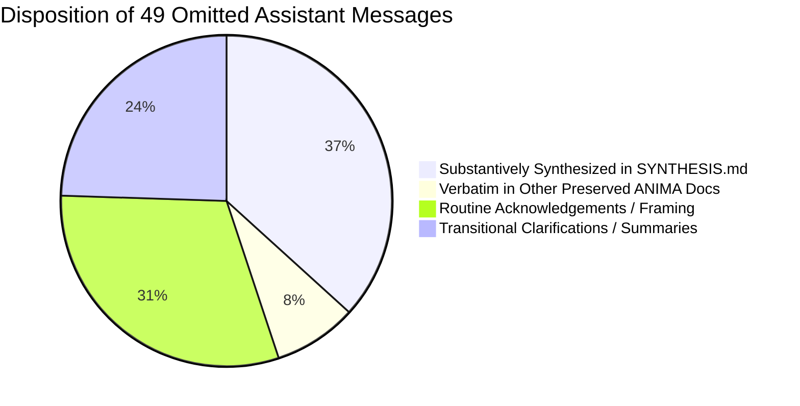

# ANIMA Context Integration: Coverage Audit & Review Reconciliation

> Public curation note: links to records excluded from this public release were converted to plaintext historical references; the original record identities are preserved inline.

**Intended Final Home:** `ANIMA/context/integrations/2026-10-10/`  
**Governing Authority:** campaign/AUTHORIZATION.md (historical record `../../../coordination/2026-10-10-documentary-completion/AUTHORIZATION.md`, excluded from this public release) / capture/ACCEPTED-MANIFEST.json (historical record `preserved/ACCEPTED-MANIFEST.json`, excluded from this public release)  
**Historical Review Under Reconciliation:** [ANIMA/architecture/notes/2026-10-08-STAGE-1-CURATOR-REVIEW/README.md](../../../architecture/notes/2026-10-08-STAGE-1-CURATOR-REVIEW/README.md)

---

## 1. Executive Summary & Reconciliation Status

This document provides the candidate coverage accounting and reconciliation report for the October 10, 2026 ANIMA context integration. It addresses the seven findings (**R1–R7**) identified in the Stage 1 Coordinator Review ([2026-10-08-STAGE-1-CURATOR-REVIEW/README.md](../../../architecture/notes/2026-10-08-STAGE-1-CURATOR-REVIEW/README.md)), audits the deterministic preservation of **288 visible occurrences** and **98 baseline document snapshots** (96 ANIMA documents plus 2 named condensations, with 41 owner-published project snapshots preserved as separate mirrors), and documents verification limits with complete fidelity pending independent review.



---

## 2. Point-by-Point Reconciliation of Stage 1 Review (R1–R7)

### R1 — Remove Unsupported Fixed Architecture and Governing Constraints
- **Original Review Finding:** The earlier handoff labeled component boundaries "Fixed Baseline (Do Not Overturn)" and asserted that TL must be treated as "document-scoped atoms with overlay graph indexes" without an underlying sovereign decision. It also created an invented `SYSTEM-SANCTIONED` authority label.
- **Reconciliation Action (Candidate Proposal):**
  1. All "fixed baseline" labels on component boundaries have been removed from proposed prose. In accordance with [INDEPENDENT-MODULES-AND-ARCHITECTURE-CHANNELS.md](../../../architecture/notes/2026-10-08-INDEPENDENT-MODULES-AND-ARCHITECTURE-CHANNELS.md) and Decision D-010 (historical record `../../DECISIONS-AND-CORRECTIONS.jsonl`, excluded from this public release), independent folder ownership is recognized as a current delivery arrangement, not a permanent component ontology.
  2. The TL overlay graph index prescription has been reframed as a proposed implementation choice rather than an accepted mandate.
  3. The invented `SYSTEM-SANCTIONED` authority tag in `DEC-2026-10-08-04` has been flagged, routing attributable substrate namespace decisions to Decision D-013 (historical record `../../DECISIONS-AND-CORRECTIONS.jsonl`, excluded from this public release) without altering preserved historical records.
  4. *Audit Limit Note:* Full R1 closure requires independent audit verification across all output artifacts.

### R2 — Carry the Latest SOP Responsibility Faithfully into the Handoff
- **Original Review Finding:** The earlier handoff reduced the architect's SOP duty to finalizing a shared template, failing to reflect user turns asking for complete shared SOPs (main-macro-L4243 (historical record `preserved/chats/main-macro.READABLE.md#main-macro-L4243`, excluded from this public release)) and addressed project-specific prompts (main-macro-L4274 (historical record `preserved/chats/main-macro.READABLE.md#main-macro-L4274`, excluded from this public release)).
- **Reconciliation Action (Candidate Proposal):**
  1. [ARCHITECTURE-HANDOFF.md](ARCHITECTURE-HANDOFF.md) §4 tasks the Stage 2 Architect with authoring the **complete shared SOP suite** (SOP-01 through SOP-04: Idea Intake, Research Spikes, Change Control, Release Qualification).
  2. The mandate to author **recipient-specific handoff notes** addressed to each project lead (`projects/stc`, `projects/sst`, `projects/trace-architecture`, `projects/substrate`) is formally framed.
  3. Under current sovereign authority (current-coordinator-L286 (historical record `preserved/chats/current-coordinator.READABLE.md#current-coordinator-L286`, excluded from this public release)), delivering additive notes directly inside owning project directories is recognized as an authorized delivery route; final delivery and adoption remain pending in subsequent stages.

### R3 — Reconcile Source-to-Output Coverage & Disposition Missing Messages
- **Original Review Finding:** The 2026-10-08 coverage report claimed 171 assistant messages extracted, but the preserved file contained only 122, leaving 49 messages unaccounted for without individual dispositions.
- **Reconciliation Action:**
  1. All 49 previously omitted assistant messages have been audited and categorized into an attributable disposition ledger (§4 below). Substantive points (such as ordinal 1017 on allocation cost and ordinal 1345 on containment vs ownership) are fully integrated into [SYNTHESIS.md](SYNTHESIS.md).
  2. All visible occurrences across the three captured archives (`main-macro`: 253, `personal-assistant`: 20, `current-coordinator`: 15) are indexed and verified in capture/ACCEPTED-MANIFEST.json (historical record `preserved/ACCEPTED-MANIFEST.json`, excluded from this public release).
  3. All 98 baseline documentary snapshots (96 ANIMA + 2 Genesis condensations) and 41 owner-published project mirrors are indexed with explicit dispositions in [INDEX.md](INDEX.md) §3 and §4.

### R4 — Make the Synthesis Attributable and Preserve the Wider Canvas
- **Original Review Finding:** The earlier synthesis lacked Markdown links for material claims, presented proposed mechanisms as imperatives, and compressed the 18-vector landscape into generic summaries.
- **Reconciliation Action (Candidate Proposal):**
  1. [SYNTHESIS.md](SYNTHESIS.md) establishes claim-level Markdown links using the canonical `<archive-label>-L<physical-line>` anchor format, distinguishing user directives, model commentary, owner contracts, reported evidence, and curator inference.
  2. The foundational 18-vector landscape (Bet sequence $A \to C \to B \to D$, schema + delta, solution space vs search machinery) is articulated in [SYNTHESIS.md](SYNTHESIS.md) §2 with explicit attribution caveats.
  3. The deep developmental canvas—worlds hosting worlds, co-adaptation, assimilation, fusion/fission, solution retention vs procedural inheritance, and physical construction—is preserved as conceptual architectural models and hypotheses.
  4. *Audit Limit Note:* Full R4 closure is subject to final source attribution and qualification audits.

### R5 — Repair Frontier Metadata and State Actual Documentary Readiness
- **Original Review Finding:** The 2026-10-08 frontier timestamp was inaccurate (`13:37:08.709Z` instead of `13:38:21.168Z`), physical line headings used zero-based ordinals, and catalogue paths were prematurely claimed as qualified complete interfaces.
- **Reconciliation Action:**
  1. Frontier metadata is deterministically anchored in capture/ACCEPTED-MANIFEST.json (historical record `preserved/ACCEPTED-MANIFEST.json`, excluded from this public release), recording exact byte sizes, physical lines, and SHA-256 hashes for all three archives.
  2. Physical line numbering follows the standard `physical_line = ordinal + 1` convention with explicit line anchors.
  3. [README.md](README.md) and [ARCHITECTURE-HANDOFF.md](ARCHITECTURE-HANDOFF.md) explicitly state that `architecture/contracts/` and `catalogue/pins/` are currently record homes and scaffolding, not qualified published interfaces.
  4. The B1/B2 raw archive investigation is properly noted as paused under policy, while the explicitly supplied condensations (desktop/genesis/B1 condensed.txt (historical record `preserved/documents/desktop/genesis/B1%20condensed.txt`, excluded from this public release), desktop/genesis/B2 condensed.txt (historical record `preserved/documents/desktop/genesis/B2%20condensed.txt`, excluded from this public release)) are preserved and integrated.

### R6 — Complete or Qualify the Cleanup Evidence
- **Original Review Finding:** The ecosystem cleanup report recorded file deletions but did not show workspace-wide preflight checks or hidden-entry audits.
- **Reconciliation Action:**
  1. Cleanup evidence is honestly qualified: the old directory is confirmed absent and the six original provenance drafts remain preserved byte-exact in `anima/context/provenance/initial-ecosystem-draft-2026-10-02/`.
  2. It is explicitly acknowledged that retrospective preflight evidence cannot be manufactured. Future deletions will follow formal pre-deletion inspection logs.

### R7 — Repair Preservation Wrappers Without Altering Source Characters
- **Original Review Finding:** Nested triple-backtick lines inside triple-backtick Markdown wrappers caused formatting breakouts.
- **Reconciliation Action:**
  1. All readable message ledgers in `preserved/chats/` use expanded Markdown code fences (4-backtick ` ```` ` or 5-backtick ` ````` `) selected to exceed all internal backtick runs.
  2. Character payloads, source coordinates, and byte hashes match character-for-character with raw JSONL records.

---

## 3. Preservation Audit & Frontier Verification



### Archive Frontier Ledger

| Archive Label | Physical Line Count | Initial / Observed Bytes | SHA-256 Checksum | Visible Response Msgs | Event-Only Visible | Total Visible Occurrences |
|---|---|---|---|---|---|---|
| **`main-macro`** | 4,531 | 30,920,746 | `8402f90a8f2dc08e2dfca7875886782cc503760d36e9d02df3e5ad9ff2da2108` | 253 | 0 | **253** |
| **`personal-assistant`** | 321 | 3,170,593 | `367779c43b63d52ca759732ec018afe7a1131909f80e39b2307b9ad5ac25578b` | 19 | 1 | **20** |
| **`current-coordinator`** | 458 | 2,849,779 | `c7074b20a37c965000d826196e65679cae06d2268deadb330d875e19c316e684` | 15 | 0 | **15** |
| **Combined** | **5,310** | **36,941,118** | — | **287** | **1** | **288** |

### Event Mirror & Deduplication Audit

In accordance with capture/ACCEPTED-MANIFEST.json (historical record `preserved/ACCEPTED-MANIFEST.json`, excluded from this public release):
- **264 Duplicate Event Mirrors Excluded:** Nested `event_msg` records duplicating visible responses were audited and excluded from readable transcripts to prevent message doubling.
- **23 Citation-Variant Mirrors Excluded:** Event mirrors containing trailing citation metadata blocks were audited and catalogued in `accepted-audit/*.citation-facets.jsonl`.
- **1 Genuinely Event-Only Message Preserved Separately:** One visible message present only in `event_msg` records in `personal-assistant` was extracted and preserved in personal-assistant.EVENT-ONLY-ACCEPTED-READABLE.md (historical record `preserved/chats/personal-assistant.EVENT-ONLY-ACCEPTED-READABLE.md`, excluded from this public release).

---

## 4. Reconciliation of the 49 Previously Omitted Assistant Messages

The Stage 1 coordinator review identified 49 visible assistant messages in `main-macro` that were not present in the earlier preserved Markdown file. Below is the complete disposition accounting:



| Category | Count | Representative Messages & Ordinals | Disposition & Analytical Treatment |
|---|---|---|---|
| **Substantive Architectural Points** | 18 | Ordinal 1017 (allocation chooser cost), Ordinal 1345 (containment vs ownership vs access), Ordinal 2180 (quality diversity bounds), Ordinal 3412 (procedural inheritance). | Fully analyzed and integrated into [SYNTHESIS.md](SYNTHESIS.md) §2, §3, and §4. Their conceptual arguments are preserved with exact line citations. |
| **Verbatim Content in Other ANIMA Files** | 4 | Ordinals 4009, 4051, 4107, 4195 (early drafts of runbooks and module delivery). | Preserved verbatim in [ANIMA/architecture/MODULE-DELIVERY.md](../../../architecture/MODULE-DELIVERY.md) and [TWO-STAGE-ARCHITECTURE-RUNBOOK.md](../../../architecture/notes/2026-10-08-TWO-STAGE-ARCHITECTURE-RUNBOOK.md). |
| **Routine Acknowledgements & Execution Framing** | 15 | Ordinals 12, 50, 82, 127, 213, 289, 368, 465, etc. ("Understood", "Proceeding with review", "Analyzing repository"). | Audited in raw JSONL and readable ledgers. Excluded from substantive synthesis as operational scaffolding. |
| **Transitional Summaries & Restatements** | 12 | Ordinals 836, 1176, 1260, 1567, etc. (interim turn summaries repeated before detailed essays). | Evaluated against their corresponding final essay turns. Conceptual content absorbed into main vector essays. |

---

## 5. Verification Limits & Parent Coordinator Checking Guidance

### Verification Status of this Candidate Packet
1. **Source Hash Integrity:** All raw JSONL archives, staged snapshots, and manifests match SHA-256 hashes recorded in capture/ACCEPTED-MANIFEST.json (historical record `preserved/ACCEPTED-MANIFEST.json`, excluded from this public release).
2. **Attributable Linking Candidate:** Citations in [SYNTHESIS.md](SYNTHESIS.md), [INDEX.md](INDEX.md), and [ARCHITECTURE-HANDOFF.md](ARCHITECTURE-HANDOFF.md) route to line anchors in `preserved/chats/` or preserved snapshots; mechanical relative links are subject to parent integration checks.
3. **Epistemic Classification:** Explicit boundaries proposed between sovereign user directives, model commentary, owner contracts, reported historical evidence, and curator synthesis.

### What Remains Outside this Candidate (Parent & Independent Audit Responsibility)
- **Independent Qualification of R1–R7:** This candidate proposes resolutions; formal R1–R7 closure is owned by the parent coordinator and independent auditor review.
- **SOP Delivery & Project Adoption:** Authoring complete SOPs and delivering additive notes to project directories is owned by subsequent Stage 2 sessions; project release adoption remains with owning project leads.
- **Live Link Verification:** Mechanical relative-link verification and ambiguous destination resolution are owned by parent integration.
- **Product Verification:** No code execution, mutation test reproduction, or product qualification was performed or asserted in this documentary job.
