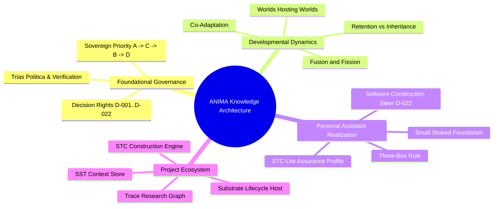
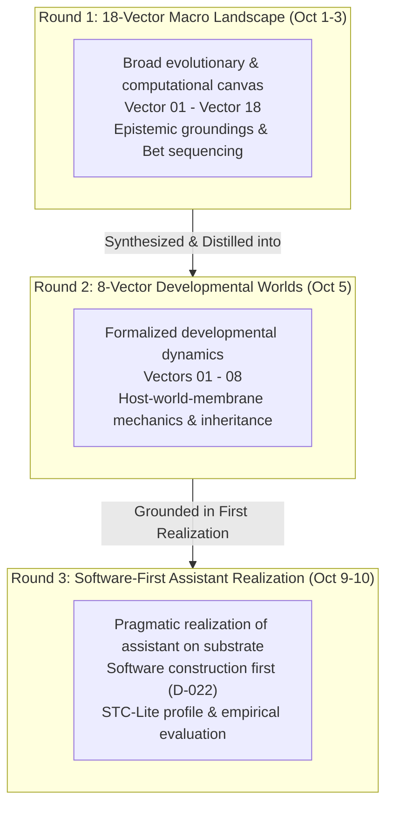
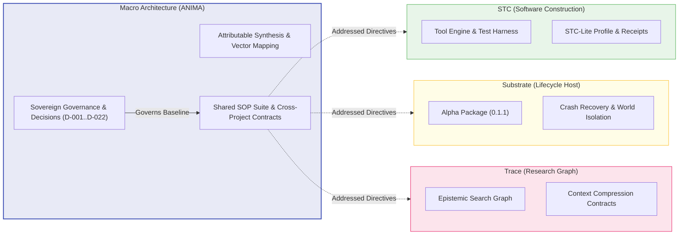

# ANIMA Context Integration: Master Index & Source Disposition

> Public curation note: links to records excluded from this public release were converted to plaintext historical references; the original record identities are preserved inline.

**Intended Final Home:** `ANIMA/context/integrations/2026-10-10/`  
**Governing Authority:** campaign/AUTHORIZATION.md (historical record `../../../coordination/2026-10-10-documentary-completion/AUTHORIZATION.md`, excluded from this public release) / capture/ACCEPTED-MANIFEST.json (historical record `preserved/ACCEPTED-MANIFEST.json`, excluded from this public release)  
**Preservation Home:** `preserved/` (containing preserved chats, ANIMA documents, desktop genesis texts, and project snapshots)

---

## 1. Master Topic & Concept Routes

This index routes architectural topics to exact source ledgers, synthesized essays, and owning project contracts across the three developmental rounds.

| Topic / Mechanism | Primary Concept & Authority | Exact Source Anchors | Key Documents & Preserved Files |
|---|---|---|---|
| **Sovereign Authority & Decision Rights** | Trias Politica; separation of Human Sovereign, Coordinator, Architect, and Builder. Decisions D-001 through D-022 (historical record `../../DECISIONS-AND-CORRECTIONS.jsonl`, excluded from this public release). | current-coordinator-L286 (historical record `preserved/chats/current-coordinator.READABLE.md#current-coordinator-L286`, excluded from this public release), personal-assistant-L21 (historical record `preserved/chats/personal-assistant.READABLE.md#personal-assistant-L21`, excluded from this public release) | campaign/AUTHORIZATION.md (historical record `../../../coordination/2026-10-10-documentary-completion/AUTHORIZATION.md`, excluded from this public release), [ANIMA/context/OPERATIVE-BRIEF.md](../../OPERATIVE-BRIEF.md) |
| **Research Priorities ($A \to C \to B \to D$)** | Priority map: Useful Knowledge ($A$) $\to$ Learned Schemas ($C$) $\to$ Meta-Learning ($B$) $\to$ Co-Design ($D$). | main-macro-L1261 (historical record `preserved/chats/main-macro.READABLE.md#main-macro-L1261`, excluded from this public release), main-macro-L1325 (historical record `preserved/chats/main-macro.READABLE.md#main-macro-L1325`, excluded from this public release), D-004 (historical record `../../DECISIONS-AND-CORRECTIONS.jsonl`, excluded from this public release) | [SYNTHESIS.md](SYNTHESIS.md) §2, [ANIMA/context/IDEA-MAP.md](../../IDEA-MAP.md) |
| **Schema Compression** | General Abstract Schema + Domain Specific Schema + Empirical Delta. | main-macro-L1388 (historical record `preserved/chats/main-macro.READABLE.md#main-macro-L1388`, excluded from this public release), D-009 (historical record `../../DECISIONS-AND-CORRECTIONS.jsonl`, excluded from this public release) | [SYNTHESIS.md](SYNTHESIS.md) §2, projects/trace-architecture/docs/CONTEXT-CONTRACT.md (historical record `preserved/documents/projects/trace-architecture/docs/CONTEXT-CONTRACT.md`, excluded from this public release) |
| **Worlds Hosting Worlds** | Nested execution environments; distinction between location, containment, ownership, and membrane access. | main-macro-L1346 (historical record `preserved/chats/main-macro.READABLE.md#main-macro-L1346`, excluded from this public release), D-006 (historical record `../../DECISIONS-AND-CORRECTIONS.jsonl`, excluded from this public release) | [CONSTRUCTION-LANGUAGES.md](../../../architecture/notes/2026-10-05-DEVELOPMENTAL-WORLDS/CONSTRUCTION-LANGUAGES.md), [projects/substrate/docs/CONSUMER.md](../../../../../components/substrate/docs/CONSUMER.md) |
| **Structural Operations (Fusion / Fission)** | Dynamic consolidation of high-coordination worlds; fission for failure isolation. | D-006 (historical record `../../DECISIONS-AND-CORRECTIONS.jsonl`, excluded from this public release), D-010 (historical record `../../DECISIONS-AND-CORRECTIONS.jsonl`, excluded from this public release) | [projects/substrate/CANONICAL-RECORD.md](../../../../../components/substrate/CANONICAL-RECORD.md), [projects/substrate/docs/CONSUMER.md](../../../../../components/substrate/docs/CONSUMER.md), [SYNTHESIS.md](SYNTHESIS.md) §4 |
| **Retention vs. Inheritance** | Solution reuse (running old programs) vs. Developmental inheritance (inheriting capability-construction machinery). | main-macro-L1568 (historical record `preserved/chats/main-macro.READABLE.md#main-macro-L1568`, excluded from this public release), D-008 (historical record `../../DECISIONS-AND-CORRECTIONS.jsonl`, excluded from this public release) | [VECTOR-08-RETENTION-AND-DESCENDANTS.md](../../../architecture/notes/2026-10-05-DEVELOPMENTAL-WORLDS/VECTOR-08-RETENTION-AND-DESCENDANTS.md) |
| **Software-First Personal Assistant** | Personal assistant as demanding application; software construction priority. | personal-assistant-L189 (historical record `preserved/chats/personal-assistant.READABLE.md#personal-assistant-L189`, excluded from this public release), personal-assistant-L264 (historical record `preserved/chats/personal-assistant.READABLE.md#personal-assistant-L264`, excluded from this public release), D-022 (historical record `../../DECISIONS-AND-CORRECTIONS.jsonl`, excluded from this public release) | [2026-10-09-PERSONAL-ASSISTANT-AND-DEVELOPMENTAL-SUBSTRATE.md](../../../architecture/notes/2026-10-09-PERSONAL-ASSISTANT-AND-DEVELOPMENTAL-SUBSTRATE.md), [ARCHITECTURE-HANDOFF.md](ARCHITECTURE-HANDOFF.md) |
| **Three-Box Adaptation Rule** | Proportional scale of change: Action Sequence $\to$ Procedure Adaptation $\to$ Tool Construction $\to$ Structural Reorganization. | personal-assistant-L21 (historical record `preserved/chats/personal-assistant.READABLE.md#personal-assistant-L21`, excluded from this public release) | [SYNTHESIS.md](SYNTHESIS.md) §5 |
| **STC-Lite Assurance Profile** | Single codebase profile; task/commit hash binding; fail-closed upgrade path. | personal-assistant-L21 (historical record `preserved/chats/personal-assistant.READABLE.md#personal-assistant-L21`, excluded from this public release), personal-assistant-L236 (historical record `preserved/chats/personal-assistant.READABLE.md#personal-assistant-L236`, excluded from this public release) | [projects/stc/docs/STC-DSH-RECORD.md](../../../../../components/stc/docs/STC-DSH-RECORD.md), [ARCHITECTURE-HANDOFF.md](ARCHITECTURE-HANDOFF.md) §3 |
| **SOP Suite & Addressed Delivery** | Authoring shared SOP suite and addressed project prompts/notes into owning directories. | main-macro-L4243 (historical record `preserved/chats/main-macro.READABLE.md#main-macro-L4243`, excluded from this public release), main-macro-L4274 (historical record `preserved/chats/main-macro.READABLE.md#main-macro-L4274`, excluded from this public release), D-020 (historical record `../../DECISIONS-AND-CORRECTIONS.jsonl`, excluded from this public release) | [2026-10-08-SOP-RESEARCH-PROMPT.md](../../../architecture/notes/2026-10-08-SOP-RESEARCH-PROMPT.md), [2026-10-08-SOP-SOURCE-SEEDS.md](../../../architecture/notes/2026-10-08-SOP-SOURCE-SEEDS.md) |

---

## 2. Multi-Round Evolution Matrix

To avoid conflating numbering schemes and historical scopes, the three developmental rounds are distinguished below:

| Dimension | Round 1 (18 Vectors) | Round 2 (8 Developmental Vectors) | Modern Realization (Personal Assistant) |
|---|---|---|---|
| **Primary Focus** | Comprehensive space of artificial evolution, cognition, and co-design. | Morphogenesis, developmental constraints, and world hosting. | Software construction assistant developing capabilities on a substrate. |
| **Core Vectors** | 18 numbered vectors spanning representations to hardware. | 8 consolidated vectors: Change, Attention, Individuality, Construction, Coverage, Repertoires, Program Search, Retention. | Vectors 6 (Repertoires), 8 (Retention/Inheritance), and 2 (Attention/Commitments) prioritized. |
| **Target Mechanism** | Broad holonic substrate. | Nested worlds, recipes, fusion/fission, developmental procedures. | Small shared foundation + STC/prompt-kit + evaluated substrate services. |
| **Verification Basis** | Theoretical arguments and prior-art benchmarks. | Structural models and initial prototype testbeds. | Empirical repo journeys, mutmut $\ge 85\%$ kill rates, TOCTOU-safe receipts. |

---

## 3. Comprehensive Disposition of the 98 Baseline Documentary Snapshots

The 98 baseline snapshots deterministically preserved in `capture/ACCEPTED-MANIFEST.json` comprise exactly **96 ANIMA documents** plus **2 named Desktop Genesis condensations** (`B1 condensed.txt` and `B2 condensed.txt`). The 41 owner-published project snapshots are separate context mirrors catalogued in §4. Snapshots are categorized below with explicit disposition labels:
- **`argument-integrated`:** Evaluated and incorporated into synthesis and handoff arguments.
- **`consulted`:** Read for specific facts, constraints, boundaries, or historical decisions.
- **`indexed`:** Verified for presence, path routing, and metadata mapping.
- **`preserved`:** Maintained byte-exact as historical provenance or baseline context.
- **`deferred`:** Acknowledged as active in separate concurrent campaigns (e.g. Linux migration).

> [!IMPORTANT]
> Inventory presence is strictly distinct from semantic reading. Curation never claims every preserved file was deeply re-read.

### 3.1 ANIMA Architecture Documents (47 Snapshots)

| Snapshot Path (relative to inputs) | Status / Disposition | Role & Analytical Content |
|---|---|---|
| `anima/architecture/contracts/README.md` | `indexed` | Record home for qualified cross-module contracts (currently scaffolding). |
| `anima/architecture/MODULE-DELIVERY.md` | `consulted` | Delivery policies, independent project ownership, and release boundaries. |
| `anima/architecture/RESPONSIBILITIES.md` | `argument-integrated` | Division of responsibilities across ANIMA, STC, SST, Trace, and Substrate. |
| `anima/architecture/templates/MODULE-ARCHITECTURE-DIRECTIVE.md` | `consulted` | Directive template for project architects. |
| `anima/architecture/notes/2026-10-05-B-CONTEXT-REVIEW-PENDING.md` | `preserved` | Record of paused B-context raw transcript review. |
| `anima/architecture/notes/2026-10-05-DEVELOPMENTAL-WORLDS/CONSTRUCTION-LANGUAGES.md` | `argument-integrated` | Deep analysis of construction DSLs, containment, and execution semantics. |
| `anima/architecture/notes/2026-10-05-DEVELOPMENTAL-WORLDS/CREATIVITY-AND-CONSTRAINTS.md` | `consulted` | Quality diversity, search spaces, and creative coverage constraints. |
| `anima/architecture/notes/2026-10-05-DEVELOPMENTAL-WORLDS/EXPERT-WORLDS-AND-SEARCH.md` | `consulted` | Societies of specialized expert worlds and search topologies. |
| `anima/architecture/notes/2026-10-05-DEVELOPMENTAL-WORLDS/FORAGING-PROMPTS.md` | `consulted` | Epistemic foraging prompts and search guidance. |
| `anima/architecture/notes/2026-10-05-DEVELOPMENTAL-WORLDS/PHYSICAL-DEVELOPMENT.md` | `consulted` | Grounding in physical/simulated construction environments. |
| `anima/architecture/notes/2026-10-05-DEVELOPMENTAL-WORLDS/README.md` | `indexed` | Navigation overview of the 8 developmental worlds documents. |
| `anima/architecture/notes/2026-10-05-DEVELOPMENTAL-WORLDS/REVIEW-PLAN.md` | `indexed` | Review plan for the developmental worlds dossier. |
| `anima/architecture/notes/2026-10-05-DEVELOPMENTAL-WORLDS/REVIEW.md` | `consulted` | Dossier review notes and cross-vector evaluation. |
| `anima/architecture/notes/2026-10-05-DEVELOPMENTAL-WORLDS/reviewed-draft/CONSTRUCTION-LANGUAGES.txt` | `preserved` | Reviewed draft text for construction languages. |
| `anima/architecture/notes/2026-10-05-DEVELOPMENTAL-WORLDS/reviewed-draft/SYNTHESIS.txt` | `preserved` | Reviewed draft text for developmental synthesis. |
| `anima/architecture/notes/2026-10-05-DEVELOPMENTAL-WORLDS/SYNTHESIS.md` | `argument-integrated` | Canonical Round 2 developmental worlds synthesis. |
| `anima/architecture/notes/2026-10-05-DEVELOPMENTAL-WORLDS/VECTOR-01-DEVELOPMENTAL-CHANGE.md` | `argument-integrated` | Vector 01: Morphogenesis, multi-timescale adaptation. |
| `anima/architecture/notes/2026-10-05-DEVELOPMENTAL-WORLDS/VECTOR-02-ATTENTION-AND-COMMITMENTS.md` | `argument-integrated` | Vector 02: Attention allocation, commitment tiers. |
| `anima/architecture/notes/2026-10-05-DEVELOPMENTAL-WORLDS/VECTOR-03-EVIDENCE-NOTE.md` | `consulted` | Vector 03 evidence ledger. |
| `anima/architecture/notes/2026-10-05-DEVELOPMENTAL-WORLDS/VECTOR-03-EXPERT-INDIVIDUALITY.md` | `argument-integrated` | Vector 03: Societies of expert agents. |
| `anima/architecture/notes/2026-10-05-DEVELOPMENTAL-WORLDS/VECTOR-04-EVIDENCE-NOTE.md` | `consulted` | Vector 04 evidence ledger. |
| `anima/architecture/notes/2026-10-05-DEVELOPMENTAL-WORLDS/VECTOR-04-PHYSICAL-CONSTRUCTION.md` | `argument-integrated` | Vector 04: Tool construction, environment grounding. |
| `anima/architecture/notes/2026-10-05-DEVELOPMENTAL-WORLDS/VECTOR-05-CREATIVE-COVERAGE.md` | `argument-integrated` | Vector 05: Divergent search, MAP-Elites, coverage. |
| `anima/architecture/notes/2026-10-05-DEVELOPMENTAL-WORLDS/VECTOR-05-NEUROSCIENCE-EVIDENCE.md` | `consulted` | Vector 05 neuroscience evidence notes. |
| `anima/architecture/notes/2026-10-05-DEVELOPMENTAL-WORLDS/VECTOR-05-SEARCH-EVIDENCE.md` | `consulted` | Vector 05 search algorithm evidence. |
| `anima/architecture/notes/2026-10-05-DEVELOPMENTAL-WORLDS/VECTOR-06-CHOICE-EVIDENCE.md` | `consulted` | Vector 06 tool choice evidence. |
| `anima/architecture/notes/2026-10-05-DEVELOPMENTAL-WORLDS/VECTOR-06-CONSTRUCTION-REPERTOIRES.md` | `argument-integrated` | Vector 06: Executable tool repertoires, capability synthesis. |
| `anima/architecture/notes/2026-10-05-DEVELOPMENTAL-WORLDS/VECTOR-06-LIBRARY-EVIDENCE.md` | `consulted` | Vector 06 tool library evidence. |
| `anima/architecture/notes/2026-10-05-DEVELOPMENTAL-WORLDS/VECTOR-07-ALLOCATION-EVIDENCE.md` | `consulted` | Vector 07 resource allocation evidence. |
| `anima/architecture/notes/2026-10-05-DEVELOPMENTAL-WORLDS/VECTOR-07-PROGRAMME-SEARCH.md` | `argument-integrated` | Vector 07: Program space exploration, meta-search. |
| `anima/architecture/notes/2026-10-05-DEVELOPMENTAL-WORLDS/VECTOR-07-SEARCH-EVIDENCE.md` | `consulted` | Vector 07 program search evidence. |
| `anima/architecture/notes/2026-10-05-DEVELOPMENTAL-WORLDS/VECTOR-08-INHERITANCE-EVIDENCE.md` | `consulted` | Vector 08 inheritance evidence ledger. |
| `anima/architecture/notes/2026-10-05-DEVELOPMENTAL-WORLDS/VECTOR-08-RETENTION-AND-DESCENDANTS.md` | `argument-integrated` | Vector 08: Inheritance of developmental machinery vs solutions. |
| `anima/architecture/notes/2026-10-05-DEVELOPMENTAL-WORLDS/VECTOR-08-RETENTION-EVIDENCE.md` | `consulted` | Vector 08 capability retention evidence. |
| `anima/architecture/notes/2026-10-08-ARCHITECTURE-AUTHORING-PROMPT.md` | `argument-integrated` | Historical Stage 2 Architect brief. |
| `anima/architecture/notes/2026-10-08-CONTEXT-INTEGRATION-PROMPT.md` | `argument-integrated` | Historical Stage 1 Curator brief. |
| `anima/architecture/notes/2026-10-08-INDEPENDENT-MODULES-AND-ARCHITECTURE-CHANNELS.md` | `argument-integrated` | Guidelines on independent delivery vs permanent ontology. |
| `anima/architecture/notes/2026-10-08-SOP-RESEARCH-PROMPT.md` | `argument-integrated` | SOP research spike brief. |
| `anima/architecture/notes/2026-10-08-SOP-SOURCE-SEEDS.md` | `consulted` | Seed practices for shared SOPs. |
| `anima/architecture/notes/2026-10-08-STAGE-1-CURATOR-REVIEW/README.md` | `argument-integrated` | Independent coordinator review findings R1–R7. |
| `anima/architecture/notes/2026-10-08-TWO-STAGE-ARCHITECTURE-RUNBOOK.md` | `consulted` | Operational runbook for 2-stage execution. |
| `anima/architecture/notes/2026-10-09-LINUX-AGY-RESEARCH-AUTOMATION/EVIDENCE.md` | `indexed` | Evidence ledger for Linux research automation. |
| `anima/architecture/notes/2026-10-09-LINUX-AGY-RESEARCH-AUTOMATION/research-prompt.txt` | `indexed` | Research prompt for Linux agy automation. |
| `anima/architecture/notes/2026-10-09-LINUX-AGY-RESEARCH-AUTOMATION/worker-report.unaccepted.md` | `preserved` | Unaccepted worker report retained as evidence. |
| `anima/architecture/notes/2026-10-09-LINUX-AGY-RESEARCH-AUTOMATION.md` | `consulted` | Linux agy research automation analysis. |
| `anima/architecture/notes/2026-10-09-PERSONAL-ASSISTANT-AND-DEVELOPMENTAL-SUBSTRATE.md` | `argument-integrated` | Core architecture note establishing software-first personal assistant. |
| `anima/architecture/notes/README.md` | `indexed` | Navigation overview of architecture notes. |

### 3.2 ANIMA Catalogue & Context Documents (40 Snapshots)

| Snapshot Path (relative to inputs) | Status / Disposition | Role & Analytical Content |
|---|---|---|
| `anima/catalogue/MODULES.json` | `consulted` | Module catalogue and repository coordinates. |
| `anima/catalogue/pins/README.md` | `indexed` | Record home for release pins (scaffolding). |
| `anima/catalogue/releases/README.md` | `indexed` | Record home for module releases. |
| `anima/context/conversations/2026-10-09-personal-assistant-and-developmental-substrate/README.md` | `argument-integrated` | Context reference for personal assistant discussion. |
| `anima/context/DECISIONS-AND-CORRECTIONS.jsonl` | `argument-integrated` | Authoritative decision ledger D-001 through D-022. |
| `anima/context/IDEA-MAP.md` | `argument-integrated` | Comprehensive idea map linking concepts to source turns. |
| `anima/context/INTAKE-AND-ROUTING.md` | `consulted` | Intake guidelines for new research and ideas. |
| `anima/context/integrations/2026-10-08/ARCHITECTURE-HANDOFF.md` | `consulted` | Previous Stage 1 handoff (analyzed for R1–R7). |
| `anima/context/integrations/2026-10-08/COVERAGE-AND-REVIEW.md` | `consulted` | Previous Stage 1 coverage report. |
| `anima/context/integrations/2026-10-08/DECISIONS.jsonl` | `preserved` | Previous 2026-10-08 decisions ledger. |
| `anima/context/integrations/2026-10-08/INDEX.md` | `consulted` | Previous 2026-10-08 index. |
| `anima/context/integrations/2026-10-08/preserved/A-B-CONTEXTS-AND-SUBMITTED-MATERIALS.md` | `preserved` | Preserved A/B submitted materials from 2026-10-08. |
| `anima/context/integrations/2026-10-08/preserved/ASSISTANT-SUBSTANTIVE-PROPOSALS.md` | `preserved` | Preserved assistant proposals from 2026-10-08. |
| `anima/context/integrations/2026-10-08/preserved/DUPLICATE-OCCURRENCES.md` | `preserved` | Preserved duplicate occurrences map. |
| `anima/context/integrations/2026-10-08/preserved/INDEPENDENT-MODULES-AND-DIRECTIVES.md` | `preserved` | Preserved directives from 2026-10-08. |
| `anima/context/integrations/2026-10-08/preserved/SOURCE-MAP.md` | `preserved` | Preserved source map from 2026-10-08. |
| `anima/context/integrations/2026-10-08/preserved/USER-SUBSTANTIVE-TURNS.md` | `preserved` | Preserved 76 user turns from 2026-10-08. |
| `anima/context/integrations/2026-10-08/README.md` | `indexed` | Previous 2026-10-08 entry point. |
| `anima/context/integrations/2026-10-08/SOURCES.jsonl` | `preserved` | Previous 2026-10-08 sources ledger. |
| `anima/context/integrations/2026-10-08/SYNTHESIS.md` | `consulted` | Previous 2026-10-08 synthesis. |
| `anima/context/OPEN-ISSUES.md` | `argument-integrated` | Open architectural and research issues (O-01..O-05). |
| `anima/context/OPERATIVE-BRIEF.md` | `argument-integrated` | Operative brief and core system baseline. |
| `anima/context/PRESERVATION-AUDIT.md` | `consulted` | Historical preservation audit. |
| `anima/context/provenance/initial-ecosystem-draft-2026-10-02/catalog.json` | `preserved` | Provenance catalog from initial ecosystem draft. |
| `anima/context/provenance/initial-ecosystem-draft-2026-10-02/context/HISTORY-CURATOR.md` | `preserved` | Provenance curator history. |
| `anima/context/provenance/initial-ecosystem-draft-2026-10-02/context/HISTORY-SOURCES.json` | `preserved` | Provenance source index. |
| `anima/context/provenance/initial-ecosystem-draft-2026-10-02/context/README.md` | `preserved` | Provenance context README. |
| `anima/context/provenance/initial-ecosystem-draft-2026-10-02/ORGANIZATION.md` | `preserved` | Provenance organization record. |
| `anima/context/provenance/initial-ecosystem-draft-2026-10-02/README.md` | `preserved` | Provenance ecosystem README. |
| `anima/context/README.md` | `indexed` | ANIMA context reading-room index. |
| `anima/context/REQUIREMENTS-AND-EVIDENCE.md` | `consulted` | Cross-project requirements and evidence ledger. |
| `anima/context/SESSION-STEER-WINDOWS-2026-10-03.md` | `consulted` | Windows steering directive. |
| `anima/context/SOURCE-EXCERPTS.md` | `argument-integrated` | Attributed excerpts from foundational chats. |
| `anima/context/SOURCES.jsonl` | `argument-integrated` | Canonical source register. |
| `anima/context/tracks/EXPERIMENTS.md` | `consulted` | Research track: experiments. |
| `anima/context/tracks/SST.md` | `consulted` | Research track: SST. |
| `anima/context/tracks/STC.md` | `argument-integrated` | Research track: STC. |
| `anima/context/tracks/SUBSTRATE.md` | `argument-integrated` | Research track: Substrate. |
| `anima/context/tracks/TL.md` | `consulted` | Research track: TL. |
| `anima/context/tracks/TRACE.md` | `consulted` | Research track: Trace. |

### 3.3 Root, Labs, Procedures, Programmes, Progress Logs, Worlds, Desktop Genesis (11 Snapshots)

| Snapshot Path (relative to inputs) | Status / Disposition | Role & Analytical Content |
|---|---|---|
| `anima/START-HERE.md` | `argument-integrated` | Mutable reading-room entry point. |
| `anima/README.md` | `indexed` | ANIMA root README. |
| `anima/labs/README.md` | `indexed` | Record home for experimental labs. |
| `anima/procedures/README.md` | `indexed` | Record home for operational procedures. |
| `anima/programmes/README.md` | `indexed` | Record home for autonomous programmes. |
| `anima/progress_logs/2026-10-09-linux-agy-research-automation.md` | `consulted` | Progress log: Linux agy automation. |
| `anima/progress_logs/2026-10-09-macro-architecture-prompt-work.md` | `consulted` | Progress log: Macro architecture prompt authoring. |
| `anima/progress_logs/2026-10-09-stage-1-context-integration.md` | `consulted` | Progress log: Stage 1 curator completion. |
| `anima/worlds/README.md` | `indexed` | Record home for world definitions. |
| `desktop/genesis/B1 condensed.txt` | `argument-integrated` | Explicitly supplied B1 condensation text. |
| `desktop/genesis/B2 condensed.txt` | `argument-integrated` | Explicitly supplied B2 condensation text. |

## 4. Disposition of the 41 Owner-Published Project Mirrors

The 41 project snapshots preserved in `capture/ACCEPTED-MANIFEST.json` are external project mirrors tracked separately from the 98 ANIMA baseline documents:

### 4.1 Trace Architecture Project (10 Snapshots)
| Snapshot Path (relative to inputs) | Status / Disposition | Role & Analytical Content |
|---|---|---|
| `projects/trace-architecture/AGENTS.md` | `consulted` | Agent roles in Trace architecture. |
| `projects/trace-architecture/START_HERE.md` | `consulted` | Trace architecture entry point. |
| `projects/trace-architecture/docs/FILING-POLICY-AND-INVENTORY.md` | `indexed` | Trace filing policy. |
| `projects/trace-architecture/docs/CONTEXT-CONTRACT.md` | `argument-integrated` | Trace context compression contract. |
| `projects/trace-architecture/docs/SOURCE-LAYOUT.md` | `consulted` | Trace source layout and repository structure. |
| `projects/trace-architecture/coordination/module-architecture-20261008/PROGRESS.md` | `consulted` | Trace architecture progress record. |
| `projects/trace-architecture/coordination/c2-work-20261006T1925Z/workspace-organization/INTAKE-CODEX.md` | `consulted` | Trace Codex intake log. |
| `projects/trace-architecture/coordination/c2-work-20261006T1925Z/workspace-organization/INTAKE-MUSE.md` | `consulted` | Trace Muse intake log. |
| `projects/trace-architecture/roadmap/trace-architecture/coordination/STATUS.md` | `consulted` | Trace roadmap status. |
| `projects/trace-architecture/roadmap/trace-architecture/coordination/LEDGER.md` | `consulted` | Trace roadmap decision ledger. |

### 4.2 STC Project (6 Snapshots)
| Snapshot Path (relative to inputs) | Status / Disposition | Role & Analytical Content |
|---|---|---|
| `projects/stc/README.md` | `argument-integrated` | STC overview, architecture, and tool harness. |
| `projects/stc/01_PLAN_BROAD_STROKES.md` | `consulted` | STC broad strokes development plan. |
| `projects/stc/docs/STC-DSH-RECORD.md` | `argument-integrated` | STC DSH execution records and test results. |
| `projects/stc/docs/STC-DSH-RELEASE.md` | `consulted` | STC release documentation. |
| `projects/stc/docs/STC-SST-CALLER-CONTRACT.md` | `argument-integrated` | STC-SST caller contract. |
| `projects/stc/docs/STC-COORDINATOR-PROMPT-WINDOWS-2026-10-03.md` | `consulted` | STC Windows coordinator prompt. |

### 4.3 SST Project (6 Snapshots)
| Snapshot Path (relative to inputs) | Status / Disposition | Role & Analytical Content |
|---|---|---|
| `projects/sst/README.md` | `consulted` | SST overview and architecture. |
| `projects/sst/docs/SST-PROGRESS.md` | `consulted` | SST progress records. |
| `projects/sst/docs/01_PLAN_BROAD_STROKES.md` | `consulted` | SST development plan. |
| `projects/sst/docs/03_DATA_CONTRACTS.md` | `consulted` | SST data contract specifications. |
| `projects/sst/docs/STC-HANDOFF.md` | `argument-integrated` | SST handoff to STC. |
| `projects/sst/.delivery/budget-review-20261008/REVIEW.md` | `consulted` | SST budget review record. |

### 4.4 Substrate Project (6 Snapshots)
| Snapshot Path (relative to inputs) | Status / Disposition | Role & Analytical Content |
|---|---|---|
| `projects/substrate/README.md` | `argument-integrated` | Substrate package overview, alpha 0.1.1 capabilities & limits. |
| `projects/substrate/CANONICAL-RECORD.md` | `argument-integrated` | Substrate canonical development record. |
| `projects/substrate/docs/ARCHITECTURE.md` | `consulted` | Substrate architecture overview. |
| `projects/substrate/docs/CONSUMER.md` | `argument-integrated` | Substrate consumer contract and membrane analysis. |
| `projects/substrate/docs/CONTRACTS.md` | `consulted` | Substrate contracts documentation. |
| `projects/substrate/docs/ROADMAP.md` | `argument-integrated` | Substrate roadmap and negative experimental findings. |

### 4.5 Migration Runs, Entorhinal, Relfex, Autonomous Runs (13 Snapshots)
| Snapshot Path (relative to inputs) | Status / Disposition | Role & Analytical Content |
|---|---|---|
| `projects/migration_runs/windows-to-linux-20261008/STATE.json` | `deferred` | Migration state record. |
| `projects/entorhinal/README.md` | `consulted` | Entorhinal README. |
| `projects/entorhinal/ENTORHINAL_SUBAGENT_CONTEXT.md` | `consulted` | Entorhinal subagent context. |
| `projects/entorhinal/docs/BUILDER-AUTHORITY-BOUNDARY.md` | `consulted` | Entorhinal builder authority boundary. |
| `projects/entorhinal/docs/plans/README.md` | `indexed` | Entorhinal plans index. |
| `projects/entorhinal/docs/progress_logs/COORDINATOR-STATUS.md` | `consulted` | Entorhinal coordinator status. |
| `projects/relfex/README.md` | `consulted` | Relfex README. |
| `projects/relfex/SUBAGENT_GLOBAL_CONTEXT.md` | `consulted` | Relfex subagent context. |
| `projects/relfex/docs/subagents/README.md` | `indexed` | Relfex subagents index. |
| `projects/relfex/docs/plans/07-REFLEX-ENTORHINAL-MASTER-TRAJECTORY.md` | `consulted` | Relfex master trajectory plan. |
| `projects/autonomous_runs/reflex_entorhinal_architecture_20261004/README.md` | `consulted` | Autonomous run README. |
| `projects/autonomous_runs/reflex_entorhinal_architecture_20261004/SHARED-DIRECTION.md` | `consulted` | Autonomous run shared direction. |
| `projects/autonomous_runs/trace_ecosystem_20261002/README.md` | `consulted` | Trace ecosystem autonomous run README. |

---

## 5. Local versus Macro Ownership Matrix

| Project / Domain | Macro Ownership (ANIMA) | Local Ownership (Project Repository) | Interface / Boundary |
|---|---|---|---|
| **ANIMA Umbrella** | Curated home, strategic research bets ($A \to C \to B \to D$), sovereign decision ledger, macro architecture proposals, shared SOP suite. | — | Publishes umbrella baseline to reading room; coordinates cross-module requirements. |
| **STC (Software Construction)** | Assigns STC the role of First Construction World; defines capability-construction requirements. | Engine implementation, prompt-kit harness, mutation tests, AST parsers, local refactoring pipelines. | Compact caller contracts ([STC-SST-CALLER-CONTRACT.md](../../../../../components/stc/docs/STC-SST-CALLER-CONTRACT.md)); versioned receipts. |
| **SST (Context & Storage)** | Integrates SST as a durable capability store for the personal assistant. | Data storage engine, compaction algorithms, SQLite / vector backends, local schema migration. | Data contracts ([projects/sst/docs/03_DATA_CONTRACTS.md](../../../../../components/sst/docs/03_DATA_CONTRACTS.md)); caller interfaces. |
| **Trace (Research & Architecture)** | Integrates Trace knowledge representation for epistemic foraging and literature search. | Search graph engine, candidate ranking, bibliometric tools, local pipeline workers. | Context contract (projects/trace-architecture/docs/CONTEXT-CONTRACT.md (historical record `preserved/documents/projects/trace-architecture/docs/CONTEXT-CONTRACT.md`, excluded from this public release)); schema + delta outputs. |
| **Substrate (Lifecycle & Worlds)** | Evaluates substrate services (fusion, recipes, crash recovery) for demand-driven adoption; preserves proposal status. | Alpha `0.1.1` package code, process manager, world isolation handlers, recipe evaluation runners. | Consumer contract ([projects/substrate/docs/CONSUMER.md](../../../../../components/substrate/docs/CONSUMER.md)); evaluated service APIs. |
