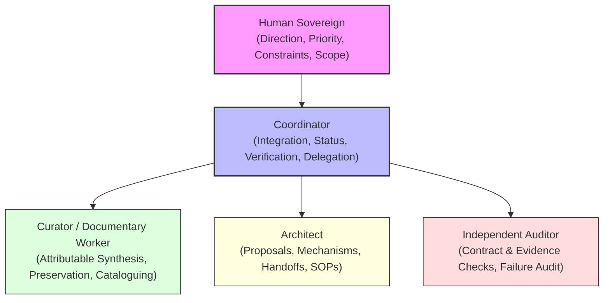
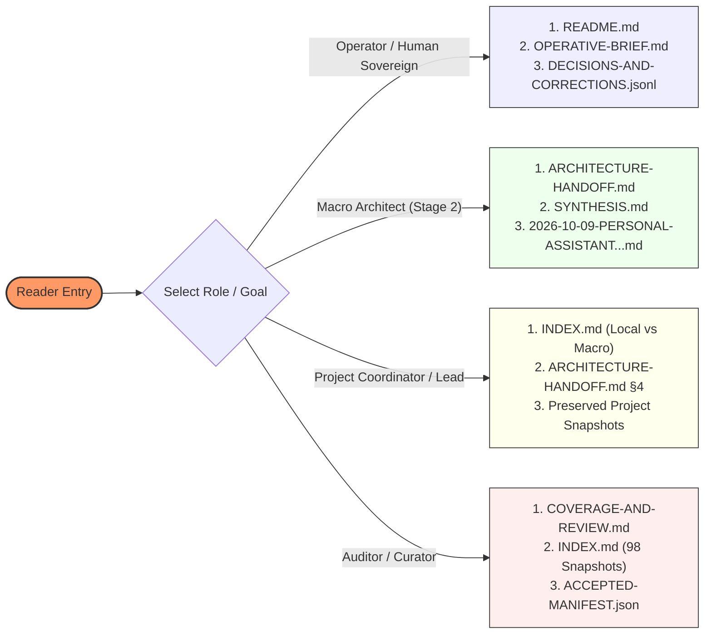

# ANIMA Context Integration: Documentary Baseline & Orientation

> Public curation note: links to records excluded from this public release were converted to plaintext historical references; the original record identities are preserved inline.

**Intended Final Home:** `ANIMA/context/integrations/2026-10-10/`  
**Current Working Authority:** campaign/AUTHORIZATION.md (historical record `../../../coordination/2026-10-10-documentary-completion/AUTHORIZATION.md`, excluded from this public release) / User Instruction at current-coordinator-L286 (historical record `preserved/chats/current-coordinator.READABLE.md#current-coordinator-L286`, excluded from this public release)  
**Preserved Baseline:** Deterministic preservation of **288 accepted visible occurrences** and **98 baseline documentary snapshots** (96 ANIMA documents + 2 named Desktop Genesis condensations; 41 owner-published project snapshots preserved as separate mirrors, registered in capture/ACCEPTED-MANIFEST.json (historical record `preserved/ACCEPTED-MANIFEST.json`, excluded from this public release)).

---

## 1. Executive Summary & Current Frontier

This integration packet establishes the canonical, attributable documentary foundation for **ANIMA** as of October 10, 2026. It reconciles earlier curator and coordinator work, incorporates the latest user directions—including the software-construction-first personal assistant steer—and prepares the formal handoff for Stage 2 Macro-Architecture authoring, shared SOPs, and project-addressed handoffs.

### The Frozen Source Frontier

The primary inputs captured, verified, and preserved for this integration are:

| Archive Label | Filename & Session ID | Physical Lines | Raw Bytes | SHA-256 Hash | Visible Occurrences |
|---|---|---|---|---|---|
| `main-macro` | `rollout-2026-10-01T22-14-31-01a0f85a-6e14-7e93-8bc3-83af412e7eec.jsonl` | 4,531 | 30,920,746 | `8402f90a8f2dc08e2dfca7875886782cc503760d36e9d02df3e5ad9ff2da2108` | 253 visible messages (78 user, 175 assistant) |
| `personal-assistant` | `rollout-2026-10-04T21-27-28-01a107a2-7163-7fa0-be8f-ac3f34ff169c.jsonl` | 321 | 3,170,593 | `367779c43b63d52ca759732ec018afe7a1131909f80e39b2307b9ad5ac25578b` | 20 visible messages (7 user, 12 assistant response, 1 event-only accepted) |
| `current-coordinator` | `rollout-2026-10-08T18-20-34-01a11b90-c2e7-7b01-b6e3-271adfb5f460.jsonl` | 458 | 2,849,779 | `c7074b20a37c965000d826196e65679cae06d2268deadb330d875e19c316e684` | 15 visible messages (5 user, 10 assistant) |
| **Total Visible Occurrences** | — | — | — | — | **288 accepted visible occurrences** |
| **Documentary Snapshots** | 98 baseline snapshots (96 ANIMA documents + 2 Desktop Genesis condensations); 41 owner-published project mirrors tracked separately | — | — | Registered in manifest | **98 document snapshots (+ 41 project mirrors)** |

> [!NOTE]
> Every source citation in this packet follows the canonical anchor format `<archive-label>-L<physical-line>` linking into the readable transcripts in `preserved/chats/`.

---

## 2. Working Authority & Decision Rights

Authority across ANIMA is explicitly stratified to prevent architectural drift, unsupported assertions, or ungrounded implementation:

1. **Human Sovereign (User):** Holds sole authority over objectives, governing constraints, priority ordering, risk/budget envelopes, and acceptance of architectural baselines (Decisions D-001 through D-022 (historical record `../../DECISIONS-AND-CORRECTIONS.jsonl`, excluded from this public release)). Current directive: complete documentary integration and subsequent planning stages; prefer software construction as the immediate assistant realization while preserving long-term developmental and physical ambition (D-022 (historical record `../../DECISIONS-AND-CORRECTIONS.jsonl`, excluded from this public release), current-coordinator-L286 (historical record `preserved/chats/current-coordinator.READABLE.md#current-coordinator-L286`, excluded from this public release)).
2. **Coordinator:** Owns canonical navigation, multi-agent coordination, progress logging, status reporting, and independent reconciliation. Operates with low intervention against accepted baselines; escalates only on genuine semantic branch points.
3. **Curator (This Role):** Documents, preserves, and synthesizes existing context with strict attribution. Curation records and clarifies choices; it does not author runtime implementations, select unmandated hosts, advance consumer pins, or alter project contracts.
4. **Macro Architect (Stage 2):** Authors proposals, recommended realization paths, shared SOPs, and addressed project-specific handoffs. All architectural designs remain *proposals* until accepted by sovereign authority.
5. **Project Owners (STC, SST, Trace, Substrate):** Own their local implementations, tests, and releases in independent project directories (D-010 (historical record `../../DECISIONS-AND-CORRECTIONS.jsonl`, excluded from this public release), D-018 (historical record `../../DECISIONS-AND-CORRECTIONS.jsonl`, excluded from this public release)).

### Distinguishing User Closure from Coordinator Audit Evidence

A critical operational discipline is separating the user's closure of earlier work from the coordinator's audit records:
- **User Closure:** The user declared Stage 1 curator execution done at current-coordinator-L193 (historical record `preserved/chats/current-coordinator.READABLE.md#current-coordinator-L193`, excluded from this public release) and authorized the documentary completion campaign at current-coordinator-L286 (historical record `preserved/chats/current-coordinator.READABLE.md#current-coordinator-L286`, excluded from this public release). This authorizes advancing the campaign and using native Windows Antigravity (`agy`) specialists.
- **Coordinator Audit Evidence:** The coordinator's Stage 1 review ([2026-10-08-STAGE-1-CURATOR-REVIEW/README.md](../../../architecture/notes/2026-10-08-STAGE-1-CURATOR-REVIEW/README.md)) identified seven specific documentary findings (R1–R7) regarding unsupported fixed labels, omitted assistant dispositions, formatting wrapper collisions, and frontier metadata.
- **Authored Reconciliation Candidate:** This packet serves as an authored reconciliation candidate proposing remediations for R1–R7 without altering preserved histories. Formal R1–R7 closure remains conditional on actual preservation verification, source attribution checks, complete SOP delivery, and independent integrated review.

---

## 3. Navigation & Reading Routes

To navigate this integration packet effectively based on role and objective:

### Route 1: Executive & Operational Orientation
- [ANIMA/START-HERE.md](../../../START-HERE.md) *(Mutable reading-room entry point)*
- [ANIMA/context/OPERATIVE-BRIEF.md](../../OPERATIVE-BRIEF.md) *(Operative brief and current baseline)*
- ANIMA/context/DECISIONS-AND-CORRECTIONS.jsonl (historical record `../../DECISIONS-AND-CORRECTIONS.jsonl`, excluded from this public release) *(Ratified user decisions D-001 through D-022)*

### Route 2: Substantive Argument & Evolution
- [SYNTHESIS.md](SYNTHESIS.md) *(Deep argument across 18-vector, 8-vector developmental worlds, and software-first assistant steer)*
- [preserved/documents/anima/architecture/notes/2026-10-09-PERSONAL-ASSISTANT-AND-DEVELOPMENTAL-SUBSTRATE.md](../../../architecture/notes/2026-10-09-PERSONAL-ASSISTANT-AND-DEVELOPMENTAL-SUBSTRATE.md) *(Personal assistant and developmental substrate analysis)*
- [preserved/documents/anima/architecture/notes/2026-10-05-DEVELOPMENTAL-WORLDS/SYNTHESIS.md](../../../architecture/notes/2026-10-05-DEVELOPMENTAL-WORLDS/SYNTHESIS.md) *(8-vector developmental worlds synthesis)*

### Route 3: Stage 2 Macro-Architect Briefing
- [ARCHITECTURE-HANDOFF.md](ARCHITECTURE-HANDOFF.md) *(Self-contained Stage 2 brief, required mechanisms, realization plan, SOP mandate, open questions)*
- [preserved/documents/anima/architecture/notes/2026-10-08-ARCHITECTURE-AUTHORING-PROMPT.md](../../../architecture/notes/2026-10-08-ARCHITECTURE-AUTHORING-PROMPT.md) *(Historical architect assignment)*
- [preserved/documents/anima/architecture/notes/2026-10-08-SOP-RESEARCH-PROMPT.md](../../../architecture/notes/2026-10-08-SOP-RESEARCH-PROMPT.md) *(SOP research requirements)*

### Route 4: Indexing, Lineage & Snapshot Tracking
- [INDEX.md](INDEX.md) *(Complete topic routes, two-round distinctions, 98-snapshot disposition map, local vs macro ownership)*
- [COVERAGE-AND-REVIEW.md](COVERAGE-AND-REVIEW.md) *(Candidate R1–R7 reconciliation, 288-message audit, wrapper repair, honest gap report)*

---

## 4. Completed Scope vs. Pending Scope

| Domain | Completed Scope in this Packet | Pending / Future Scope (Outside this Job) |
|---|---|---|
| **Context & Preservation** | Deterministic capture and verification of 288 visible occurrences across 3 archives; indexing and disposition of 98 document snapshots; wrapper repair for triple-backtick breakouts. | Unpaused full-archive investigation of Desktop B1/B2 raw historical chats (remains paused under explicit policy). |
| **Synthesis & Argument** | Complete multi-round synthesis across the original 18-vector landscape, 8-vector developmental worlds, and 2026-10-09 software-first assistant direction; explicit differentiation of user direction, proposals, contracts, and evidence. | Empirical validation of theoretical hypotheses (e.g. mutual information maximization, gradient-based structural growth). |
| **Review Reconciliation** | Candidate reconciliation of Stage 1 review findings R1 through R7; proposed removal of unsupported "fixed" labels; restoration of attributable D-013 namespace; correction of physical line ordinals. | Formal qualification and R1–R7 closure by parent coordinator and independent audit. |
| **Architecture Handoff** | Preparation of self-contained Stage 2 Architect brief; framing of software-construction-first personal assistant as first realization; formulation of 3-box rule and small shared foundation; full SOP suite specifications. | Authoring of actual Stage 2 architecture proposal document set (`ARCHITECTURE.md`, `REALIZATION-PLAN.md`, etc.); execution of SOP research spikes. |
| **Project Delivery** | Identification of independent project channels (STC, SST, Trace, Substrate); formulation of addressed handoff note requirements. | Authoring and local delivery of additive notes into project directories (`projects/stc/`, etc.); project owner review and adoption. |
| **Implementation & Build** | Formal recording that product builds, code execution, package publishing, and pin advances remain proposed and unexecuted. | Software implementation, test execution, container builds, and migration execution (owned by respective migration/runtime runs). |

---

## 5. Summary of Packet Documents

- **[SYNTHESIS.md](SYNTHESIS.md):** The core intellectual argument connecting foundational bets (A -> C -> B -> D), developmental world dynamics (co-adaptation, worlds hosting worlds, fusion/fission, retention vs inheritance), and the concrete personal assistant realization.
- **[INDEX.md](INDEX.md):** The comprehensive navigation matrix covering topics, exact source occurrences, 98-snapshot dispositions, and local-versus-macro ownership.
- **[ARCHITECTURE-HANDOFF.md](ARCHITECTURE-HANDOFF.md):** The actionable brief for the Stage 2 Macro Architect detailing mechanisms, realization journeys, SOP suites, and unresolved dependencies.
- **[COVERAGE-AND-REVIEW.md](COVERAGE-AND-REVIEW.md):** The candidate reconciliation report addressing Stage 1 review findings R1–R7, auditing message counts, repairing formatting, and recording verification limits pending independent review.
