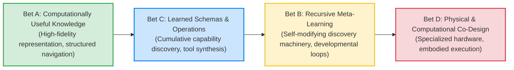
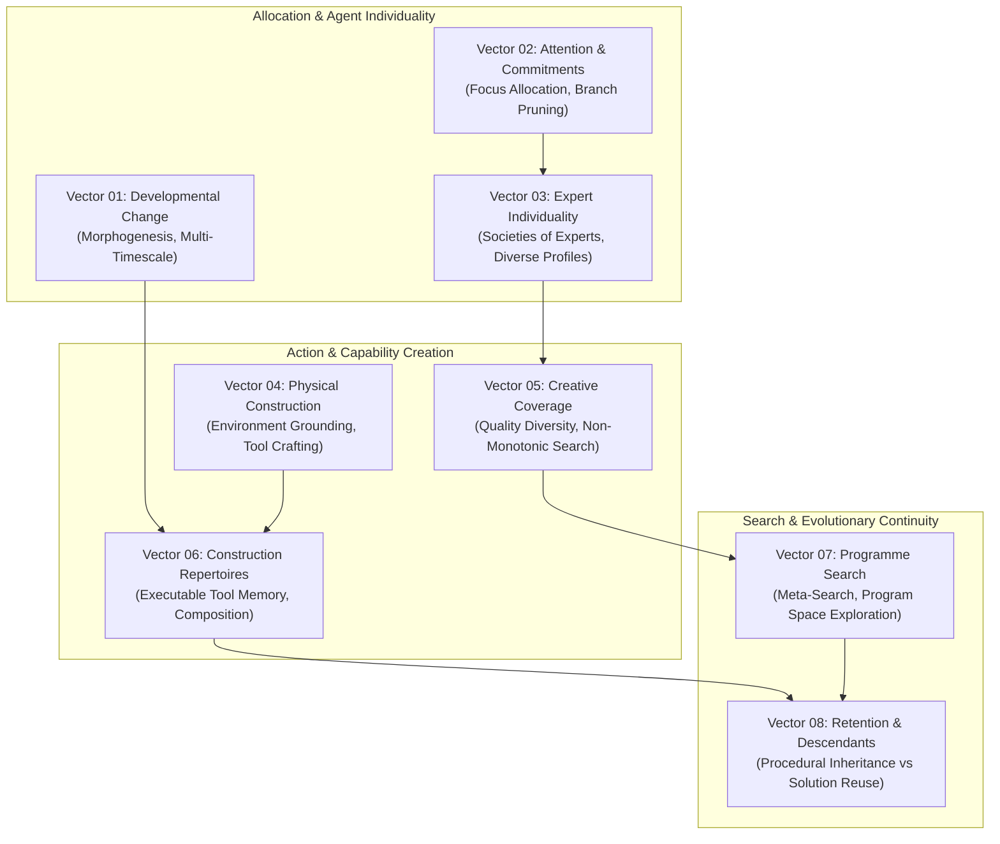
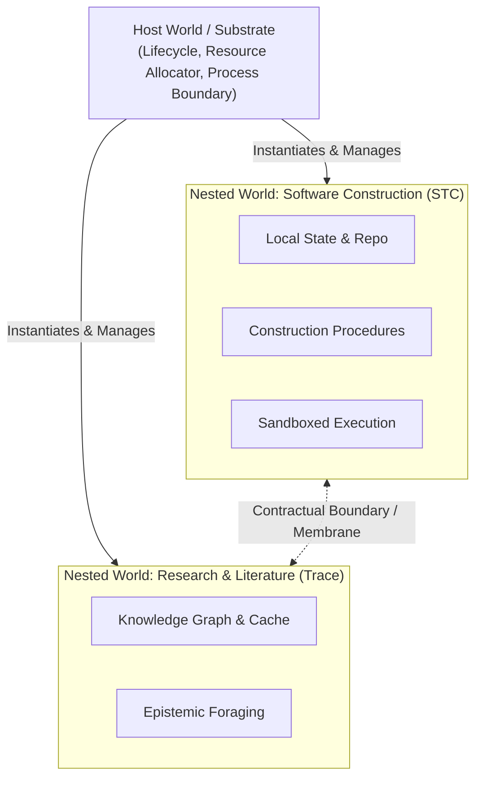
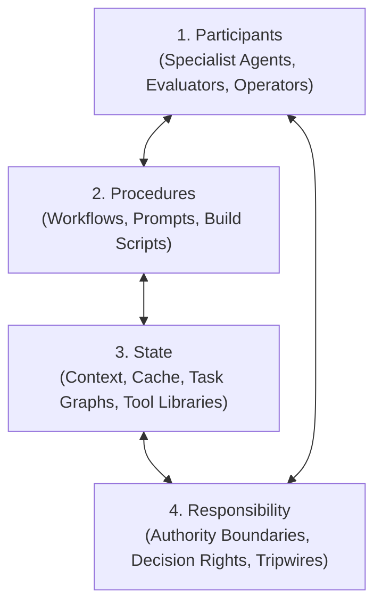
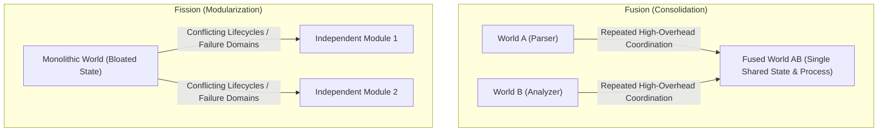
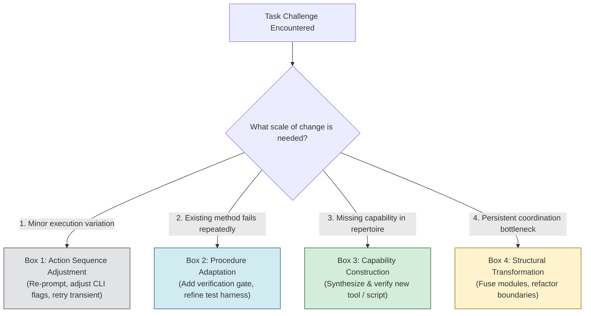
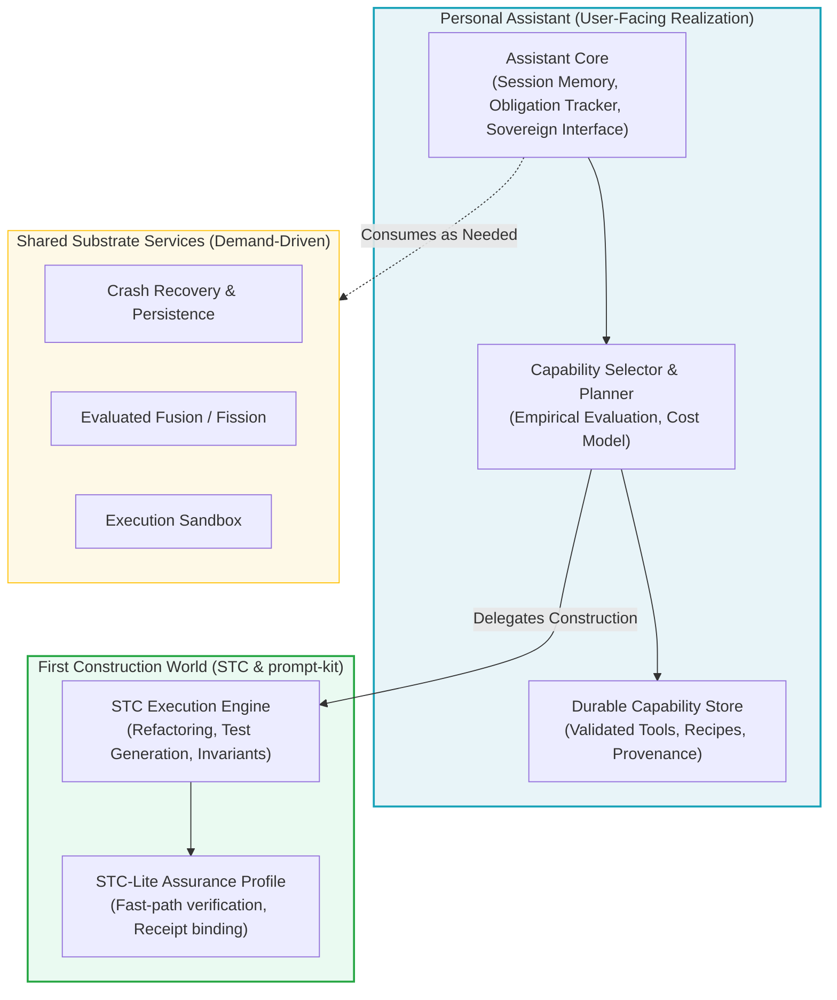
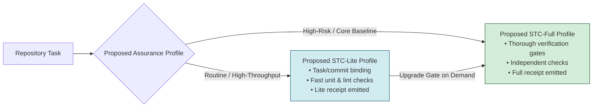
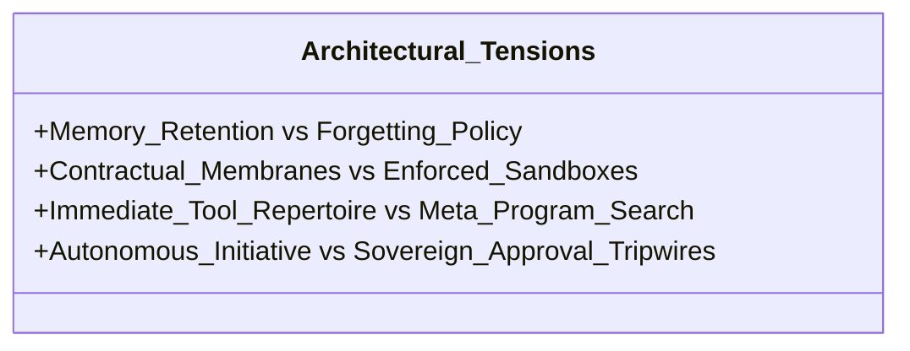

# ANIMA Context Integration: Architectural & Developmental Synthesis

> Public curation note: links to records excluded from this public release were converted to plaintext historical references; the original record identities are preserved inline.

**Intended Final Home:** `ANIMA/context/integrations/2026-10-10/`  
**Governing Authority:** campaign/AUTHORIZATION.md (historical record `../../../coordination/2026-10-10-documentary-completion/AUTHORIZATION.md`, excluded from this public release) / Decisions D-001 through D-022 (historical record `../../DECISIONS-AND-CORRECTIONS.jsonl`, excluded from this public release)  
**Primary Source Ledgers:** main-macro.READABLE.md (historical record `preserved/chats/main-macro.READABLE.md`, excluded from this public release), personal-assistant.READABLE.md (historical record `preserved/chats/personal-assistant.READABLE.md`, excluded from this public release), current-coordinator.READABLE.md (historical record `preserved/chats/current-coordinator.READABLE.md`, excluded from this public release)

---

## 1. Introduction & Epistemic Framework

ANIMA represents a long-horizon ambition to construct an evolving, self-developing intelligence environment while delivering immediate, high-leverage computational capabilities. This synthesis establishes a connected argument across three distinct developmental eras:
1. **The Initial 18-Vector Landscape (Macro Round 1):** Broad evolutionary exploration, foundational priority ordering ($A \to C \to B \to D$), compression schemas, and architectural topologies.
2. **The 8-Vector Developmental Worlds Formulation (Round 2):** Formalization of developmental dynamics, multi-timescale adaptation, worlds hosting worlds, composite formation, and procedural inheritance.
3. **The Software-First Personal Assistant Realization (Modern Steer):** Grounding the developmental substrate in an immediate, high-utility personal assistant for software construction, utilizing existing tools, STC-Lite assurance profiles, and empirical capability evaluation.

```mermaid
timeline
    title The Evolution of ANIMA Architecture
    section Round 1: 18 Vectors
        Macro Exploration : 18 vectors of capability & evolution
        Foundational Bets : A -> C -> B -> D priority map
        Epistemic Schema : Abstract + Specific Schema + Delta
    section Round 2: 8 Vectors
        Developmental Worlds : 8 developmental vectors formalized
        Host & Membrane : Worlds hosting worlds, Fusion & Fission
        Inheritance Dynamics : Solution inheritance vs Developmental machinery
    section Modern: Assistant Realization
        Software-First Steer : D-022 personal assistant for software construction
        Pragmatic Grounding : Small shared foundation + STC/prompt-kit
        Empirical Discipline : Substrate alpha evaluated reuse, 3-Box rule
```

### The Epistemic Distinction Standard

To maintain analytical integrity, every concept in this synthesis is categorized into five epistemic classes:

| Classification | Meaning & Authority | Examples in ANIMA |
|---|---|---|
| **User Direction** | Sovereign, non-negotiable intent, priorities, and governing constraints established directly by the human operator. | Decisions D-001 through D-022 (historical record `../../DECISIONS-AND-CORRECTIONS.jsonl`, excluded from this public release); priority map $A \to C \to B \to D$ (D-004 (historical record `../../DECISIONS-AND-CORRECTIONS.jsonl`, excluded from this public release)); software construction first (D-022 (historical record `../../DECISIONS-AND-CORRECTIONS.jsonl`, excluded from this public release)). |
| **Model Commentary / Proposal** | Hypothesized architectures, mathematical formulations, and mechanisms proposed by assistants. Distinctly provisional. | Holon equations and 5-band models (main-macro-L1177 (historical record `preserved/chats/main-macro.READABLE.md#main-macro-L1177`, excluded from this public release)); 3-choice realization topology (personal-assistant-L264 (historical record `preserved/chats/personal-assistant.READABLE.md#personal-assistant-L264`, excluded from this public release)). |
| **Owner Contracts** | Published API specifications, invariants, and delivery promises issued by owning project directories. | STC Caller Contract ([projects/stc/docs/STC-SST-CALLER-CONTRACT.md](../../../../../components/stc/docs/STC-SST-CALLER-CONTRACT.md)); Substrate Consumer Contract ([projects/substrate/docs/CONSUMER.md](../../../../../components/substrate/docs/CONSUMER.md)). |
| **Attributed Prior Evidence & Reports** | Historical test reports, inspected owner documentary evidence, and negative benchmark results (not independently re-executed by this campaign). | Attributed STC mutation reports (historical $\ge 85\%$ kill rate target); prompt-kit test suites (historical $58/58$ pass report); Substrate owner prototype negative evidence (`HOST-VALUE-NOT-DEMONSTRATED`). |
| **Curator Synthesis** | Deductions, comparative trade-off analyses, and structural mappings drawn across sources by this documentary synthesis. | The reconciliation of the 18-vector and 8-vector landscapes; the 3-box rule mapping to capability levels. |

---

## 2. Foundational Research Bets & The 18-Vector Landscape

### The Sovereign Priority Map ($A \to C \to B \to D$)

In main-macro-L1261 (historical record `preserved/chats/main-macro.READABLE.md#main-macro-L1261`, excluded from this public release) and main-macro-L1325 (historical record `preserved/chats/main-macro.READABLE.md#main-macro-L1325`, excluded from this public release), ratified in D-004 (historical record `../../DECISIONS-AND-CORRECTIONS.jsonl`, excluded from this public release), the user established the foundational sequence of research bets:

$$\mathbf{A} \longrightarrow \mathbf{C} \longrightarrow \mathbf{B} \longrightarrow \mathbf{D}$$



1. **Bet A (Computationally Useful Knowledge):** Grounding systems in structured, navigable representations of reality and software repositories without losing raw evidence or author intent.
2. **Bet C (Learned Schemas & Construction Operations):** Developing reusable, composable tools and workflows that improve through direct execution experience.
3. **Bet B (Meta-Learning & Cumulative Discovery Machinery):** Evolving the search and discovery machinery itself, allowing systems to discover novel problem-solving paradigms.
4. **Bet D (Computational & Physical Co-Design):** Transitioning proven software abstractions into dedicated physical or hardware substrates when measured bottlenecks demand it.

> [!IMPORTANT]
> Decision D-004 (historical record `../../DECISIONS-AND-CORRECTIONS.jsonl`, excluded from this public release) explicitly specifies that this sequence is an investment and dependency priority map, not a rigid temporal gate. Hardware exploration or capability creation may proceed whenever immediate research needs justify it, provided long-term evolutionary machinery is not treated as a blocking prerequisite for useful work.

### Solution-Space Representation vs. Search Machinery (Curator Deduction)

During early macro exploration (main-macro-L217 (historical record `preserved/chats/main-macro.READABLE.md#main-macro-L217`, excluded from this public release), main-macro-L253 (historical record `preserved/chats/main-macro.READABLE.md#main-macro-L253`, excluded from this public release)), discussions articulated broad preferences for structured representations and evolutionary discovery. Curation deduces a critical distinction between **solution-space representations** and the **search machinery operating upon them**:
- **Solution-Space Representations:** How knowledge, code, and system state are structured (e.g., ASTs, dependency graphs, execution traces, schema representations).
- **Search Machinery:** The active processes that explore, mutate, evaluate, and prune that space (e.g., heuristic search, prompting pipelines, verification checks).

*Curator Rationale:* While early turns reflect broad ambitions rather than formal ontology, separating the structure of representations from active search algorithms prevents conflating passive knowledge schemas with automated discovery.

### Schema Compression: Abstract + Specific + Delta (Experimental Preference)

In main-macro-L1388 (historical record `preserved/chats/main-macro.READABLE.md#main-macro-L1388`, excluded from this public release) and Decision D-009 (historical record `../../DECISIONS-AND-CORRECTIONS.jsonl`, excluded from this public release), the user expressed a preference for structured schema-plus-delta compression over rigid universal ontologies or unstructured raw text:

$$\text{Knowledge Artifact} = \text{General Abstract Schema} + \text{Domain-Specific Schema} + \text{Empirical Delta}$$

- **General Abstract Schema:** Core topological properties (identity, inputs, outputs, invariants, causal dependencies).
- **Domain-Specific Schema:** Specialized idioms (e.g., Python typing, AST node types, API schemas).
- **Delta:** The unique, uncompressed nuances, historical context, and failure logs of the specific instance.

*Epistemic Status:* This tripartite structure is an experimental preference subject to noise, diversity, and maintenance caveats, rather than an absolute proven representation.

---

## 3. The 8-Vector Developmental Worlds Formulation

In Round 2 ([preserved/documents/anima/architecture/notes/2026-10-05-DEVELOPMENTAL-WORLDS/SYNTHESIS.md](../../../architecture/notes/2026-10-05-DEVELOPMENTAL-WORLDS/SYNTHESIS.md)), the 18 broad exploratory areas were distilled into **eight core developmental vectors**, formalizing how computational entities adapt, construct, and inherit capabilities.



### Detailed Vector Mechanics

1. **Vector 01: Developmental Change (Morphogenesis):** Systems must support multi-timescale adaptation—rapid intra-session parameter shifts, medium-term procedure refinement, and long-term structural restructuring ([VECTOR-01-DEVELOPMENTAL-CHANGE.md](../../../architecture/notes/2026-10-05-DEVELOPMENTAL-WORLDS/VECTOR-01-DEVELOPMENTAL-CHANGE.md)).
2. **Vector 02: Attention and Commitments:** Explicit mechanisms for allocating finite cognitive and computational budgets, distinguishing hardened baseline commitments from speculative search paths ([VECTOR-02-ATTENTION-AND-COMMITMENTS.md](../../../architecture/notes/2026-10-05-DEVELOPMENTAL-WORLDS/VECTOR-02-ATTENTION-AND-COMMITMENTS.md)).
3. **Vector 03: Expert Individuality:** Societies of heterogeneous, specialized agents possessing distinct training trajectories, epistemic priors, and evaluation biases, collaborating without forced homogenization ([VECTOR-03-EXPERT-INDIVIDUALITY.md](../../../architecture/notes/2026-10-05-DEVELOPMENTAL-WORLDS/VECTOR-03-EXPERT-INDIVIDUALITY.md)).
4. **Vector 04: Physical Construction:** Grounding development in executable reality—whether a physical robotic cell or a virtual software workspace (filesystem, test harness, execution sandbox) ([VECTOR-04-PHYSICAL-CONSTRUCTION.md](../../../architecture/notes/2026-10-05-DEVELOPMENTAL-WORLDS/VECTOR-04-PHYSICAL-CONSTRUCTION.md)).
5. **Vector 05: Creative Coverage:** Maintaining search diversity and exploring behavioral spaces systematically (e.g., MAP-Elites, Quality-Diversity) to avoid premature convergence on local optima ([VECTOR-05-CREATIVE-COVERAGE.md](../../../architecture/notes/2026-10-05-DEVELOPMENTAL-WORLDS/VECTOR-05-CREATIVE-COVERAGE.md)).
6. **Vector 06: Construction Repertoires:** The operational core: synthesizing, cataloguing, selecting, and adapting executable tools from experience ([VECTOR-06-CONSTRUCTION-REPERTOIRES.md](../../../architecture/notes/2026-10-05-DEVELOPMENTAL-WORLDS/VECTOR-06-CONSTRUCTION-REPERTOIRES.md)).
7. **Vector 07: Programme Search:** Searching over the space of architectures, prompts, and execution topologies rather than merely adjusting numeric parameters ([VECTOR-07-PROGRAMME-SEARCH.md](../../../architecture/notes/2026-10-05-DEVELOPMENTAL-WORLDS/VECTOR-07-PROGRAMME-SEARCH.md)).
8. **Vector 08: Retention and Descendants:** Mechanisms for transferring accumulated competence across session boundaries and generations ([VECTOR-08-RETENTION-AND-DESCENDANTS.md](../../../architecture/notes/2026-10-05-DEVELOPMENTAL-WORLDS/VECTOR-08-RETENTION-AND-DESCENDANTS.md)).

---

## 4. Deep Architectural Dynamics

### Worlds Hosting Worlds: Containment, Ownership, and Access

A central theme in ANIMA is the concept of nested computational environments: **worlds hosting worlds** (main-macro-L1346 (historical record `preserved/chats/main-macro.READABLE.md#main-macro-L1346`, excluded from this public release), [CONSTRUCTION-LANGUAGES.md](../../../architecture/notes/2026-10-05-DEVELOPMENTAL-WORLDS/CONSTRUCTION-LANGUAGES.md)).



The system strictly distinguishes between four related concepts:
1. **Source Location:** The filesystem directory where code and documentation live (e.g., `projects/stc/`).
2. **Runtime Containment:** The host environment that allocates execution memory, processes, and CPU time to an active world.
3. **Data Ownership:** The entity that owns and governs state mutations, receipts, and logs.
4. **Functional Access / Membrane:** The published API or contract through which external worlds interact with internal state.

> [!CAUTION]
> A directory boundary is not a security membrane. As noted in the Substrate consumer analysis ([projects/substrate/docs/CONSUMER.md](../../../../../components/substrate/docs/CONSUMER.md)), filesystem and network isolation in the alpha package are contractual rather than hardware-enforced. True containment requires operating-system level or containerized sandboxing.

### Co-Adaptation of Participants, Procedures, State, and Responsibility

Capability development is not merely an agent modifying a script; it is the **co-adaptation** of four interconnected pillars:



- When a procedure fails, the system can:
  1. Swap the **Participant** (assign a specialist with a different prior).
  2. Modify the **Procedure** (adjust steps, add a verification gate).
  3. Enrich the **State** (supply cached historical failures or dependency schemas).
  4. Escalate **Responsibility** (shift from autonomous promotion to human sovereign sign-off).

### Structural Operations: Assimilation, Composites, Fusion, and Fission

When capabilities mature or coordination overhead grows, the substrate supports structural transformations (D-006 (historical record `../../DECISIONS-AND-CORRECTIONS.jsonl`, excluded from this public release), D-010 (historical record `../../DECISIONS-AND-CORRECTIONS.jsonl`, excluded from this public release)):



- **Assimilation:** An external tool, library, or script is absorbed into a world's internal repertoire, with its dependencies pinned and verified.
- **Composite Formation:** Multiple independent worlds are linked through a unified coordinator contract while retaining separate internal states.
- **Fusion:** Two tightly coupled worlds that communicate with high overhead are proposed to merge into a single execution boundary with shared state ([projects/substrate/CANONICAL-RECORD.md](../../../../../components/substrate/CANONICAL-RECORD.md), [projects/substrate/docs/CONSUMER.md](../../../../../components/substrate/docs/CONSUMER.md)).
- **Fission:** A bloated world is split into smaller, decoupled worlds to isolate failure domains or parallelize execution.

### Retention vs. Inheritance: Solutions vs. Machinery

In Vector 08 ([VECTOR-08-RETENTION-AND-DESCENDANTS.md](../../../architecture/notes/2026-10-05-DEVELOPMENTAL-WORLDS/VECTOR-08-RETENTION-AND-DESCENDANTS.md)), a critical distinction is established:

| Type of Continuity | What is Transferred | Example | Evidentiary Significance |
|---|---|---|---|
| **Solution Reuse (Retention)** | A finished, static artifact, script, or cached output. | Running an existing Python build script in a new session. | Useful engineering automation, but does not demonstrate developmental learning. |
| **Developmental Inheritance** | The *procedure and machinery* for constructing, debugging, and adapting solutions for unfamiliar tasks. | A descendant agent inheriting a verified epistemic foraging workflow and self-repair heuristic that succeeds on a novel repository. | **True developmental capability:** demonstrates transfer of meta-competence across generations. |

---

## 5. Modern Realization: The Software-First Personal Assistant

### Origin and Sovereign Direction (D-022 (historical record `../../DECISIONS-AND-CORRECTIONS.jsonl`, excluded from this public release))

On October 9, 2026 (personal-assistant-L189 (historical record `preserved/chats/personal-assistant.READABLE.md#personal-assistant-L189`, excluded from this public release), personal-assistant-L264 (historical record `preserved/chats/personal-assistant.READABLE.md#personal-assistant-L264`, excluded from this public release)), the user provided a vital clarifying steer, recorded in Decision D-022 (historical record `../../DECISIONS-AND-CORRECTIONS.jsonl`, excluded from this public release):
> *Research-to-experiment-to-artifact and software construction are both goals; prefer software construction as the immediate assistant target.*

This direct priority grounds ANIMA in immediate practical utility. Rather than building abstract meta-orchestrators in a vacuum, the system focuses on creating a **Personal Assistant that develops its capabilities through software engineering tasks**.

### The Three-Box Rule for Proportional Adaptation

To prevent "architecture astronaut recursion" (spending all compute on meta-orchestration rather than domain breakthroughs), the assistant follows the **Three-Box Rule** (personal-assistant-L21 (historical record `preserved/chats/personal-assistant.READABLE.md#personal-assistant-L21`, excluded from this public release), [2026-10-09-PERSONAL-ASSISTANT-AND-DEVELOPMENTAL-SUBSTRATE.md](../../../architecture/notes/2026-10-09-PERSONAL-ASSISTANT-AND-DEVELOPMENTAL-SUBSTRATE.md)):



- Always solve problems at the lowest adequate box. Novelty does not automatically mandate creating a permanent new component or altering system topology.

### The Immediate Assistant Recommendation: Pragmatic Realization

In [2026-10-09-PERSONAL-ASSISTANT-AND-DEVELOPMENTAL-SUBSTRATE.md](../../../architecture/notes/2026-10-09-PERSONAL-ASSISTANT-AND-DEVELOPMENTAL-SUBSTRATE.md), three alternative deployment paths were evaluated:

| Architectural Choice | Advantages | Costs / Risks | Recommendation |
|---|---|---|---|
| **1. Expand STC into the general assistant** | Rapid access to existing construction workflows. | Software-delivery assumptions dominate and constrain general assistance. | Rejected as sole host. |
| **2. Complete a general developmental host first** | Unified environment for broad evolutionary experiments. | High risk of over-engineering; delays practical utility; unproven real-world value. | Rejected as blocking prerequisite. |
| **3. Build the assistant on a small shared foundation with demand-driven developmental mechanisms** | Immediate utility, real task feedback, grounded empirical research, modular growth. | Requires strict discipline to separate ordinary orchestration from true structural development. | **RECOMMENDED PATH** |



### Reality of the Substrate Alpha Package (0.1.1) & Scoped Negative Evidence

A rigorous documentary audit inspects the selected owner records for `projects/substrate/`:
- **Current Machinery:** The alpha `0.1.1` package documents process crash recovery, world isolation interfaces, and prototype recipe handlers ([projects/substrate/README.md](../../../../../components/substrate/README.md), [projects/substrate/CANONICAL-RECORD.md](../../../../../components/substrate/CANONICAL-RECORD.md)).
- **Explicit Limitations:** The owner records explicitly state that the package has no autonomous learning.
- **Scoped Negative Evidence (`HOST-VALUE-NOT-DEMONSTRATED`):** Owner documentary records ([projects/substrate/docs/ROADMAP.md](../../../../../components/substrate/docs/ROADMAP.md), [projects/substrate/docs/CONSUMER.md](../../../../../components/substrate/docs/CONSUMER.md), and personal-assistant-L21 (historical record `preserved/chats/personal-assistant.READABLE.md#personal-assistant-L21`, excluded from this public release)) record that prototype testing resulted in `HOST-VALUE-NOT-DEMONSTRATED`, with host-mediated execution tying unhosted execution, and adaptation tests proving VOID due to degenerate conditions.
- **Synthesized Principle:** *Broad substrate persistence and world nesting do not establish autonomous learning or mandate a permanent ANIMA host.* State persistence and a complete-host prerequisite remain distinct concepts; the assistant may utilize substrate services where evaluated and beneficial without treating full substrate hosting as a blocking requirement.

### STC-Lite Assurance Profile Proposal (Attributed Design Candidate)

In personal-assistant-L21 (historical record `preserved/chats/personal-assistant.READABLE.md#personal-assistant-L21`, excluded from this public release), user-supplied operating commentary presented a design proposal for treating STC-Lite as an **assurance profile** within STC:



- **Proposed Receipt Binding:** Proposes binding task IDs and Git commit hashes to mitigate Time-of-Check to Time-of-Use (TOCTOU) drift.
- **Status & Scope:** This receipt/reject/upgrade mechanism is an attributed architectural proposal, not a currently adopted project contract. Future realization should assess consumer needs against published STC contracts ([projects/stc/docs/STC-SST-CALLER-CONTRACT.md](../../../../../components/stc/docs/STC-SST-CALLER-CONTRACT.md)) rather than imposing an unratified universal mutation threshold.

---

## 6. Open Alternatives & Consequential Trade-Offs

The architecture preserves several open alternatives that must be resolved through empirical evidence rather than premature consensus:



1. **Memory Retention vs. Forgetting & Maintenance Costs:**
   - *Option A:* Retain all generated tools indefinitely in a growing library.
   - *Option B:* Actively prune and consolidate tool repertoires based on measured utility, recovery cost, and invocation frequency.
   - *Proposed Policy Candidate:* Bounded active working memory with cold archival storage; consolidation carries its own measured computational cost.
2. **Contractual vs. Enforced Sandboxing:**
   - *Option A:* Rely on contractual assumptions that generated code behaves within stated boundaries.
   - *Option B:* Enforce strict OS-level containerization and network isolation before executing assistant-generated tools.
   - *Proposed Design Recommendation:* Evaluate OS containerization for untrusted code execution where local host capabilities permit, while maintaining lightweight contractual boundaries for trusted internal services.
3. **Autonomous Initiative vs. Sovereign Tripwires:**
   - *Option A:* Maximize proactive assistant suggestions and background exploration.
   - *Option B:* Restrict autonomous execution to established baselines, triggering batched escalations on semantic branch points.
   - *Proposed Policy Candidate:* Proactive initiative must earn its place by demonstrably reducing human management overhead, with budget limits and stall detection proposed to prevent runaway token spend.

---

## 7. Strategic Synthesis Conclusion

ANIMA's architectural trajectory unites a bold long-term ambition with rigorous near-term engineering:

$$\begin{aligned}
\text{ANIMA} &= \underbrace{\text{Personal Assistant}}_{\text{Immediate Software Construction Engine (STC)}} \\
&\quad + \underbrace{\text{Developmental Substrate}}_{\text{Demand-Driven Continuity, Fusion, Repertoire Learning}} \\
&\quad + \underbrace{\text{Epistemic Governance}}_{\text{Trias Politica, Independent Audits, Sovereign Human Authority}}
\end{aligned}$$

By grounding the 8 developmental vectors in the daily reality of software construction, ANIMA establishes a closed-loop environment where capabilities are evaluated by their real-world utility, verified by independent checks, and accumulated through disciplined, attributable inheritance.
